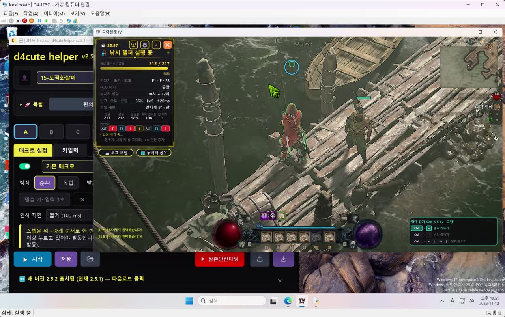

# 🖥️ 가상 머신(Hyper-V)으로 디아블로 IV + d4cute helper 돌리기

> 📢 **d4cute helper 공식 저장소로 돌아가기**: [https://github.com/kaljake70/d4helper](https://github.com/kaljake70/d4helper) · 최종 갱신 2026-11-12

낚시처럼 오래 켜 두는 기능을 **윈도우 안의 또 하나의 윈도우(가상 머신)** 에서 돌리는 방법입니다. 디아블로 IV 와 헬퍼는 가상 머신 안에서 돌고, 내 PC 화면은 그대로 다른 일에 쓸 수 있습니다.

[](images/vm_guide.mp4)

▶ **[실제 화면 영상 보기 (55초)](images/vm_guide.mp4)** — 가상 머신 창 안에서 낚시 헬퍼가 217번 던져 212번(98%) 낚는 모습입니다.

---

## ✅ 장점

- **PC 를 그대로 쓸 수 있습니다.** 헬퍼는 디아블로 IV 가 앞 창일 때만 키를 보냅니다. 가상 머신 안에서는 디아블로가 늘 앞 창이라, 내 PC 에서는 인터넷·문서·다른 게임을 해도 낚시가 멈추지 않습니다.
- **마우스·키보드가 엉키지 않습니다.** 헬퍼가 움직이는 커서와 키 입력이 가상 머신 안에서만 일어납니다.
- **창 하나로 지켜볼 수 있습니다.** 가상 머신 창을 작게 띄워 두고 진행 카드(던짐·낚음·성공률)만 가끔 보면 됩니다.
- **같은 헬퍼를 그대로 씁니다.** 가상 머신 안에 헬퍼를 설치하면 설정·업데이트 방법이 PC 와 같습니다.

## ⚠️ 먼저 알아 둘 것

- **그래픽 카드 성능을 나눠 씁니다.** 가상 머신의 디아블로도 내 그래픽 카드를 씁니다. 가상 머신 화면을 크게(4K) 띄우면 PC 가 버벅입니다. 1600×900 정도를 권합니다.
- **메모리가 넉넉해야 합니다.** 가상 머신에 16GB 이상 나눠 주는 것을 권합니다(PC 전체 32GB 이상).
- **디스크 공간**: 윈도우 + 디아블로 설치분이 들어갈 만큼(약 200GB) 필요합니다.
- **약관 책임**: 가상 머신 실행과 자동 입력 도구 사용에 대한 판단과 책임은 사용자 본인에게 있습니다.

## 📋 준비물

| 항목 | 내용 |
|---|---|
| 윈도우 | Windows 10/11 **Pro · Enterprise · Education** (Home 은 Hyper-V 가 기본으로 없음) |
| 그래픽 카드 | GPU 나누기(GPU-P / GPU-PV)를 지원하는 카드 (NVIDIA RTX 계열에서 확인) |
| BIOS | 가상화(Intel VT-x / AMD-V) 켜기 |
| 가상 머신 윈도우 | **Windows 11 24H2 (빌드 26100)** — 저희 시험에서는 더 새 빌드(26300)에 그래픽 카드를 붙이면 블루스크린이 났고, 24H2 에서 됐습니다 |

## 🚀 순서

### 1단계: Hyper-V 켜기
1. BIOS 에서 가상화를 켭니다.
2. 관리자 PowerShell 에서 아래 명령을 실행하고 재부팅합니다.
   ```powershell
   Enable-WindowsOptionalFeature -Online -FeatureName Microsoft-Hyper-V-All
   ```
   - 👉 공식 안내: [Microsoft Learn — Windows 에서 Hyper-V 사용](https://learn.microsoft.com/en-us/virtualization/hyper-v-on-windows/quick-start/enable-hyper-v)

### 2단계: 그래픽 카드를 나눠 쓰는 가상 머신 만들기
- 가장 쉬운 방법은 **Easy-GPU-PV** 스크립트입니다. 가상 머신을 만들고, 윈도우를 설치하고, 내 그래픽 카드 드라이버를 가상 머신에 복사해 줍니다.
  - 👉 [Easy-GPU-PV (GitHub)](https://github.com/jamesstringerparsec/Easy-GPU-PV) — README 의 순서대로 진행하세요.
- 그래픽 카드가 나누기를 지원하는지는 관리자 PowerShell 에서 `Get-VMHostPartitionableGpu` 로 확인합니다(목록이 나오면 지원).
- 가상 머신 설정: 2세대, 동적 메모리 끄기, 검사점(체크포인트) 끄기를 권합니다.

### 3단계: 가상 머신에 디아블로 IV 설치
- 가상 머신 안에서 Steam(또는 Battle.net)을 설치합니다.
- 게임을 새로 받는 대신, PC 의 게임 폴더(예: `steamapps\common\Diablo IV`)를 가상 머신의 같은 위치로 복사한 뒤 런처에서 **설치 확인(파일 검사)** 을 하면 빠릅니다.

### 4단계: 가상 머신에 d4cute helper 설치
- 가상 머신 안에서 [최신 릴리스](https://github.com/kaljake70/d4helper/releases/latest)의 `d4cute_helper_setup.exe` 를 받아 설치합니다.
- 설정 방법은 PC 와 같습니다. 낚시는 HUD 를 '중앙'으로 두고, 강제 상호작용 키를 지정해 주세요.

### 5단계: 가상 머신 창 크기 정하기
- Hyper-V 연결 창(vmconnect)을 열 때 **화면 크기를 1600×900 정도**로 고르세요. 너무 크면 그래픽 카드를 다 써서 PC 가 느려집니다.
- 창을 닫아도 가상 머신 안의 디아블로와 헬퍼는 계속 돕니다. 다시 볼 때 Hyper-V 관리자에서 [연결]을 누르면 됩니다.

## 🎬 참고 영상·자료

| 자료 | 설명 |
|---|---|
| ▶ [Two Gamers, One GPU — Hyper-V Paravirtualization Build and Tutorial (Craft Computing, YouTube)](https://www.youtube.com/watch?v=XLLcc29EZ_8) | 그래픽 카드 하나를 PC 와 가상 머신이 나눠 쓰는 과정 전체 (영어) |
| ▶ [HyperV GPU-P Demo with Windows 10 Pro 20H2 (YouTube)](https://www.youtube.com/watch?v=3fTUGpVMVdI) | GPU-P 설정 시연 (영어) |
| 📄 [2 Gamers 1 GPU with Hyper-V GPU-P (Level1Techs 포럼)](https://forum.level1techs.com/t/2-gamers-1-gpu-with-hyper-v-gpu-p-gpu-partitioning-finally-made-possible-with-hyperv/172234) | 문제 해결 사례가 많이 모인 커뮤니티 글 (영어) |
| 🛠️ [Easy-GPU-PV (GitHub)](https://github.com/jamesstringerparsec/Easy-GPU-PV) | 가상 머신 만들기·드라이버 복사 자동 스크립트 |
| 📄 [Microsoft Learn — Hyper-V 사용](https://learn.microsoft.com/en-us/virtualization/hyper-v-on-windows/quick-start/enable-hyper-v) | Hyper-V 켜는 공식 안내 |

## ❓ 자주 막히는 곳

- **가상 머신 화면이 검다 / 블루스크린**: 가상 머신 윈도우를 24H2(빌드 26100)로 설치해 보세요. 호스트(PC)의 그래픽 드라이버를 업데이트했다면 Easy-GPU-PV 의 드라이버 복사를 다시 하세요.
- **헬퍼 화면이 하얗다**: 헬퍼가 가상 머신에서는 자동으로 다른 그리기 방식(d3d11)을 씁니다. 최신 버전으로 업데이트해 주세요.
- **설정이 어렵다**: [애니데스크 원격 지원 안내](ANYDESK_GUIDE.md)를 참고하세요.
