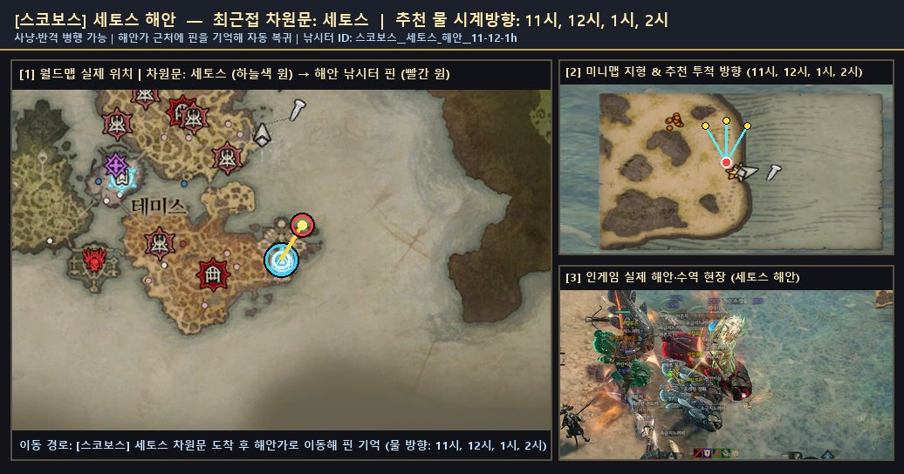
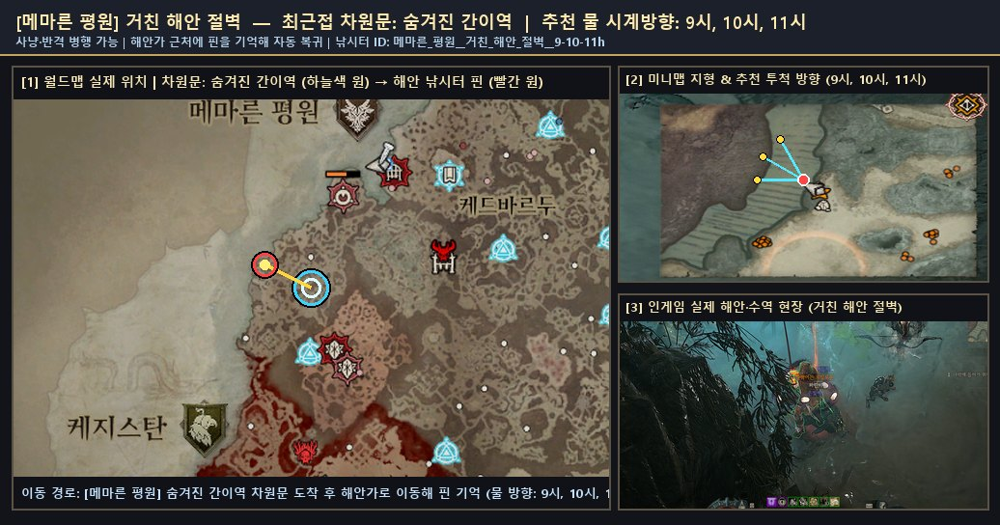
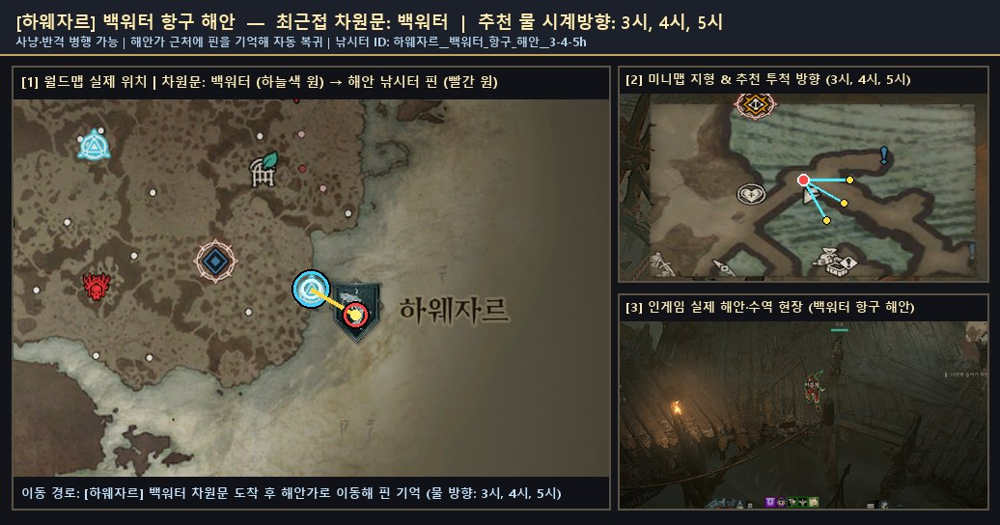
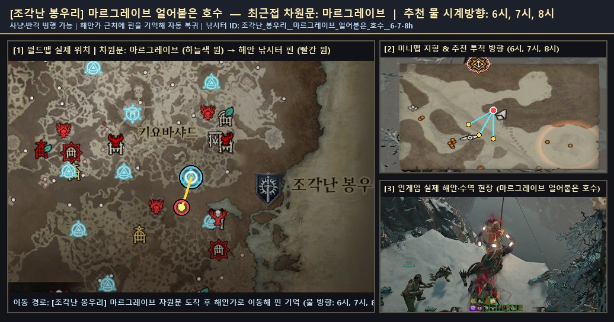
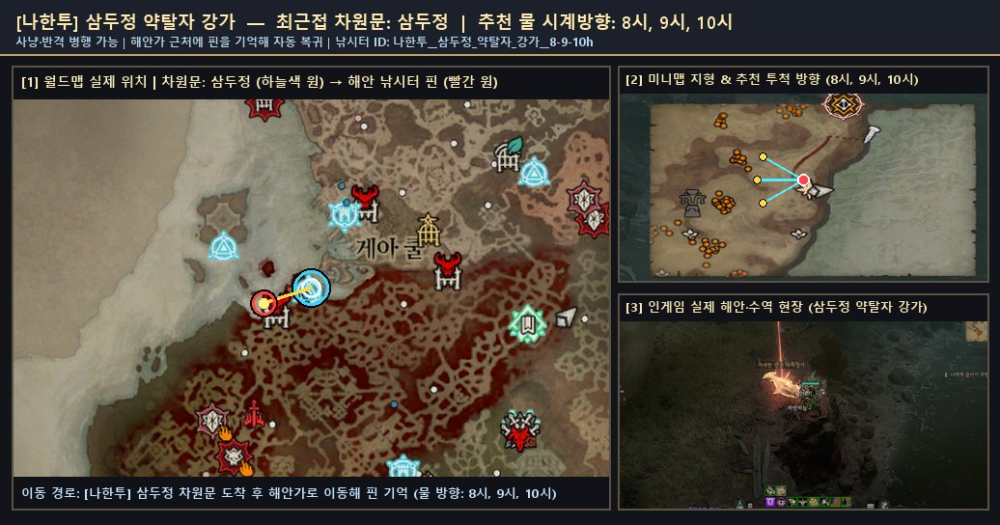
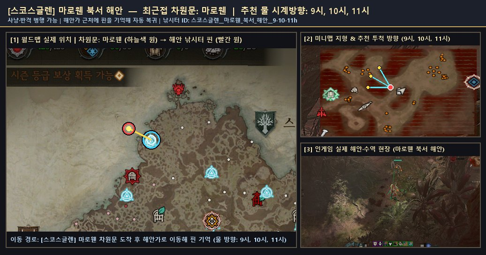
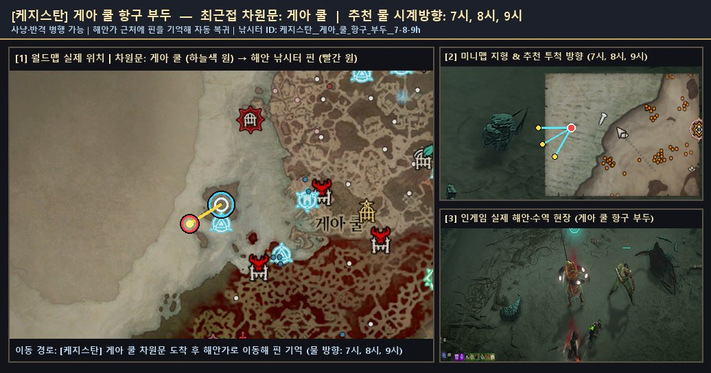
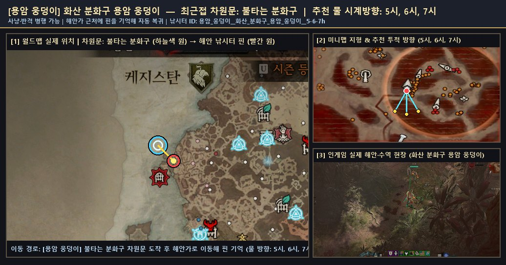

# 🎣 성역 전역 낚시터 공유 도감 · 지역별 전리품 및 특수 이벤트 현황

> **안내**: 낚시 헬퍼에서 **`🌐 낚시터 공유`** 및 **`🧭 낚시터 찾아가기`** 옵션을 켜고 낚시하면,
> 사냥(반격)과 낚시가 가능한 검증된 낚시터 위치·잡히는 물고기·신화 어종·특수 이벤트(메피쉬토 출현 등)가 이곳에 자동으로 기록·정리됩니다.
> **각 대륙 문서를 클릭하거나 아래 위치 스크린샷을 보면 글로 찾지 않고도 월드맵 차원문·미니맵 해안가·현장 스샷으로 즉시 위치를 확인할 수 있습니다.**

- **최종 갱신**: `2026-11-09 05:08:16 KST`
- **공유된 사냥 가능 낚시터**: **19곳** (성역 8대 권역 · 전 포인트 실제 위치 스샷 포함)
- **성역 전역 공통 전리품**: **16,840개**
- **권역별 서식 어종 전리품 합계**: **9,190개**

---

## 📊 지역별 전리품 (물고기 서식지) · 대륙별 낚시터 요약

| 권역 (대륙) | 전리품 서식 그래프 | 누적 어획 | 사냥 가능 낚시터 | 도감 서식 어종 | 신화/고유 어획 | 특수 이벤트 | 위치 스샷 & 상세 보기 |
|:--|--|--:|--:|--:|--:|--:|:--:|
| **스코보스** | 🟪🟪🟪🟪🟪🟪🟪🟪🟪🟪🟪🟪🟪🟪🟪🟪🟪🟪 | **3,072** | **4곳** | 47종 | 234건 | 1338건 | [📸 스코보스 위치 스샷·도감](./스코보스.md) |
| **메마른 평원** | 🟪🟪🟪🟪🟪🟪🟪🟪🟪 | **1,496** | **3곳** | 16종 | 150건 | 640건 | [📸 메마른 평원 위치 스샷·도감](./메마른_평원.md) |
| **하웨자르** | 🟪🟪🟪🟪🟪🟪🟪🟪🟪 | **1,464** | **3곳** | 16종 | 134건 | 604건 | [📸 하웨자르 위치 스샷·도감](./하웨자르.md) |
| **조각난 봉우리** | 🟪🟪🟪🟪🟪🟪🟪 | **1,266** | **2곳** | 16종 | 138건 | 610건 | [📸 조각난 봉우리 위치 스샷·도감](./조각난_봉우리.md) |
| **나한투** | 🟪🟪🟪🟪🟪🟪 | **1,002** | **2곳** | 16종 | 240건 | 540건 | [📸 나한투 위치 스샷·도감](./나한투.md) |
| **스코스글렌** | 🟪🟪🟪🟪🟪 | **884** | **2곳** | 16종 | 62건 | 332건 | [📸 스코스글렌 위치 스샷·도감](./스코스글렌.md) |
| **케지스탄** | 🟪 | **4** | **2곳** | 16종 | 2건 | 4건 | [📸 케지스탄 위치 스샷·도감](./케지스탄.md) |
| **용암 웅덩이** | 🟪 | **2** | **1곳** | 1종 | 2건 | 2건 | [📸 용암 웅덩이 위치 스샷·도감](./용암_웅덩이.md) |

---

## 🗺️ 검증된 사냥·낚시 가능 대표 낚시 포인트 일람

| 대륙 | 세부 지역 (Zone) | 최근접 차원문 (Waypoint) | 추천 시계 방향 | 사냥 안전 | 투척 검증 | 주요 포획 어종 / 비고 | 실제 위치 스크린샷 |
|:--|:--|:--|:--:|:--:|:--:|:--|:--:|
| **스코보스** | `세토스 해안` | 세토스 | `11시, 12시, 1시, 2시` | ✅ 가능 | ✅ 확인됨 | 코칼로돈(1760), 악마 코칼로돈(192), 거대한 환영 코칼로돈(26) — 세토스 차원문 인접 사냥·낚시 검증 수역 | [🗺️ 위치 스샷](./patches/스코보스__세토스_해안__11-12-1h/location.jpg) · [🧭 미니맵](./patches/스코보스__세토스_해안__11-12-1h/minimap.jpg) |
| **스코보스** | `아타노스 해안` | 아타노스 | `4시, 5시, 6시` | ✅ 가능 | ✅ 확인됨 | 거대한 코칼로돈(226), 반짝이는 코칼로돈(164), 반짝이는 악마 코칼로돈(30) — 아타노스 차원문 인접 사냥·낚시 검증 수역 | [🗺️ 위치 스샷](./patches/스코보스__아타노스_해안__4-5-6h/location.jpg) · [🧭 미니맵](./patches/스코보스__아타노스_해안__4-5-6h/minimap.jpg) |
| **스코보스** | `테미스 해안` | 테미스 | `4시, 5시, 6시` | ✅ 가능 | ✅ 확인됨 | 천공 코칼로돈(202), 환영 코칼로돈(162), 작은 코칼로돈(132) — 테미스 차원문 인접 사냥·낚시 검증 수역 | [🗺️ 위치 스샷](./patches/스코보스__테미스_해안__4-5-6h/location.jpg) · [🧭 미니맵](./patches/스코보스__테미스_해안__4-5-6h/minimap.jpg) |
| **스코보스** | `필레노스 남부 해안` | 필레노스 | `5시, 6시, 7시` | ✅ 가능 | ✅ 확인됨 | 작은 천공 코칼로돈(32), 거대한 악마 코칼로돈(28), 반짝이는 환영 코칼로돈(16) — 필레노스 차원문 인접 사냥·낚시 검증 수역 | [🗺️ 위치 스샷](./patches/스코보스__필레노스_남부_해안__5-6-7h/location.jpg) · [🧭 미니맵](./patches/스코보스__필레노스_남부_해안__5-6-7h/minimap.jpg) |
| **메마른 평원** | `거친 해안 절벽` | 숨겨진 간이역 | `9시, 10시, 11시` | ✅ 가능 | ✅ 확인됨 | 작은 시보의 징조(64), 반짝이는 악마 시보의 징조(12), 반짝이는 환영 시보의 징조(12) — 숨겨진 간이역 차원문 인접 사냥·낚시 검증 수역 | [🗺️ 위치 스샷](./patches/메마른_평원__거친_해안_절벽__9-10-11h/location.jpg) · [🧭 미니맵](./patches/메마른_평원__거친_해안_절벽__9-10-11h/minimap.jpg) |
| **메마른 평원** | `운명의 은신처 서해안` | 운명의 은신처 | `8시, 9시, 10시` | ✅ 가능 | ✅ 확인됨 | 환영 시보의 징조(96), 반짝이는 시보의 징조(84), 거대한 시보의 징조(80) — 운명의 은신처 차원문 인접 사냥·낚시 검증 수역 | [🗺️ 위치 스샷](./patches/메마른_평원__운명의_은신처_서해안__8-9-10h/location.jpg) · [🧭 미니맵](./patches/메마른_평원__운명의_은신처_서해안__8-9-10h/minimap.jpg) |
| **메마른 평원** | `지란다이 남부 강변` | 지란다이 | `5시, 6시, 7시` | ✅ 가능 | ✅ 확인됨 | 시보의 징조(856), 천공 시보의 징조(88), 악마 시보의 징조(78) — 지란다이 차원문 인접 사냥·낚시 검증 수역 | [🗺️ 위치 스샷](./patches/메마른_평원__지란다이_남부_강변__5-6-7h/location.jpg) · [🧭 미니맵](./patches/메마른_평원__지란다이_남부_강변__5-6-7h/minimap.jpg) |
| **하웨자르** | `백워터 항구 해안` | 백워터 | `3시, 4시, 5시` | ✅ 가능 | ✅ 확인됨 | 천공 갈고리고기(94), 악마 갈고리고기(72), 거대한 갈고리고기(62) — 백워터 차원문 인접 사냥·낚시 검증 수역 | [🗺️ 위치 스샷](./patches/하웨자르__백워터_항구_해안__3-4-5h/location.jpg) · [🧭 미니맵](./patches/하웨자르__백워터_항구_해안__3-4-5h/minimap.jpg) |
| **하웨자르** | `속삭임의 나무 늪지` | 속삭임의 나무 | `2시, 3시, 4시` | ✅ 가능 | ✅ 확인됨 | 환영 갈고리고기(92), 반짝이는 갈고리고기(66), 작은 천공 갈고리고기(20) — 속삭임의 나무 차원문 인접 사냥·낚시 검증 수역 | [🗺️ 위치 스샷](./patches/하웨자르__속삭임의_나무_늪지__2-3-4h/location.jpg) · [🧭 미니맵](./patches/하웨자르__속삭임의_나무_늪지__2-3-4h/minimap.jpg) |
| **하웨자르** | `위자오 난파선 해안` | 위자오 | `5시, 6시, 7시` | ✅ 가능 | ✅ 확인됨 | 갈고리고기(860), 작은 갈고리고기(84), 거대한 악마 갈고리고기(24) — 위자오 차원문 인접 사냥·낚시 검증 수역 | [🗺️ 위치 스샷](./patches/하웨자르__위자오_난파선_해안__5-6-7h/location.jpg) · [🧭 미니맵](./patches/하웨자르__위자오_난파선_해안__5-6-7h/minimap.jpg) |
| **조각난 봉우리** | `마르그레이브 얼어붙은 호수` | 마르그레이브 | `6시, 7시, 8시` | ✅ 가능 | ✅ 확인됨 | 천공 모라야가(68), 작은 모라야가(66), 반짝이는 악마 모라야가(24) — 마르그레이브 차원문 인접 사냥·낚시 검증 수역 | [🗺️ 위치 스샷](./patches/조각난_봉우리__마르그레이브_얼어붙은_호수__6-7-8h/location.jpg) · [🧭 미니맵](./patches/조각난_봉우리__마르그레이브_얼어붙은_호수__6-7-8h/minimap.jpg) |
| **조각난 봉우리** | `메네스타드 북서 강변` | 메네스타드 | `10시, 11시, 12시` | ✅ 가능 | ✅ 확인됨 | 모라야가(656), 거대한 모라야가(128), 반짝이는 모라야가(90) — 메네스타드 차원문 인접 사냥·낚시 검증 수역 | [🗺️ 위치 스샷](./patches/조각난_봉우리__메네스타드_북서_강변__10-11-12h/location.jpg) · [🧭 미니맵](./patches/조각난_봉우리__메네스타드_북서_강변__10-11-12h/minimap.jpg) |
| **나한투** | `삼두정 약탈자 강가` | 삼두정 | `8시, 9시, 10시` | ✅ 가능 | ✅ 확인됨 | 작은 악마 네메셍가(112), 악마 네메셍가(80), 작은 네메셍가(50) — 삼두정 차원문 인접 사냥·낚시 검증 수역 | [🗺️ 위치 스샷](./patches/나한투__삼두정_약탈자_강가__8-9-10h/location.jpg) · [🧭 미니맵](./patches/나한투__삼두정_약탈자_강가__8-9-10h/minimap.jpg) |
| **나한투** | `쿠라스트 부두 강변` | 쿠라스트 부두 | `6시, 7시, 8시` | ✅ 가능 | ✅ 확인됨 | 네메셍가(462), 천공 네메셍가(48), 반짝이는 네메셍가(34) — 쿠라스트 부두 차원문 인접 사냥·낚시 검증 수역 | [🗺️ 위치 스샷](./patches/나한투__쿠라스트_부두_강변__6-7-8h/location.jpg) · [🧭 미니맵](./patches/나한투__쿠라스트_부두_강변__6-7-8h/minimap.jpg) |
| **스코스글렌** | `마로웬 북서 해안` | 마로웬 | `9시, 10시, 11시` | ✅ 가능 | ✅ 확인됨 | 드라콘수염(552), 반짝이는 드라콘수염(46), 환영 드라콘수염(44) — 마로웬 차원문 인접 사냥·낚시 검증 수역 | [🗺️ 위치 스샷](./patches/스코스글렌__마로웬_북서_해안__9-10-11h/location.jpg) · [🧭 미니맵](./patches/스코스글렌__마로웬_북서_해안__9-10-11h/minimap.jpg) |
| **스코스글렌** | `티르마르 고원 호수` | 티르마르 | `11시, 12시, 1시` | ✅ 가능 | ✅ 확인됨 | 천공 드라콘수염(50), 작은 드라콘수염(46), 악마 드라콘수염(40) — 티르마르 차원문 인접 사냥·낚시 검증 수역 | [🗺️ 위치 스샷](./patches/스코스글렌__티르마르_고원_호수__11-12-1h/location.jpg) · [🧭 미니맵](./patches/스코스글렌__티르마르_고원_호수__11-12-1h/minimap.jpg) |
| **케지스탄** | `게아 쿨 항구 부두` | 게아 쿨 | `7시, 8시, 9시` | ✅ 가능 | ✅ 확인됨 | 환영 자카라티(2) — 게아 쿨 차원문 인접 사냥·낚시 검증 수역 | [🗺️ 위치 스샷](./patches/케지스탄__게아_쿨_항구_부두__7-8-9h/location.jpg) · [🧭 미니맵](./patches/케지스탄__게아_쿨_항구_부두__7-8-9h/minimap.jpg) |
| **케지스탄** | `달구르 오아시스 수역` | 강철늑대단 야영지 | `5시, 6시, 7시` | ✅ 가능 | ✅ 확인됨 | 반짝이는 환영 자카라티(2) — 강철늑대단 야영지 차원문 인접 사냥·낚시 검증 수역 | [🗺️ 위치 스샷](./patches/케지스탄__달구르_오아시스_수역__5-6-7h/location.jpg) · [🧭 미니맵](./patches/케지스탄__달구르_오아시스_수역__5-6-7h/minimap.jpg) |
| **용암 웅덩이** | `화산 분화구 용암 웅덩이` | 불타는 분화구 | `5시, 6시, 7시` | ✅ 가능 | ✅ 확인됨 | 녹아내린 순교자(2) — 불타는 분화구 차원문 인접 사냥·낚시 검증 수역 | [🗺️ 위치 스샷](./patches/용암_웅덩이__화산_분화구_용암_웅덩이__5-6-7h/location.jpg) · [🧭 미니맵](./patches/용암_웅덩이__화산_분화구_용암_웅덩이__5-6-7h/minimap.jpg) |

---

## 📸 대륙별 대표 낚시터 실제 위치 스크린샷 (월드맵 · 미니맵 · 인게임 현장)

> 각 대륙 이름을 클릭하면 해당 대륙의 모든 세부 낚시 포인트 위치 스크린샷과 서식 어종을 볼 수 있습니다.

### 📍 [스코보스 전체 포인트 보기](./스코보스.md) — 대표: `세토스 해안` (차원문: 세토스, 물 방향: `11시, 12시, 1시, 2시`)

### 📍 [메마른 평원 전체 포인트 보기](./메마른_평원.md) — 대표: `거친 해안 절벽` (차원문: 숨겨진 간이역, 물 방향: `9시, 10시, 11시`)

### 📍 [하웨자르 전체 포인트 보기](./하웨자르.md) — 대표: `백워터 항구 해안` (차원문: 백워터, 물 방향: `3시, 4시, 5시`)

### 📍 [조각난 봉우리 전체 포인트 보기](./조각난_봉우리.md) — 대표: `마르그레이브 얼어붙은 호수` (차원문: 마르그레이브, 물 방향: `6시, 7시, 8시`)

### 📍 [나한투 전체 포인트 보기](./나한투.md) — 대표: `삼두정 약탈자 강가` (차원문: 삼두정, 물 방향: `8시, 9시, 10시`)

### 📍 [스코스글렌 전체 포인트 보기](./스코스글렌.md) — 대표: `마로웬 북서 해안` (차원문: 마로웬, 물 방향: `9시, 10시, 11시`)

### 📍 [케지스탄 전체 포인트 보기](./케지스탄.md) — 대표: `게아 쿨 항구 부두` (차원문: 게아 쿨, 물 방향: `7시, 8시, 9시`)

### 📍 [용암 웅덩이 전체 포인트 보기](./용암_웅덩이.md) — 대표: `화산 분화구 용암 웅덩이` (차원문: 불타는 분화구, 물 방향: `5시, 6시, 7시`)

---

## ⚡ 최근 신화 어종 · 히든 보스(메피쉬토) · 특수 이벤트 기록

| 발생 시각 (KST) | 구분 | 대륙 · 지역 | 상세 내용 |
|:--|:--|:--|:--|
| `2026-11-06 12:13:34` | **mefishto** | 스코보스 · `아타노스 해안` | 🦈 메피쉬토 여유의 군주 출현·처치 (6초) |
| `2026-11-06 09:06:25` | **mefishto** | 스코보스 · `아타노스 해안` | 🦈 메피쉬토 여유의 군주 출현·처치 (9초) |
| `2026-11-06 08:16:06` | **mefishto** | 스코보스 · `아타노스 해안` | 🦈 메피쉬토 여유의 군주 출현·처치 (180초) |
| `2026-11-09 05:20:20` | **고유_어종** | 스코보스 · `필레노스 남부 해안` | [고유] 작은 천공 코칼로돈 어획 (스코보스 · 필레노스 남부 해안) |
| `2026-11-09 05:18:28` | **고유_어종** | 스코보스 · `필레노스 남부 해안` | [고유] 거대한 악마 코칼로돈 어획 (스코보스 · 필레노스 남부 해안) |
| `2026-11-09 04:46:38` | **고유_어종** | 스코보스 · `필레노스 남부 해안` | [고유] 거대한 악마 코칼로돈 어획 (스코보스 · 필레노스 남부 해안) |
| `2026-11-09 02:55:03` | **고유_어종** | 스코보스 · `테미스 해안` | [고유] 거대한 천공 코칼로돈 어획 (스코보스 · 테미스 해안) |
| `2026-11-09 02:41:15` | **고유_어종** | 스코보스 · `아타노스 해안` | [고유] 작은 환영 코칼로돈 어획 (스코보스 · 아타노스 해안) |
| `2026-11-09 02:34:36` | **고유_어종** | 스코보스 · `테미스 해안` | [고유] 반짝이는 천공 코칼로돈 어획 (스코보스 · 테미스 해안) |
| `2026-11-09 02:26:29` | **고유_어종** | 스코보스 · `필레노스 남부 해안` | [고유] 작은 천공 코칼로돈 어획 (스코보스 · 필레노스 남부 해안) |
| `2026-11-09 02:26:29` | **고유_어종** | 스코보스 · `아타노스 해안` | [고유] 반짝이는 악마 코칼로돈 어획 (스코보스 · 아타노스 해안) |
| `2026-11-09 05:20:20` | **전설_어종** | 스코보스 · `테미스 해안` | [전설] 작은 코칼로돈 어획 (스코보스 · 테미스 해안) |
| `2026-11-09 05:20:20` | **전설_어종** | 스코보스 · `아타노스 해안` | [전설] 거대한 코칼로돈 어획 (스코보스 · 아타노스 해안) |
| `2026-11-09 05:16:10` | **전설_어종** | 스코보스 · `테미스 해안` | [전설] 환영 코칼로돈 어획 (스코보스 · 테미스 해안) |
| `2026-11-09 05:14:38` | **전설_어종** | 조각난 봉우리 · `메네스타드 북서 강변` | [전설] 거대한 모라야가 어획 (조각난 봉우리 · 메네스타드 북서 강변) |
| `2026-11-09 05:08:09` | **전설_어종** | 스코보스 · `테미스 해안` | [전설] 작은 코칼로돈 어획 (스코보스 · 테미스 해안) |
| `2026-11-09 05:06:47` | **전설_어종** | 스코보스 · `테미스 해안` | [전설] 천공 코칼로돈 어획 (스코보스 · 테미스 해안) |
| `2026-11-09 05:05:32` | **전설_어종** | 스코보스 · `세토스 해안` | [전설] 악마 코칼로돈 어획 (스코보스 · 세토스 해안) |
| `2026-11-09 04:38:32` | **전설_어종** | 스코보스 · `아타노스 해안` | [전설] 거대한 코칼로돈 어획 (스코보스 · 아타노스 해안) |
| `2026-11-09 04:38:32` | **전설_어종** | 스코보스 · `테미스 해안` | [전설] 작은 코칼로돈 어획 (스코보스 · 테미스 해안) |
| `2026-11-09 04:38:32` | **전설_어종** | 스코보스 · `테미스 해안` | [전설] 환영 코칼로돈 어획 (스코보스 · 테미스 해안) |
| `2026-11-09 04:37:20` | **전설_어종** | 스코보스 · `테미스 해안` | [전설] 작은 코칼로돈 어획 (스코보스 · 테미스 해안) |
| `2026-11-09 04:14:27` | **전설_어종** | 스코보스 · `테미스 해안` | [전설] 작은 코칼로돈 어획 (스코보스 · 테미스 해안) |
| `2026-11-09 04:13:55` | **전설_어종** | 스코보스 · `아타노스 해안` | [전설] 반짝이는 코칼로돈 어획 (스코보스 · 아타노스 해안) |
| `2026-11-09 03:25:35` | **전설_어종** | 스코보스 · `테미스 해안` | [전설] 환영 코칼로돈 어획 (스코보스 · 테미스 해안) |
| `2026-11-09 03:06:49` | **전설_어종** | 스코보스 · `아타노스 해안` | [전설] 반짝이는 코칼로돈 어획 (스코보스 · 아타노스 해안) |
| `2026-11-09 02:53:51` | **전설_어종** | 스코보스 · `테미스 해안` | [전설] 환영 코칼로돈 어획 (스코보스 · 테미스 해안) |
| `2026-11-09 02:53:46` | **전설_어종** | 조각난 봉우리 · `메네스타드 북서 강변` | [전설] 거대한 모라야가 어획 (조각난 봉우리 · 메네스타드 북서 강변) |
| `2026-11-09 02:53:19` | **전설_어종** | 조각난 봉우리 · `메네스타드 북서 강변` | [전설] 거대한 모라야가 어획 (조각난 봉우리 · 메네스타드 북서 강변) |
| `2026-11-09 02:42:17` | **전설_어종** | 스코보스 · `테미스 해안` | [전설] 천공 코칼로돈 어획 (스코보스 · 테미스 해안) |
