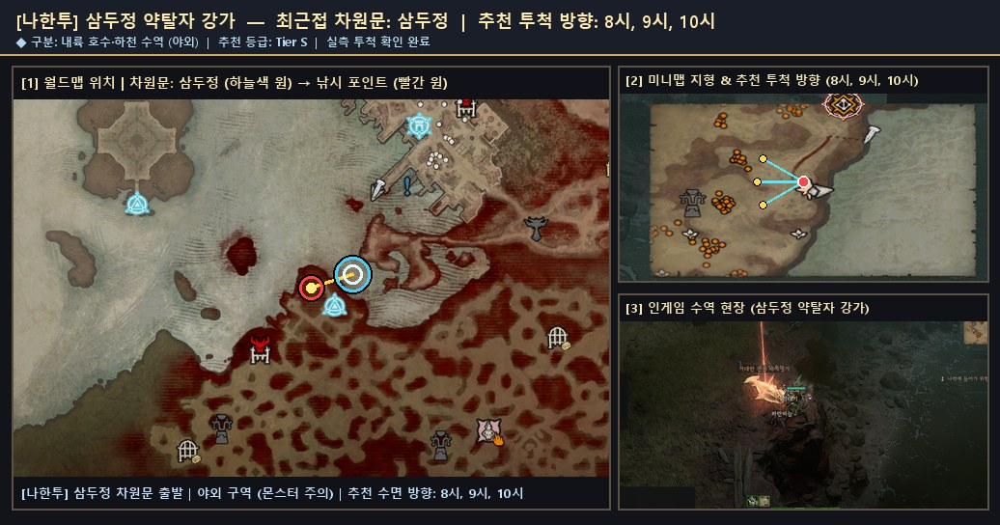
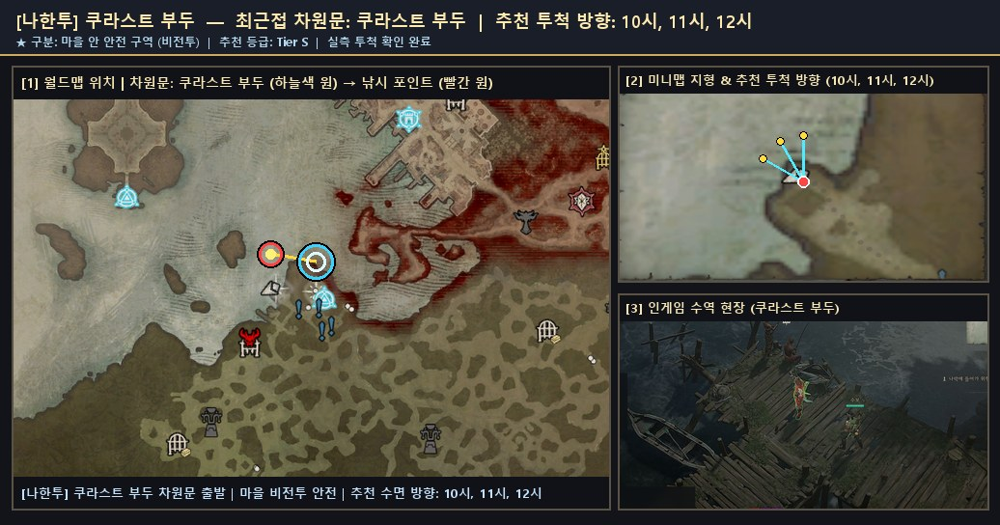
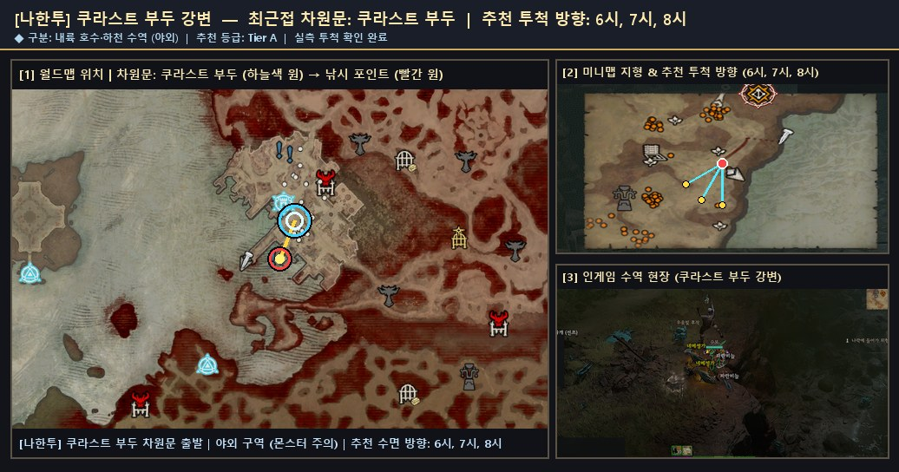

# 🗺️ 나한투 — 검증 낚시터 위치 가이드 및 서식 어종 도감

> 🌐 **빠른 검색 웹 플랫폼**: [**대화형 낚시터 · 어종 통합 검색 열기 (`낚시터검색.html`)**](https://kaljake70.github.io/d4helper/%EB%82%9A%EC%8B%9C%ED%84%B0/%EB%82%9A%EC%8B%9C%ED%84%B0%EA%B2%80%EC%83%89.html)  
> 📚 **테마별 가이드**: [🏠 전체 허브](./README.md) · [⭐ 인기 추천](./인기_추천_낚시터.md) · [🏘️ 마을 안전](./마을_안전_낚시터.md) · [🏞️ 내륙 호수·강](./내륙_호수_강_낚시터.md) · [🌋 특수·용암](./특수_이색_낚시터.md) · [🐟 전체 어종 도감](./어종_도감.md)  
> 🗺️ **8대 권역**: [스코보스](./스코보스.md) · [나한투](./나한투.md) · [케지스탄](./케지스탄.md) · [하웨자르](./하웨자르.md) · [메마른 평원](./메마른_평원.md) · [스코스글렌](./스코스글렌.md) · [조각난 봉우리](./조각난_봉우리.md) · [용암 웅덩이](./용암_웅덩이.md)

- **권역명**: **나한투**
- **실측 검증 낚시터**: **3곳** (마을 비전투 안전 **1곳** 포함)
- **권역 전용 서식 어종**: **16종** (+ 성역 전역 공통 어종 5종 출현)
- **누적 어획 표본**: **1,007개**

---

## 1. 나한투 낚시 포인트 한눈 요약

| # | 유형 | 등급 | 세부 지역 | 최근접 차원문 | 안전 여부 | 추천 투척 방향 | 주요 포획 어종 |
|:--:|:--:|:--:|:--|:--|:--:|:--:|:--|
| 1 | 🏞️ 내륙 수역 | **S** | `삼두정 약탈자 강가` | 삼두정 | ⚔️ 야외 주의 | `8시, 9시, 10시` | 작은 악마 네메셍가(112), 악마 네메셍가(80), 작은 네메셍가(50) |
| 2 | 🏘️ 마을 안전 | **S** | `쿠라스트 부두` | 쿠라스트 부두 | 🏘️ 마을 안전 | `10시, 11시, 12시` | 아른치(1), 은빛배(1), 천공 네메셍가(1) |
| 3 | 🏞️ 내륙 수역 | **A** | `쿠라스트 부두 강변` | 쿠라스트 부두 | ⚔️ 야외 주의 | `6시, 7시, 8시` | 네메셍가(462), 천공 네메셍가(48), 반짝이는 네메셍가(34) |

---

## 2. 나한투 세부 낚시 포인트 위치 안내 및 현장 스크린샷

### 1. `삼두정 약탈자 강가` (최근접 차원문: 삼두정)

- **유형 및 추천 등급**: **🏞️ 내륙 수역** · **Tier S** · ⭐ 인기 추천
- **안전 구역 구분**: ⚔️ 야외 구역 (주변 몬스터 출몰 주의)
- **추천 투척 시계 방향**: `8시, 9시, 10시`
- **실측 투척 확인 여부**: 확인 완료 (`2026-11-10` 기준)
- **차원문 접근 및 위치 안내**: 삼두정 차원문 도착 후 바로 북서쪽(10시 방향)으로 짧게 걸어 나가면 정글 대하천 동쪽 만곡부 물가와 즉시 맞닿습니다. 차원문과의 거리가 매우 짧고 8~10시 수면 폭이 넓어 고유 네메셍가 채집 효율이 뛰어납니다.
- **주요 포획 기록**: **작은 악마 네메셍가**(112회), **악마 네메셍가**(80회), **작은 네메셍가**(50회), **거대한 네메셍가**(46회), **거대한 천공 네메셍가**(46회), **환영 네메셍가**(42회), **거대한 악마 네메셍가**(22회), **반짝이는 악마 네메셍가**(12회)
- **🌟 포획 확인된 신화·고유 어종**: `거대한 악마 네메셍가`, `반짝이는 악마 네메셍가`, `작은 악마 네메셍가`, `거대한 천공 네메셍가`
- **📍 종합 위치 안내도 (월드맵 차원문 · 미니맵 투척 각도 · 인게임 수역 현장)**:

  

  - 원본 확대 보기: [🗺️ 월드맵 차원문 원본](./patches/나한투__삼두정_약탈자_강가__8-9-10h/worldmap.jpg) · [🧭 미니맵 방향 원본](./patches/나한투__삼두정_약탈자_강가__8-9-10h/minimap.jpg) · [🎬 인게임 현장 원본](./patches/나한투__삼두정_약탈자_강가__8-9-10h/scene.jpg)

### 2. `쿠라스트 부두` (최근접 차원문: 쿠라스트 부두)

- **유형 및 추천 등급**: **🏘️ 마을 안전** · **Tier S** · ⭐ 인기 추천
- **안전 구역 구분**: 🏘️ 마을 안 안전 구역 (비전투 · 몬스터 출몰 없음)
- **추천 투척 시계 방향**: `10시, 11시, 12시`
- **실측 투척 확인 여부**: 확인 완료 (`2026-11-10` 기준)
- **차원문 접근 및 위치 안내**: 쿠라스트 부두 차원문에서 남서쪽(7시 방향) 직사각형 주 석조 부두 끝단으로 도보 15초 이동한 뒤 10~12시 대하천 수면으로 투척합니다. 주의: 북서쪽의 작은 나무 잔교는 장식용 진흙 여울이라 낚시 수역 판정이 없으니 반드시 남서쪽 큰 석조 부두로 가십시오.
- **주요 포획 기록**: **아른치**(1회), **은빛배**(1회), **천공 네메셍가**(1회), **파란비늘**(1회), **환영 네메셍가**(1회)
- **📍 종합 위치 안내도 (월드맵 차원문 · 미니맵 투척 각도 · 인게임 수역 현장)**:

  

  - 원본 확대 보기: [🗺️ 월드맵 차원문 원본](./patches/나한투__쿠라스트_부두__10-11-12h/worldmap.jpg) · [🧭 미니맵 방향 원본](./patches/나한투__쿠라스트_부두__10-11-12h/minimap.jpg) · [🎬 인게임 현장 원본](./patches/나한투__쿠라스트_부두__10-11-12h/scene.jpg)

### 3. `쿠라스트 부두 강변` (최근접 차원문: 쿠라스트 부두)

- **유형 및 추천 등급**: **🏞️ 내륙 수역** · **Tier A** · ⭐ 인기 추천
- **안전 구역 구분**: ⚔️ 야외 구역 (주변 몬스터 출몰 주의)
- **추천 투척 시계 방향**: `6시, 7시, 8시`
- **실측 투척 확인 여부**: 확인 완료 (`2026-11-10` 기준)
- **차원문 접근 및 위치 안내**: 쿠라스트 부두 남쪽 성문 밖으로 나와 우아일 분지 서편 대하천 강기슭으로 이동한 뒤 6~8시 수면으로 투척합니다. 야외 정글 강변이므로 주변 몬스터에 유의하십시오.
- **주요 포획 기록**: **네메셍가**(462회), **천공 네메셍가**(48회), **반짝이는 네메셍가**(34회), **거대한 환영 네메셍가**(12회), **작은 천공 네메셍가**(12회), **작은 환영 네메셍가**(10회), **반짝이는 천공 네메셍가**(8회), **반짝이는 환영 네메셍가**(6회)
- **🌟 포획 확인된 신화·고유 어종**: `작은 천공 네메셍가`, `반짝이는 천공 네메셍가`, `반짝이는 환영 네메셍가`, `거대한 환영 네메셍가`, `작은 환영 네메셍가`
- **📍 종합 위치 안내도 (월드맵 차원문 · 미니맵 투척 각도 · 인게임 수역 현장)**:

  

  - 원본 확대 보기: [🗺️ 월드맵 차원문 원본](./patches/나한투__쿠라스트_부두_강변__6-7-8h/worldmap.jpg) · [🧭 미니맵 방향 원본](./patches/나한투__쿠라스트_부두_강변__6-7-8h/minimap.jpg) · [🎬 인게임 현장 원본](./patches/나한투__쿠라스트_부두_강변__6-7-8h/scene.jpg)

---

## 3. 나한투 서식 도감 어종 목록 (16종)

| 등급 | 물고기 이름 (한글) | 영문명 | 세부 서식지 | 도감 설명 |
|:--:|:--|:--|:--|:--|
| 🟤 고유 | **거대한 악마 네메셍가** | `Giant Demonic Neme-Senga` | 나한투 | 나한투에 서식하는 고유 물고기입니다. 나한투어로 "웃는 칼"이라는 의미인 네메셍가는 불길하지만 우호적인 영혼으로, 사랑하는 사람의 배신을 미리 알려준다고 합니다. |
| 🟤 고유 | **거대한 천공 네메셍가** | `Giant Celestial Neme-Senga` | 나한투 | 나한투에 서식하는 고유 물고기입니다. 나한투어로 "웃는 칼"이라는 의미인 네메셍가는 불길하지만 우호적인 영혼으로, 사랑하는 사람의 배신을 미리 알려준다고 합니다. |
| 🟤 고유 | **거대한 환영 네메셍가** | `Giant Spectral Neme-Senga` | 나한투 | 나한투에 서식하는 고유 물고기입니다. 나한투어로 "웃는 칼"이라는 의미인 네메셍가는 불길하지만 우호적인 영혼으로, 사랑하는 사람의 배신을 미리 알려준다고 합니다. |
| 🟤 고유 | **반짝이는 악마 네메셍가** | `Glittering Demonic Neme-Senga` | 나한투 | 나한투에 서식하는 고유 물고기입니다. 나한투어로 "웃는 칼"이라는 의미인 네메셍가는 불길하지만 우호적인 영혼으로, 사랑하는 사람의 배신을 미리 알려준다고 합니다. |
| 🟤 고유 | **반짝이는 천공 네메셍가** | `Glittering Celestial Neme-Senga` | 나한투 | 나한투에 서식하는 고유 물고기입니다. 나한투어로 "웃는 칼"이라는 의미인 네메셍가는 불길하지만 우호적인 영혼으로, 사랑하는 사람의 배신을 미리 알려준다고 합니다. |
| 🟤 고유 | **반짝이는 환영 네메셍가** | `Glittering Spectral Neme-Senga` | 나한투 | 나한투에 서식하는 고유 물고기입니다. 나한투어로 "웃는 칼"이라는 의미인 네메셍가는 불길하지만 우호적인 영혼으로, 사랑하는 사람의 배신을 미리 알려준다고 합니다. |
| 🟤 고유 | **작은 악마 네메셍가** | `Tiny Demonic Neme-Senga` | 나한투 | 나한투에 서식하는 고유 물고기입니다. 나한투어로 "웃는 칼"이라는 의미인 네메셍가는 불길하지만 우호적인 영혼으로, 사랑하는 사람의 배신을 미리 알려준다고 합니다. |
| 🟤 고유 | **작은 천공 네메셍가** | `Tiny Celestial Neme-Senga` | 나한투 | 나한투에 서식하는 고유 물고기입니다. 나한투어로 "웃는 칼"이라는 의미인 네메셍가는 불길하지만 우호적인 영혼으로, 사랑하는 사람의 배신을 미리 알려준다고 합니다. |
| 🟤 고유 | **작은 환영 네메셍가** | `Tiny Spectral Neme-Senga` | 나한투 | 나한투에 서식하는 고유 물고기입니다. 나한투어로 "웃는 칼"이라는 의미인 네메셍가는 불길하지만 우호적인 영혼으로, 사랑하는 사람의 배신을 미리 알려준다고 합니다. |
| 🟠 전설 | **거대한 네메셍가** | `Giant Neme-Senga` | 나한투 | 나한투에 서식하는 전설 물고기입니다. 나한투어로 "웃는 칼"이라는 의미인 네메셍가는 불길하지만 우호적인 영혼으로, 사랑하는 사람의 배신을 미리 알려준다고 합니다. |
| 🟠 전설 | **반짝이는 네메셍가** | `Glittering Neme-Senga` | 나한투 | 나한투에 서식하는 전설 물고기입니다. 나한투어로 "웃는 칼"이라는 의미인 네메셍가는 불길하지만 우호적인 영혼으로, 사랑하는 사람의 배신을 미리 알려준다고 합니다. |
| 🟠 전설 | **악마 네메셍가** | `Demonic Neme-Senga` | 나한투 | 나한투에 서식하는 전설 물고기입니다. 나한투어로 "웃는 칼"이라는 의미인 네메셍가는 불길하지만 우호적인 영혼으로, 사랑하는 사람의 배신을 미리 알려준다고 합니다. |
| 🟠 전설 | **작은 네메셍가** | `Tiny Neme-Senga` | 나한투 | 나한투에 서식하는 전설 물고기입니다. 나한투어로 "웃는 칼"이라는 의미인 네메셍가는 불길하지만 우호적인 영혼으로, 사랑하는 사람의 배신을 미리 알려준다고 합니다. |
| 🟠 전설 | **천공 네메셍가** | `Celestial Neme-Senga` | 나한투 | 나한투에 서식하는 전설 물고기입니다. 나한투어로 "웃는 칼"이라는 의미인 네메셍가는 불길하지만 우호적인 영혼으로, 사랑하는 사람의 배신을 미리 알려준다고 합니다. |
| 🟠 전설 | **환영 네메셍가** | `Spectral Neme-Senga` | 나한투 | 나한투에 서식하는 전설 물고기입니다. 나한투어로 "웃는 칼"이라는 의미인 네메셍가는 불길하지만 우호적인 영혼으로, 사랑하는 사람의 배신을 미리 알려준다고 합니다. |
| 🟡 희귀 | **네메셍가** | `Neme-Senga` | 나한투 | 나한투에 서식하는 희귀 물고기입니다. 나한투어로 "웃는 칼"이라는 의미인 네메셍가는 불길하지만 우호적인 영혼으로, 사랑하는 사람의 배신을 미리 알려준다고 합니다. |
