# 🏞️ 내륙 호수 · 강 · 오아시스 낚시터 & 비수면 착시 주의 가이드

> 🌐 **빠른 검색 웹 플랫폼**: [**대화형 낚시터 · 어종 통합 검색 열기 (`낚시터검색.html`)**](https://kaljake70.github.io/d4helper/%EB%82%9A%EC%8B%9C%ED%84%B0/%EB%82%9A%EC%8B%9C%ED%84%B0%EA%B2%80%EC%83%89.html)  
> 📚 **테마별 가이드**: [🏠 전체 허브](./README.md) · [⭐ 인기 추천](./인기_추천_낚시터.md) · [🏘️ 마을 안전](./마을_안전_낚시터.md) · [🏞️ 내륙 호수·강](./내륙_호수_강_낚시터.md) · [🌋 특수·용암](./특수_이색_낚시터.md) · [🐟 전체 어종 도감](./어종_도감.md)  
> 🗺️ **8대 권역**: [스코보스](./스코보스.md) · [나한투](./나한투.md) · [케지스탄](./케지스탄.md) · [하웨자르](./하웨자르.md) · [메마른 평원](./메마른_평원.md) · [스코스글렌](./스코스글렌.md) · [조각난 봉우리](./조각난_봉우리.md) · [용암 웅덩이](./용암_웅덩이.md)

바다 해안선이 아닌 성역 내륙 깊숙한 곳의 **정글 대하천, 사막 오아시스, 고산 빙하 호수, 설원 계류, 대늪지 호수, 내륙 해협**에서 낚시를 즐길 수 있는 검증 포인트 모음입니다.

---

## ⚠️ 내륙 비수면 착시 주의 구역 5대 유형 (실측 검증 기반)

디아블로 4의 양피지 스타일 월드맵에서는 물이 없는 협곡 길이나 높은 절벽이 강물처럼 보이는 착시가 자주 발생합니다. 현장 실측으로 확인된 대표 주의 지형은 다음과 같습니다.

| 주의 지형 유형 | 대표 착시 사례 (권역 · 지명) | 인게임 현상 및 구분 방법 |
|:--|:--|:--|
| **1. 마른 사막 협곡 길 착시** | 케지스탄 `타르사락` 남쪽 `중앙 언덕` / 메마른 평원 `메아리지는 동굴` | 월드맵의 **밝은 베이지색 구불구불한 띠**는 강물이 아니라 걸어 다니는 마른 모래 협곡 보행로입니다. 실제 수면은 반드시 **청회록색 가로 잔물결 해칭(수평 줄무늬)** 과 검은 해안 외곽선이 그려져 있습니다. |
| **2. 고절벽 · 성벽 시야각 차단** | 스코보스 `스카르타라` 높은 절벽 턱 / 하웨자르 `속삭임의 나무` 북동 호수 남서안(`씁쓸한 길`) / `아툴루아 주둔지` 서쪽 절벽 | 아래쪽에 실제 용암이나 호수 수면이 있더라도 절벽 위 난간에서는 `'낚시할 수 있는 수역이 시야에 보이지 않습니다.'` 문구와 함께 투척이 거절됩니다. 반드시 수면과 높이가 같은 **낮은 강둑·모래톱 발판**으로 내려가야 합니다. |
| **3. 마을 돌계단 · 실내 수로 조기 정지** | 메마른 평원 `지란다이` 남문 안쪽 돌계단 / 조각난 봉우리 `빛의 대학` 실내 | 지란다이 남쪽 강변으로 갈 때 성문 안쪽 계단에서 멈추면 강물에 닿지 않습니다. 성문 밖 어두운 강줄기 북안 모래톱까지 완전히 내려가십시오. |
| **4. 장식용 얕은 잔교** | 나한투 `쿠라스트 부두` 북서쪽 작은 나무 잔교 | 배경 낚시꾼 NPC가 서 있으나 실제 낚시 수역 판정이 없는 진흙 여울입니다. 쿠라스트 부두에서는 **남서쪽(7시 방향) 주 석조 부두 끝단**을 이용하십시오. |
| **5. 일반 사막 모래언덕 바닥** | 케지스탄 `타르사락` 북쪽 `슬픔의 모래언덕` 일반 모래밭 | 신화 어종 `새끼 사막상어`(`모래 언덕` 서식)는 일반 모래 바닥 아무 곳에서나 낚싯줄이 나가지 않으며, 상호작용 가능한 특수 지점 조건이 충족되어야 합니다. |

---

## 📍 검증된 내륙 호수 · 하천 · 오아시스 포인트 상세

### 1. [스코보스] `테미스 해안` (최근접 차원문: 테미스)

- **유형 및 추천 등급**: **🏞️ 내륙 수역** · **Tier A** · ⭐ 인기 추천
- **안전 구역 구분**: ⚔️ 야외 구역 (주변 몬스터 출몰 주의)
- **추천 투척 시계 방향**: `4시, 5시, 6시`
- **실측 투척 확인 여부**: 확인 완료 (`2026-11-10` 기준)
- **차원문 접근 및 위치 안내**: 테미스 차원문(성벽 내부)에서 2시 방향 직선 석조 다리를 건너 성문 밖으로 나간 뒤, 바로 남쪽에 파고든 내륙 해협 기슭에서 4~6시 방향으로 투척합니다. 테미스 성벽 안쪽에서는 수면 고도 차로 낚싯줄이 닿지 않습니다.
- **주요 포획 기록**: **천공 코칼로돈**(202회), **환영 코칼로돈**(162회), **작은 코칼로돈**(132회), **거대한 천공 코칼로돈**(44회), **반짝이는 천공 코칼로돈**(28회), **작은 악마 코칼로돈**(14회)
- **🌟 포획 확인된 신화·고유 어종**: `거대한 천공 코칼로돈`, `반짝이는 천공 코칼로돈`, `작은 악마 코칼로돈`
- **📍 종합 위치 안내도 (월드맵 차원문 · 미니맵 투척 각도 · 인게임 수역 현장)**:

  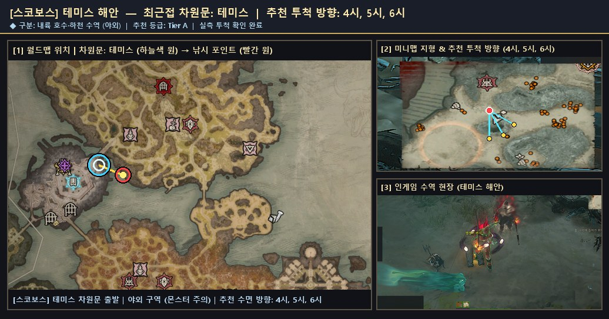

  - 원본 확대 보기: [🗺️ 월드맵 차원문 원본](./patches/스코보스__테미스_해안__4-5-6h/worldmap.jpg) · [🧭 미니맵 방향 원본](./patches/스코보스__테미스_해안__4-5-6h/minimap.jpg) · [🎬 인게임 현장 원본](./patches/스코보스__테미스_해안__4-5-6h/scene.jpg)

### 2. [스코보스] `헤파이트루스 산 남쪽 면` (최근접 차원문: 멍텅구리의 채석장)

- **유형 및 추천 등급**: **🌋 특수·용암** · **Tier S** · ⭐ 인기 추천
- **안전 구역 구분**: ⚔️ 야외 구역 (주변 몬스터 출몰 주의)
- **추천 투척 시계 방향**: `12시, 1시, 11시`
- **실측 투척 확인 여부**: 확인 완료 (`2026-11-10` 기준)
- **차원문 접근 및 위치 안내**: 멍텅구리의 채석장 차원문에서 북서쪽(10~11시 방향) 또는 비전의 끝 차원문에서 북쪽 화산 길을 따라 이동합니다. 높은 절벽 턱에서는 시야각 차단 문구가 뜨므로, 반드시 도약 발판 인근의 낮은 현무암 강둑으로 내려서서 11~1시 방향 시뻘건 용암 수면으로 투척하십시오.
- **주요 포획 기록**: **코칼로돈**(2회)
- **📍 종합 위치 안내도 (월드맵 차원문 · 미니맵 투척 각도 · 인게임 수역 현장)**:

  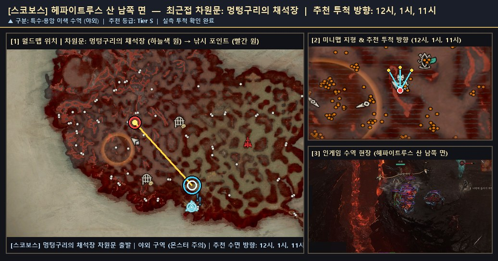

  - 원본 확대 보기: [🗺️ 월드맵 차원문 원본](./patches/스코보스__헤파이트루스_산_남쪽_면__12-1-11h/worldmap.jpg) · [🧭 미니맵 방향 원본](./patches/스코보스__헤파이트루스_산_남쪽_면__12-1-11h/minimap.jpg) · [🎬 인게임 현장 원본](./patches/스코보스__헤파이트루스_산_남쪽_면__12-1-11h/scene.jpg)

### 3. [나한투] `쿠라스트 부두` (최근접 차원문: 쿠라스트 부두)

- **유형 및 추천 등급**: **🏘️ 마을 안전** · **Tier S** · ⭐ 인기 추천
- **안전 구역 구분**: 🏘️ 마을 안 안전 구역 (비전투 · 몬스터 출몰 없음)
- **추천 투척 시계 방향**: `10시, 11시, 12시`
- **실측 투척 확인 여부**: 확인 완료 (`2026-11-10` 기준)
- **차원문 접근 및 위치 안내**: 쿠라스트 부두 차원문에서 남서쪽(7시 방향) 직사각형 주 석조 부두 끝단으로 도보 15초 이동한 뒤 10~12시 대하천 수면으로 투척합니다. 주의: 북서쪽의 작은 나무 잔교는 장식용 진흙 여울이라 낚시 수역 판정이 없으니 반드시 남서쪽 큰 석조 부두로 가십시오.
- **주요 포획 기록**: **아른치**(1회), **은빛배**(1회), **천공 네메셍가**(1회), **파란비늘**(1회), **환영 네메셍가**(1회)
- **📍 종합 위치 안내도 (월드맵 차원문 · 미니맵 투척 각도 · 인게임 수역 현장)**:

  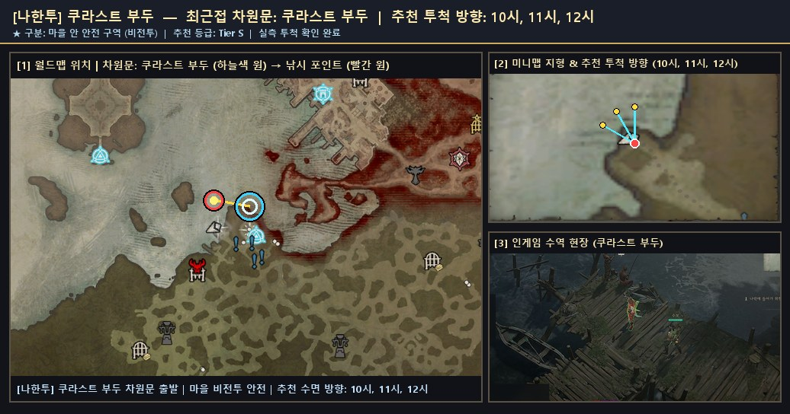

  - 원본 확대 보기: [🗺️ 월드맵 차원문 원본](./patches/나한투__쿠라스트_부두__10-11-12h/worldmap.jpg) · [🧭 미니맵 방향 원본](./patches/나한투__쿠라스트_부두__10-11-12h/minimap.jpg) · [🎬 인게임 현장 원본](./patches/나한투__쿠라스트_부두__10-11-12h/scene.jpg)

### 4. [나한투] `쿠라스트 부두 강변` (최근접 차원문: 쿠라스트 부두)

- **유형 및 추천 등급**: **🏞️ 내륙 수역** · **Tier A** · ⭐ 인기 추천
- **안전 구역 구분**: ⚔️ 야외 구역 (주변 몬스터 출몰 주의)
- **추천 투척 시계 방향**: `6시, 7시, 8시`
- **실측 투척 확인 여부**: 확인 완료 (`2026-11-10` 기준)
- **차원문 접근 및 위치 안내**: 쿠라스트 부두 남쪽 성문 밖으로 나와 우아일 분지 서편 대하천 강기슭으로 이동한 뒤 6~8시 수면으로 투척합니다. 야외 정글 강변이므로 주변 몬스터에 유의하십시오.
- **주요 포획 기록**: **네메셍가**(462회), **천공 네메셍가**(48회), **반짝이는 네메셍가**(34회), **거대한 환영 네메셍가**(12회), **작은 천공 네메셍가**(12회), **작은 환영 네메셍가**(10회), **반짝이는 천공 네메셍가**(8회), **반짝이는 환영 네메셍가**(6회)
- **🌟 포획 확인된 신화·고유 어종**: `작은 천공 네메셍가`, `반짝이는 천공 네메셍가`, `반짝이는 환영 네메셍가`, `거대한 환영 네메셍가`, `작은 환영 네메셍가`
- **📍 종합 위치 안내도 (월드맵 차원문 · 미니맵 투척 각도 · 인게임 수역 현장)**:

  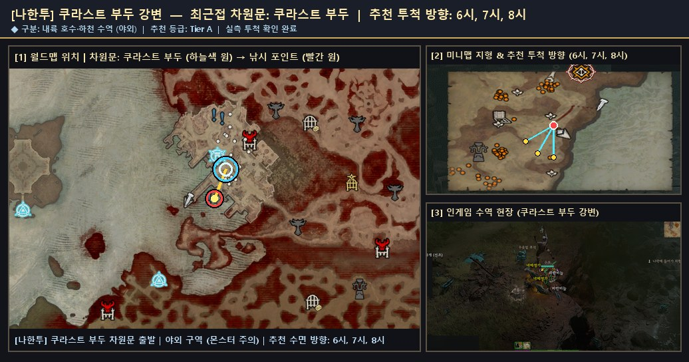

  - 원본 확대 보기: [🗺️ 월드맵 차원문 원본](./patches/나한투__쿠라스트_부두_강변__6-7-8h/worldmap.jpg) · [🧭 미니맵 방향 원본](./patches/나한투__쿠라스트_부두_강변__6-7-8h/minimap.jpg) · [🎬 인게임 현장 원본](./patches/나한투__쿠라스트_부두_강변__6-7-8h/scene.jpg)

### 5. [나한투] `삼두정 약탈자 강가` (최근접 차원문: 삼두정)

- **유형 및 추천 등급**: **🏞️ 내륙 수역** · **Tier S** · ⭐ 인기 추천
- **안전 구역 구분**: ⚔️ 야외 구역 (주변 몬스터 출몰 주의)
- **추천 투척 시계 방향**: `8시, 9시, 10시`
- **실측 투척 확인 여부**: 확인 완료 (`2026-11-10` 기준)
- **차원문 접근 및 위치 안내**: 삼두정 차원문 도착 후 바로 북서쪽(10시 방향)으로 짧게 걸어 나가면 정글 대하천 동쪽 만곡부 물가와 즉시 맞닿습니다. 차원문과의 거리가 매우 짧고 8~10시 수면 폭이 넓어 고유 네메셍가 채집 효율이 뛰어납니다.
- **주요 포획 기록**: **작은 악마 네메셍가**(112회), **악마 네메셍가**(80회), **작은 네메셍가**(50회), **거대한 네메셍가**(46회), **거대한 천공 네메셍가**(46회), **환영 네메셍가**(42회), **거대한 악마 네메셍가**(22회), **반짝이는 악마 네메셍가**(12회)
- **🌟 포획 확인된 신화·고유 어종**: `거대한 악마 네메셍가`, `반짝이는 악마 네메셍가`, `작은 악마 네메셍가`, `거대한 천공 네메셍가`
- **📍 종합 위치 안내도 (월드맵 차원문 · 미니맵 투척 각도 · 인게임 수역 현장)**:

  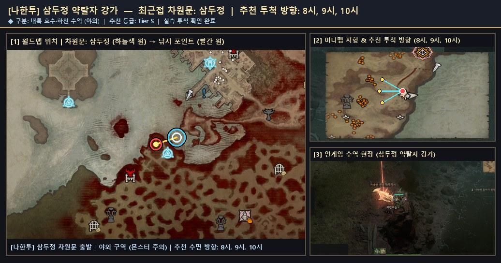

  - 원본 확대 보기: [🗺️ 월드맵 차원문 원본](./patches/나한투__삼두정_약탈자_강가__8-9-10h/worldmap.jpg) · [🧭 미니맵 방향 원본](./patches/나한투__삼두정_약탈자_강가__8-9-10h/minimap.jpg) · [🎬 인게임 현장 원본](./patches/나한투__삼두정_약탈자_강가__8-9-10h/scene.jpg)

### 6. [케지스탄] `달구르 오아시스 수역` (최근접 차원문: 강철늑대단 야영지)

- **유형 및 추천 등급**: **🏞️ 내륙 수역** · **Tier A**
- **안전 구역 구분**: ⚔️ 야외 구역 (주변 몬스터 출몰 주의)
- **추천 투척 시계 방향**: `5시, 6시, 7시`
- **실측 투척 확인 여부**: 확인 완료 (`2026-11-10` 기준)
- **차원문 접근 및 위치 안내**: 강철늑대단 야영지 차원문에서 남서쪽(7시 방향)으로 내려가 월드맵상 수평 물결 무늬가 그려진 청회록색 오아시스·석호 수변에서 투척합니다. 동쪽 사막 내륙의 밝은 베이지색 구불구불한 띠는 물이 없는 마른 모래 협곡 길이므로 혼동하지 마십시오.
- **주요 포획 기록**: **파란비늘**(24회), **은빛배**(16회), **자카라티**(12회), **소금지느러미**(8회), **아른치**(4회), **악마 자카라티**(4회), **어둠치**(4회), **작은 자카라티**(4회) 외 1종 (누적 78개)
- **🌟 포획 확인된 신화·고유 어종**: `반짝이는 환영 자카라티`
- **📍 종합 위치 안내도 (월드맵 차원문 · 미니맵 투척 각도 · 인게임 수역 현장)**:

  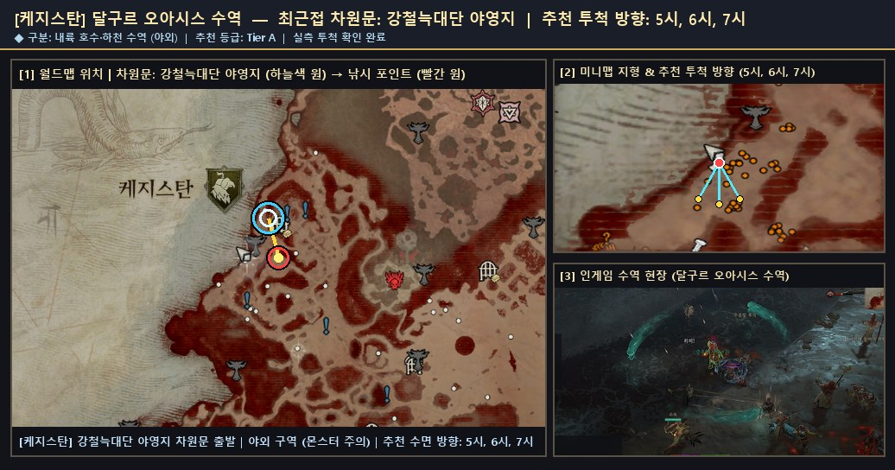

  - 원본 확대 보기: [🗺️ 월드맵 차원문 원본](./patches/케지스탄__달구르_오아시스_수역__5-6-7h/worldmap.jpg) · [🧭 미니맵 방향 원본](./patches/케지스탄__달구르_오아시스_수역__5-6-7h/minimap.jpg) · [🎬 인게임 현장 원본](./patches/케지스탄__달구르_오아시스_수역__5-6-7h/scene.jpg)

### 7. [하웨자르] `속삭임의 나무 늪지` (최근접 차원문: 속삭임의 나무)

- **유형 및 추천 등급**: **🏞️ 내륙 수역** · **Tier A** · ⭐ 인기 추천
- **안전 구역 구분**: ⚔️ 야외 구역 (주변 몬스터 출몰 주의)
- **추천 투척 시계 방향**: `2시, 3시, 4시`
- **실측 투척 확인 여부**: 확인 완료 (`2026-11-10` 기준)
- **차원문 접근 및 위치 안내**: 속삭임의 나무 차원문에서 동북동쪽(2~3시 방향) 늪지 길을 따라 내륙 호수의 낮은 남동쪽 물가 기슭으로 이동해 2~4시 방향으로 투척합니다. 주의: 호수 남서안(씁쓸한 길) 쪽은 수면보다 높은 바위 절벽이라 투척이 차단되므로 낮은 물가 발판을 이용하십시오.
- **주요 포획 기록**: **환영 갈고리고기**(92회), **반짝이는 갈고리고기**(66회), **작은 천공 갈고리고기**(20회)
- **🌟 포획 확인된 신화·고유 어종**: `작은 천공 갈고리고기`
- **📍 종합 위치 안내도 (월드맵 차원문 · 미니맵 투척 각도 · 인게임 수역 현장)**:

  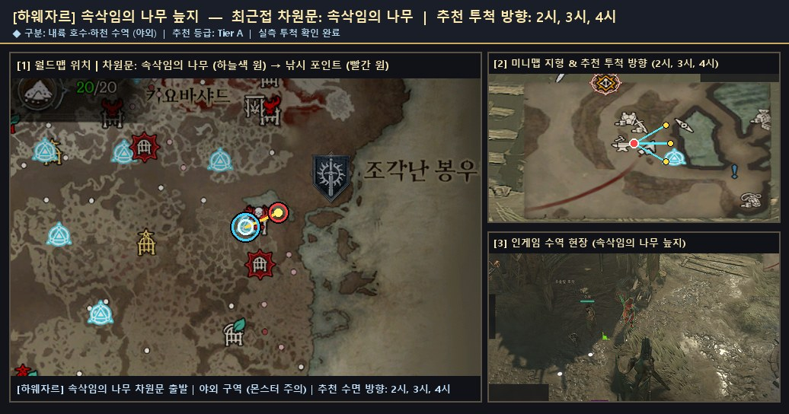

  - 원본 확대 보기: [🗺️ 월드맵 차원문 원본](./patches/하웨자르__속삭임의_나무_늪지__2-3-4h/worldmap.jpg) · [🧭 미니맵 방향 원본](./patches/하웨자르__속삭임의_나무_늪지__2-3-4h/minimap.jpg) · [🎬 인게임 현장 원본](./patches/하웨자르__속삭임의_나무_늪지__2-3-4h/scene.jpg)

### 8. [메마른 평원] `지란다이 남부 강변` (최근접 차원문: 지란다이)

- **유형 및 추천 등급**: **🏞️ 내륙 수역** · **Tier S** · ⭐ 인기 추천
- **안전 구역 구분**: ⚔️ 야외 구역 (주변 몬스터 출몰 주의)
- **추천 투척 시계 방향**: `5시, 6시, 7시`
- **실측 투척 확인 여부**: 확인 완료 (`2026-11-10` 기준)
- **차원문 접근 및 위치 안내**: 지란다이 차원문에서 남쪽(6시 방향) 성문 돌계단을 완전히 내려가 동서로 흐르는 내륙 강(두 다리 사이 북쪽 강기슭) 물가에서 5~7시 방향으로 투척합니다. 마을 내부 돌계단이나 비석 근처에서 멈추면 수역에 닿지 않으니 강변 모래톱까지 내려가십시오.
- **주요 포획 기록**: **시보의 징조**(856회), **천공 시보의 징조**(88회), **악마 시보의 징조**(78회), **거대한 천공 시보의 징조**(30회), **거대한 악마 시보의 징조**(20회), **작은 악마 시보의 징조**(20회)
- **🌟 포획 확인된 신화·고유 어종**: `작은 악마 시보의 징조`, `거대한 천공 시보의 징조`, `거대한 악마 시보의 징조`
- **📍 종합 위치 안내도 (월드맵 차원문 · 미니맵 투척 각도 · 인게임 수역 현장)**:

  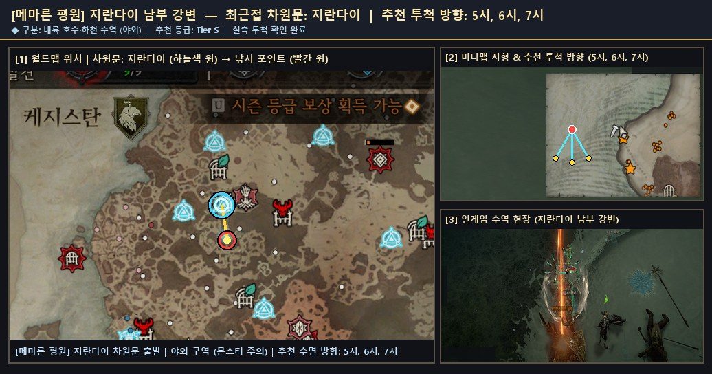

  - 원본 확대 보기: [🗺️ 월드맵 차원문 원본](./patches/메마른_평원__지란다이_남부_강변__5-6-7h/worldmap.jpg) · [🧭 미니맵 방향 원본](./patches/메마른_평원__지란다이_남부_강변__5-6-7h/minimap.jpg) · [🎬 인게임 현장 원본](./patches/메마른_평원__지란다이_남부_강변__5-6-7h/scene.jpg)

### 9. [스코스글렌] `티르마르 고원 호수` (최근접 차원문: 티르마르)

- **유형 및 추천 등급**: **🏞️ 내륙 수역** · **Tier A** · ⭐ 인기 추천
- **안전 구역 구분**: ⚔️ 야외 구역 (주변 몬스터 출몰 주의)
- **추천 투척 시계 방향**: `11시, 12시, 1시`
- **실측 투척 확인 여부**: 확인 완료 (`2026-11-10` 기준)
- **차원문 접근 및 위치 안내**: 티르마르 차원문에서 북쪽 숲길을 따라 고원 호수 남안으로 이동하거나, 통통한 거위 아래 여관 차원문에서 북동쪽(1~2시 방향) 청록색 내륙 만 남쪽 모래톱으로 이동해 11~1시 방향으로 투척합니다.
- **주요 포획 기록**: **천공 드라콘수염**(50회), **작은 드라콘수염**(46회), **아른치**(40회), **악마 드라콘수염**(40회), **파란비늘**(40회), **소금지느러미**(16회), **찢어진 그물**(12회), **작은 천공 드라콘수염**(10회) 외 7종 (누적 298개)
- **🌟 포획 확인된 신화·고유 어종**: `거대한 천공 드라콘수염`, `작은 천공 드라콘수염`, `반짝이는 환영 드라콘수염`, `거대한 환영 드라콘수염`
- **📍 종합 위치 안내도 (월드맵 차원문 · 미니맵 투척 각도 · 인게임 수역 현장)**:

  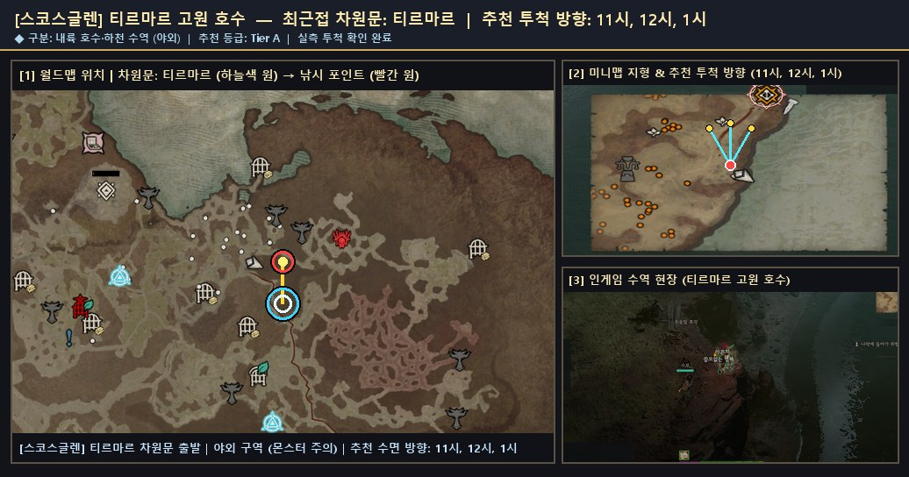

  - 원본 확대 보기: [🗺️ 월드맵 차원문 원본](./patches/스코스글렌__티르마르_고원_호수__11-12-1h/worldmap.jpg) · [🧭 미니맵 방향 원본](./patches/스코스글렌__티르마르_고원_호수__11-12-1h/minimap.jpg) · [🎬 인게임 현장 원본](./patches/스코스글렌__티르마르_고원_호수__11-12-1h/scene.jpg)

### 10. [조각난 봉우리] `메네스타드 북서 강변` (최근접 차원문: 메네스타드)

- **유형 및 추천 등급**: **🏞️ 내륙 수역** · **Tier S** · ⭐ 인기 추천
- **안전 구역 구분**: ⚔️ 야외 구역 (주변 몬스터 출몰 주의)
- **추천 투척 시계 방향**: `10시, 11시, 12시`
- **실측 투척 확인 여부**: 확인 완료 (`2026-11-10` 기준)
- **차원문 접근 및 위치 안내**: 메네스타드 차원문에서 북서쪽 성문 밖 설원 강기슭(10~12시 수면) 또는 동쪽(3시 방향) 사르코바 통로 다리 옆 얼음 계류 남안(12~2시 수면)으로 이동해 투척합니다. 조각난 봉우리에서 차원문 접근성이 가장 우수한 내륙 하천입니다.
- **주요 포획 기록**: **모라야가**(660회), **거대한 모라야가**(128회), **반짝이는 모라야가**(91회), **환영 모라야가**(64회), **악마 모라야가**(56회), **작은 환영 모라야가**(16회), **거대한 악마 모라야가**(14회), **파란비늘**(12회) 외 3종 (누적 1,063개)
- **🌟 포획 확인된 신화·고유 어종**: `작은 악마 모라야가`, `작은 환영 모라야가`, `거대한 악마 모라야가`
- **📍 종합 위치 안내도 (월드맵 차원문 · 미니맵 투척 각도 · 인게임 수역 현장)**:

  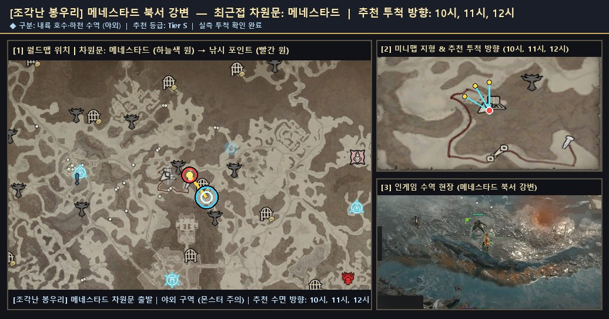

  - 원본 확대 보기: [🗺️ 월드맵 차원문 원본](./patches/조각난_봉우리__메네스타드_북서_강변__10-11-12h/worldmap.jpg) · [🧭 미니맵 방향 원본](./patches/조각난_봉우리__메네스타드_북서_강변__10-11-12h/minimap.jpg) · [🎬 인게임 현장 원본](./patches/조각난_봉우리__메네스타드_북서_강변__10-11-12h/scene.jpg)

### 11. [조각난 봉우리] `불길한 바람의 바위산` (최근접 차원문: 메네스타드)

- **유형 및 추천 등급**: **🏞️ 내륙 수역** · **Tier S** · ⭐ 인기 추천
- **안전 구역 구분**: ⚔️ 야외 구역 (주변 몬스터 출몰 주의)
- **추천 투척 시계 방향**: `2시, 3시, 4시`
- **실측 투척 확인 여부**: 확인 완료 (`2026-11-10` 기준)
- **차원문 접근 및 위치 안내**: 메네스타드 차원문에서 동북동쪽(2~3시 방향) 사르코바 통로 설원 길을 따라 이동해 내륙 강 서안 물가 발판에서 2~4시 방향으로 투척합니다. 고유 어종 '작은 천공 모라야가' 및 전설 '환영 모라야가' 실측 포획이 확인된 내륙 명소입니다.
- **주요 포획 기록**: **아른치**(2회), **모라야가**(1회), **소금지느러미**(1회), **작은 천공 모라야가**(1회), **파란비늘**(1회), **환영 모라야가**(1회)
- **🌟 포획 확인된 신화·고유 어종**: `작은 천공 모라야가`
- **📍 종합 위치 안내도 (월드맵 차원문 · 미니맵 투척 각도 · 인게임 수역 현장)**:

  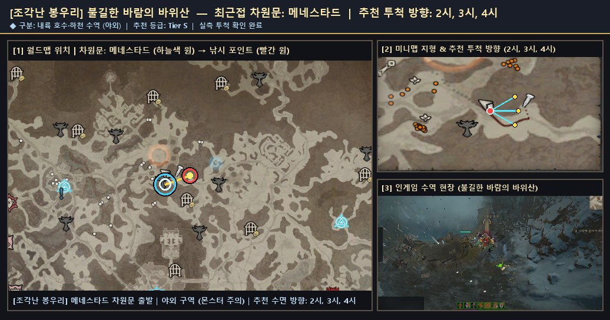

  - 원본 확대 보기: [🗺️ 월드맵 차원문 원본](./patches/조각난_봉우리__불길한_바람의_바위산__2-3-4h/worldmap.jpg) · [🧭 미니맵 방향 원본](./patches/조각난_봉우리__불길한_바람의_바위산__2-3-4h/minimap.jpg) · [🎬 인게임 현장 원본](./patches/조각난_봉우리__불길한_바람의_바위산__2-3-4h/scene.jpg)

### 12. [조각난 봉우리] `마르그레이브 얼어붙은 호수` (최근접 차원문: 마르그레이브)

- **유형 및 추천 등급**: **🏞️ 내륙 수역** · **Tier A** · ⭐ 인기 추천
- **안전 구역 구분**: ⚔️ 야외 구역 (주변 몬스터 출몰 주의)
- **추천 투척 시계 방향**: `6시, 7시, 8시`
- **실측 투척 확인 여부**: 확인 완료 (`2026-11-10` 기준)
- **차원문 접근 및 위치 안내**: 마르그레이브 또는 옐레스나 차원문에서 남남서쪽(7시 방향) 설원 계곡 통로를 따라 내려가면 얼어붙지 않은 어두운 내륙 호수 수면 북쪽 기슭과 만납니다. 6~8시 방향으로 투척하며 고유 모라야가 출현 기록이 풍부합니다.
- **주요 포획 기록**: **천공 모라야가**(68회), **작은 모라야가**(66회), **반짝이는 악마 모라야가**(24회), **반짝이는 환영 모라야가**(20회), **작은 천공 모라야가**(20회), **거대한 환영 모라야가**(14회), **거대한 천공 모라야가**(12회), **반짝이는 천공 모라야가**(12회)
- **🌟 포획 확인된 신화·고유 어종**: `반짝이는 악마 모라야가`, `거대한 천공 모라야가`, `반짝이는 천공 모라야가`, `반짝이는 환영 모라야가`, `작은 천공 모라야가`, `거대한 환영 모라야가`
- **📍 종합 위치 안내도 (월드맵 차원문 · 미니맵 투척 각도 · 인게임 수역 현장)**:

  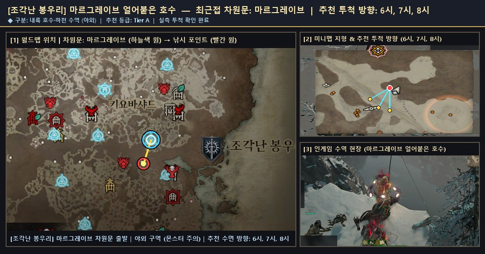

  - 원본 확대 보기: [🗺️ 월드맵 차원문 원본](./patches/조각난_봉우리__마르그레이브_얼어붙은_호수__6-7-8h/worldmap.jpg) · [🧭 미니맵 방향 원본](./patches/조각난_봉우리__마르그레이브_얼어붙은_호수__6-7-8h/minimap.jpg) · [🎬 인게임 현장 원본](./patches/조각난_봉우리__마르그레이브_얼어붙은_호수__6-7-8h/scene.jpg)
