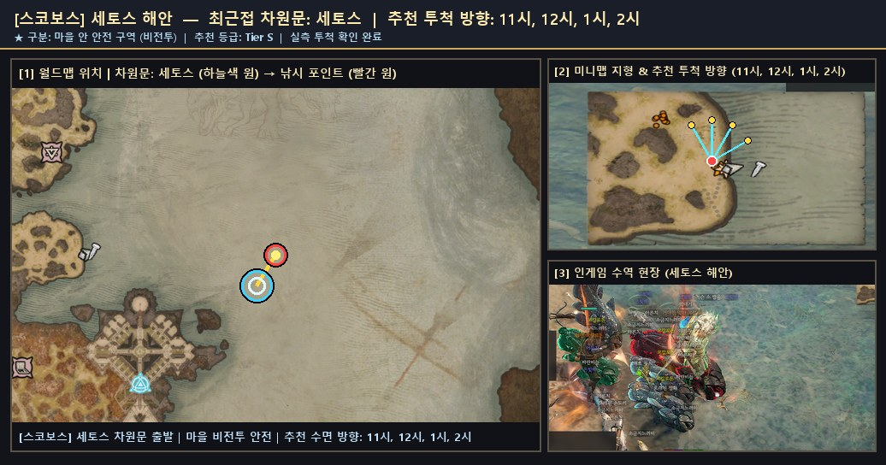
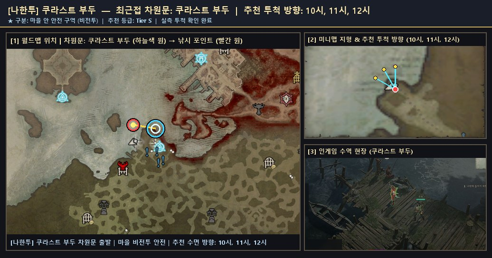
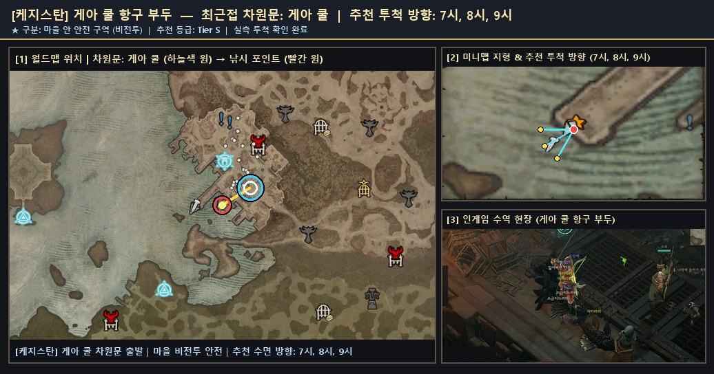
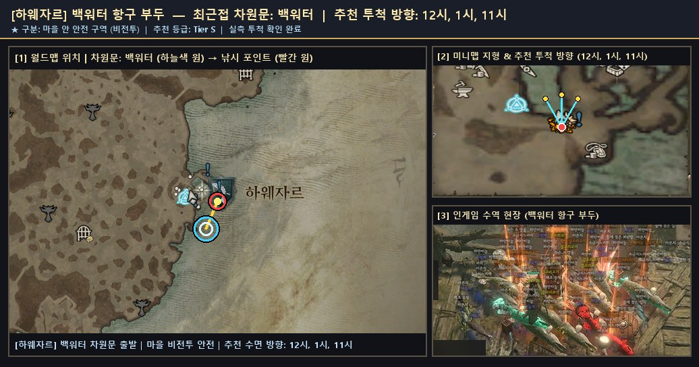

# 🏘️ 마을 안 비전투 안전 낚시터 전수 가이드

> 🌐 **빠른 검색 웹 플랫폼**: [**대화형 낚시터 · 어종 통합 검색 열기 (`낚시터검색.html`)**](https://kaljake70.github.io/d4helper/%EB%82%9A%EC%8B%9C%ED%84%B0/%EB%82%9A%EC%8B%9C%ED%84%B0%EA%B2%80%EC%83%89.html)  
> 📚 **테마별 가이드**: [🏠 전체 허브](./README.md) · [⭐ 인기 추천](./인기_추천_낚시터.md) · [🏘️ 마을 안전](./마을_안전_낚시터.md) · [🏞️ 내륙 호수·강](./내륙_호수_강_낚시터.md) · [🌋 특수·용암](./특수_이색_낚시터.md) · [🐟 전체 어종 도감](./어종_도감.md)  
> 🗺️ **8대 권역**: [스코보스](./스코보스.md) · [나한투](./나한투.md) · [케지스탄](./케지스탄.md) · [하웨자르](./하웨자르.md) · [메마른 평원](./메마른_평원.md) · [스코스글렌](./스코스글렌.md) · [조각난 봉우리](./조각난_봉우리.md) · [용암 웅덩이](./용암_웅덩이.md)

몬스터 출몰이나 피격 위험이 전혀 없는 **마을 내부 비전투 안전 구역(`in_town = true`)** 낚시터 전수 가이드입니다. 전투 스킬바가 비활성화된 상태에서도 수면 경계와 맞닿은 부두·해변 끝단에서는 낚싯줄 투척이 가능합니다.

## ⚠️ 부두별 투척 가능 위치 vs 장식용 비수면 잔교 구분 팁 (필독)

마을 항구라고 해서 모든 나무 다리나 해안 성벽에서 낚싯줄이 나가는 것은 아닙니다. 현장 실측으로 확인된 아래 구분 기준을 참고하시면 시행착오 없이 한 번에 자리 잡으실 수 있습니다.

| 마을 거점 | ✅ 실제 투척 가능 위치 (수역 판정 있음) | ❌ 투척 불가 주의 위치 (비수면 / 고도 차 차단) |
|:--|:--|:--|
| **나한투 · 쿠라스트 부두** | 차원문 **남서쪽(7시 방향) 큰 직사각형 석조 부두 끝단** (`10~12시` 대하천 수면) | 차원문 **북서쪽 작은 나무 잔교** (배경 NPC만 서 있는 얕은 진흙 여울이라 `'근처에 낚시할 수 있는 수역이 없습니다.'` 출력) |
| **케지스탄 · 게아 쿨** | 차원문 **서남쪽 계단 아래 철제 격자·석조 부두 끝단** (`7~9시` 항만 수면) | 상점가 위쪽 높은 성벽 난간 (수면과의 높이 단차로 시야 차단) |
| **하웨자르 · 백워터** | 차원문 **북동쪽 코앞(도보 3초) 목재 부두 끝단** (`11~1시` 북쪽 석호 수면) | 마을 서쪽 내륙 울타리 근처 얕은 웅덩이 (낚시 수역 폴리곤 없음) |
| **스코보스 · 세토스** | 차원문 **동쪽·북동쪽 상인 구역 옆 낮은 모래사장 해변** (`11~2시` 바다 수면) | 참고: 같은 스코보스의 **테미스**·**필레노스** 성벽 내부는 수면과 단차가 있어 성문 다리 밖으로 나가야 투척됩니다. |

---

## 📍 마을 안 안전 낚시터 상세 안내 및 위치 스크린샷

### 1. [스코보스] `세토스 해안` (최근접 차원문: 세토스)

- **유형 및 추천 등급**: **🏘️ 마을 안전** · **Tier S** · ⭐ 인기 추천
- **안전 구역 구분**: 🏘️ 마을 안 안전 구역 (비전투 · 몬스터 출몰 없음)
- **추천 투척 시계 방향**: `11시, 12시, 1시, 2시`
- **실측 투척 확인 여부**: 확인 완료 (`2026-11-10` 기준)
- **차원문 접근 및 위치 안내**: 세토스 차원문 도착 후 동쪽·북동쪽(1~2시 방향) 모래사장 물가로 이동합니다. 상인 NPC가 모여 있는 정착지 경계 안쪽 해변에서 바로 11~2시 넓은 수면으로 투척할 수 있어 몬스터 방해 없이 쾌적하게 코칼로돈을 낚을 수 있습니다.
- **주요 포획 기록**: **코칼로돈**(1788회), **악마 코칼로돈**(194회), **거대한 환영 코칼로돈**(26회), **반짝이는 코칼로돈**(4회), **거대한 코칼로돈**(2회), **천공 코칼로돈**(1회), **환영 코칼로돈**(1회)
- **🌟 포획 확인된 신화·고유 어종**: `거대한 환영 코칼로돈`
- **📍 종합 위치 안내도 (월드맵 차원문 · 미니맵 투척 각도 · 인게임 수역 현장)**:

  

  - 원본 확대 보기: [🗺️ 월드맵 차원문 원본](./patches/스코보스__세토스_해안__11-12-1h/worldmap.jpg) · [🧭 미니맵 방향 원본](./patches/스코보스__세토스_해안__11-12-1h/minimap.jpg) · [🎬 인게임 현장 원본](./patches/스코보스__세토스_해안__11-12-1h/scene.jpg)

### 2. [나한투] `쿠라스트 부두` (최근접 차원문: 쿠라스트 부두)

- **유형 및 추천 등급**: **🏘️ 마을 안전** · **Tier S** · ⭐ 인기 추천
- **안전 구역 구분**: 🏘️ 마을 안 안전 구역 (비전투 · 몬스터 출몰 없음)
- **추천 투척 시계 방향**: `10시, 11시, 12시`
- **실측 투척 확인 여부**: 확인 완료 (`2026-11-10` 기준)
- **차원문 접근 및 위치 안내**: 쿠라스트 부두 차원문에서 남서쪽(7시 방향) 직사각형 주 석조 부두 끝단으로 도보 15초 이동한 뒤 10~12시 대하천 수면으로 투척합니다. 주의: 북서쪽의 작은 나무 잔교는 장식용 진흙 여울이라 낚시 수역 판정이 없으니 반드시 남서쪽 큰 석조 부두로 가십시오.
- **주요 포획 기록**: **아른치**(1회), **은빛배**(1회), **천공 네메셍가**(1회), **파란비늘**(1회), **환영 네메셍가**(1회)
- **📍 종합 위치 안내도 (월드맵 차원문 · 미니맵 투척 각도 · 인게임 수역 현장)**:

  

  - 원본 확대 보기: [🗺️ 월드맵 차원문 원본](./patches/나한투__쿠라스트_부두__10-11-12h/worldmap.jpg) · [🧭 미니맵 방향 원본](./patches/나한투__쿠라스트_부두__10-11-12h/minimap.jpg) · [🎬 인게임 현장 원본](./patches/나한투__쿠라스트_부두__10-11-12h/scene.jpg)

### 3. [케지스탄] `게아 쿨 항구 부두` (최근접 차원문: 게아 쿨)

- **유형 및 추천 등급**: **🏘️ 마을 안전** · **Tier S** · ⭐ 인기 추천
- **안전 구역 구분**: 🏘️ 마을 안 안전 구역 (비전투 · 몬스터 출몰 없음)
- **추천 투척 시계 방향**: `7시, 8시, 9시`
- **실측 투척 확인 여부**: 확인 완료 (`2026-11-10` 기준)
- **차원문 접근 및 위치 안내**: 게아 쿨 차원문에서 서남쪽 항구 계단을 내려가 마을 내부 철제 격자·석조 부두 끝단에서 7~9시 바다 수면으로 투척합니다. 전투 스킬이 비활성화되는 완벽한 마을 안전 구역이며 상점·대장간과도 인접해 있습니다.
- **주요 포획 기록**: **소금지느러미**(78회), **파란비늘**(72회), **자카라티**(54회), **아른치**(50회), **은빛배**(41회), **어둠치**(24회), **거대한 자카라티**(10회), **천공 자카라티**(9회) 외 29종 (누적 413개)
- **🌟 포획 확인된 신화·고유 어종**: `작은 천공 자카라티`, `반짝이는 천공 코칼로돈`, `작은 환영 자카라티`, `반짝이는 환영 자카라티`, `작은 악마 자카라티`, `거대한 천공 자카라티`, `거대한 악마 자카라티`
- **📍 종합 위치 안내도 (월드맵 차원문 · 미니맵 투척 각도 · 인게임 수역 현장)**:

  

  - 원본 확대 보기: [🗺️ 월드맵 차원문 원본](./patches/케지스탄__게아_쿨_항구_부두__7-8-9h/worldmap.jpg) · [🧭 미니맵 방향 원본](./patches/케지스탄__게아_쿨_항구_부두__7-8-9h/minimap.jpg) · [🎬 인게임 현장 원본](./patches/케지스탄__게아_쿨_항구_부두__7-8-9h/scene.jpg)

### 4. [하웨자르] `백워터 항구 부두` (최근접 차원문: 백워터)

- **유형 및 추천 등급**: **🏘️ 마을 안전** · **Tier S** · ⭐ 인기 추천
- **안전 구역 구분**: 🏘️ 마을 안 안전 구역 (비전투 · 몬스터 출몰 없음)
- **추천 투척 시계 방향**: `12시, 1시, 11시`
- **실측 투척 확인 여부**: 확인 완료 (`2026-11-10` 기준)
- **차원문 접근 및 위치 안내**: 백워터 차원문 도착 후 바로 북동쪽(1~2시 방향) 마을 안 나무 잔교 끝단으로 몇 걸음만 이동해 11~1시 북쪽 석호 수면으로 투척합니다. 차원문에서 가장 가까운 마을 안 비전투 안전 포인트 중 하나입니다.
- **주요 포획 기록**: **갈고리고기**(24회), **파란비늘**(15회), **아른치**(12회), **소금지느러미**(10회), **환영 갈고리고기**(6회), **반짝이는 갈고리고기**(2회), **작은 천공 갈고리고기**(2회)
- **🌟 포획 확인된 신화·고유 어종**: `작은 천공 갈고리고기`
- **📍 종합 위치 안내도 (월드맵 차원문 · 미니맵 투척 각도 · 인게임 수역 현장)**:

  

  - 원본 확대 보기: [🗺️ 월드맵 차원문 원본](./patches/하웨자르__백워터_항구_부두__12-1-11h/worldmap.jpg) · [🧭 미니맵 방향 원본](./patches/하웨자르__백워터_항구_부두__12-1-11h/minimap.jpg) · [🎬 인게임 현장 원본](./patches/하웨자르__백워터_항구_부두__12-1-11h/scene.jpg)
