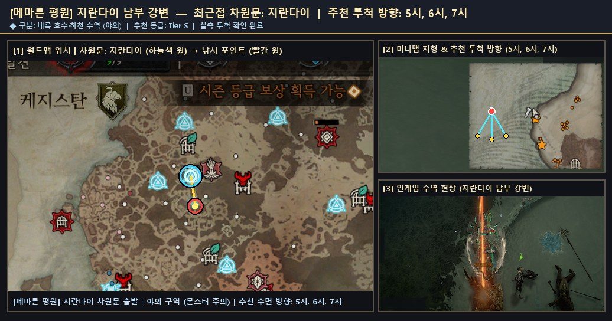
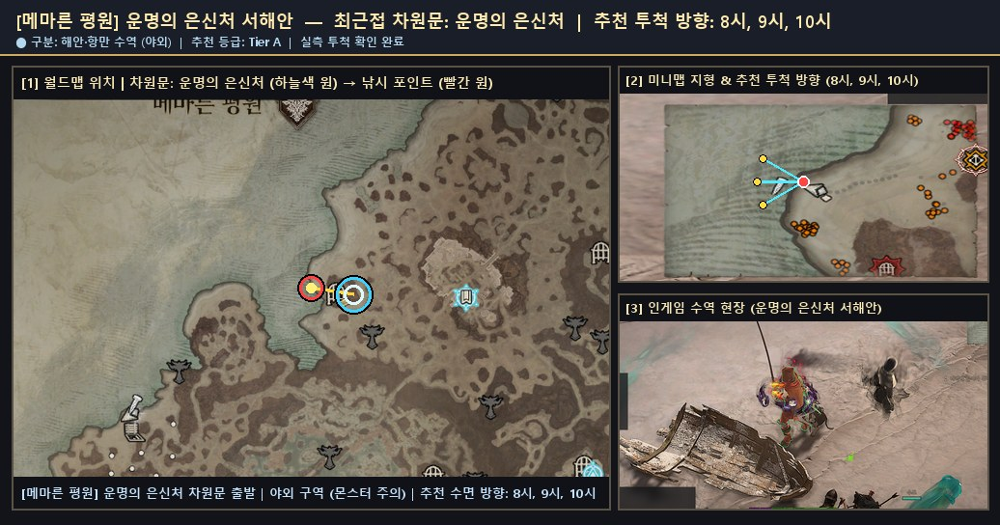
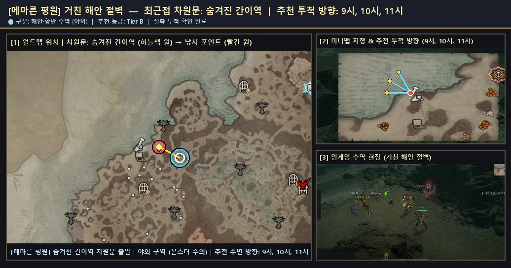

# 🗺️ 메마른 평원 — 검증 낚시터 위치 가이드 및 서식 어종 도감

> 🌐 **빠른 검색 웹 플랫폼**: [**대화형 낚시터 · 어종 통합 검색 열기 (`낚시터검색.html`)**](https://kaljake70.github.io/d4helper/%EB%82%9A%EC%8B%9C%ED%84%B0/%EB%82%9A%EC%8B%9C%ED%84%B0%EA%B2%80%EC%83%89.html)  
> 📚 **테마별 가이드**: [🏠 전체 허브](./README.md) · [⭐ 인기 추천](./인기_추천_낚시터.md) · [🏘️ 마을 안전](./마을_안전_낚시터.md) · [🏞️ 내륙 호수·강](./내륙_호수_강_낚시터.md) · [🌋 특수·용암](./특수_이색_낚시터.md) · [🐟 전체 어종 도감](./어종_도감.md)  
> 🗺️ **8대 권역**: [스코보스](./스코보스.md) · [나한투](./나한투.md) · [케지스탄](./케지스탄.md) · [하웨자르](./하웨자르.md) · [메마른 평원](./메마른_평원.md) · [스코스글렌](./스코스글렌.md) · [조각난 봉우리](./조각난_봉우리.md) · [용암 웅덩이](./용암_웅덩이.md)

- **권역명**: **메마른 평원**
- **실측 검증 낚시터**: **3곳** (마을 비전투 안전 **0곳** 포함)
- **권역 전용 서식 어종**: **16종** (+ 성역 전역 공통 어종 5종 출현)
- **누적 어획 표본**: **1,496개**

---

## 1. 메마른 평원 낚시 포인트 한눈 요약

| # | 유형 | 등급 | 세부 지역 | 최근접 차원문 | 안전 여부 | 추천 투척 방향 | 주요 포획 어종 |
|:--:|:--:|:--:|:--|:--|:--:|:--:|:--|
| 1 | 🏞️ 내륙 수역 | **S** | `지란다이 남부 강변` | 지란다이 | ⚔️ 야외 주의 | `5시, 6시, 7시` | 시보의 징조(856), 천공 시보의 징조(88), 악마 시보의 징조(78) |
| 2 | 🌊 해안·항만 | **A** | `운명의 은신처 서해안` | 운명의 은신처 | ⚔️ 야외 주의 | `8시, 9시, 10시` | 환영 시보의 징조(96), 반짝이는 시보의 징조(84), 거대한 시보의 징조(80) |
| 3 | 🌊 해안·항만 | **B** | `거친 해안 절벽` | 숨겨진 간이역 | ⚔️ 야외 주의 | `9시, 10시, 11시` | 작은 시보의 징조(64), 반짝이는 악마 시보의 징조(12), 반짝이는 환영 시보의 징조(12) |

---

## 2. 메마른 평원 세부 낚시 포인트 위치 안내 및 현장 스크린샷

### 1. `지란다이 남부 강변` (최근접 차원문: 지란다이)

- **유형 및 추천 등급**: **🏞️ 내륙 수역** · **Tier S** · ⭐ 인기 추천
- **안전 구역 구분**: ⚔️ 야외 구역 (주변 몬스터 출몰 주의)
- **추천 투척 시계 방향**: `5시, 6시, 7시`
- **실측 투척 확인 여부**: 확인 완료 (`2026-11-10` 기준)
- **차원문 접근 및 위치 안내**: 지란다이 차원문에서 남쪽(6시 방향) 성문 돌계단을 완전히 내려가 동서로 흐르는 내륙 강(두 다리 사이 북쪽 강기슭) 물가에서 5~7시 방향으로 투척합니다. 마을 내부 돌계단이나 비석 근처에서 멈추면 수역에 닿지 않으니 강변 모래톱까지 내려가십시오.
- **주요 포획 기록**: **시보의 징조**(856회), **천공 시보의 징조**(88회), **악마 시보의 징조**(78회), **거대한 천공 시보의 징조**(30회), **거대한 악마 시보의 징조**(20회), **작은 악마 시보의 징조**(20회)
- **🌟 포획 확인된 신화·고유 어종**: `작은 악마 시보의 징조`, `거대한 천공 시보의 징조`, `거대한 악마 시보의 징조`
- **📍 종합 위치 안내도 (월드맵 차원문 · 미니맵 투척 각도 · 인게임 수역 현장)**:

  

  - 원본 확대 보기: [🗺️ 월드맵 차원문 원본](./patches/메마른_평원__지란다이_남부_강변__5-6-7h/worldmap.jpg) · [🧭 미니맵 방향 원본](./patches/메마른_평원__지란다이_남부_강변__5-6-7h/minimap.jpg) · [🎬 인게임 현장 원본](./patches/메마른_평원__지란다이_남부_강변__5-6-7h/scene.jpg)

### 2. `운명의 은신처 서해안` (최근접 차원문: 운명의 은신처)

- **유형 및 추천 등급**: **🌊 해안·항만** · **Tier A** · ⭐ 인기 추천
- **안전 구역 구분**: ⚔️ 야외 구역 (주변 몬스터 출몰 주의)
- **추천 투척 시계 방향**: `8시, 9시, 10시`
- **실측 투척 확인 여부**: 확인 완료 (`2026-11-10` 기준)
- **차원문 접근 및 위치 안내**: 운명의 은신처(또는 케드바르두) 차원문에서 서쪽(9시 방향) 해안 만 안쪽 모래변으로 이동해 8~10시 바다 수면으로 투척합니다. 전설·고유 등급 시보의 징조 어획 비중이 높은 포인트입니다.
- **주요 포획 기록**: **환영 시보의 징조**(96회), **반짝이는 시보의 징조**(84회), **거대한 시보의 징조**(80회), **거대한 환영 시보의 징조**(20회), **반짝이는 천공 시보의 징조**(16회), **작은 천공 시보의 징조**(16회)
- **🌟 포획 확인된 신화·고유 어종**: `거대한 환영 시보의 징조`, `반짝이는 천공 시보의 징조`, `작은 천공 시보의 징조`
- **📍 종합 위치 안내도 (월드맵 차원문 · 미니맵 투척 각도 · 인게임 수역 현장)**:

  

  - 원본 확대 보기: [🗺️ 월드맵 차원문 원본](./patches/메마른_평원__운명의_은신처_서해안__8-9-10h/worldmap.jpg) · [🧭 미니맵 방향 원본](./patches/메마른_평원__운명의_은신처_서해안__8-9-10h/minimap.jpg) · [🎬 인게임 현장 원본](./patches/메마른_평원__운명의_은신처_서해안__8-9-10h/scene.jpg)

### 3. `거친 해안 절벽` (최근접 차원문: 숨겨진 간이역)

- **유형 및 추천 등급**: **🌊 해안·항만** · **Tier B**
- **안전 구역 구분**: ⚔️ 야외 구역 (주변 몬스터 출몰 주의)
- **추천 투척 시계 방향**: `9시, 10시, 11시`
- **실측 투척 확인 여부**: 확인 완료 (`2026-11-10` 기준)
- **차원문 접근 및 위치 안내**: 숨겨진 간이역 차원문에서 서북서쪽(9~10시 방향) 해안가로 내려가 절벽 위가 아닌 파도가 닿는 낮은 모래 해변에서 9~11시 수면으로 투척합니다.
- **주요 포획 기록**: **작은 시보의 징조**(64회), **반짝이는 악마 시보의 징조**(12회), **반짝이는 환영 시보의 징조**(12회), **작은 환영 시보의 징조**(4회)
- **🌟 포획 확인된 신화·고유 어종**: `반짝이는 악마 시보의 징조`, `반짝이는 환영 시보의 징조`, `작은 환영 시보의 징조`
- **📍 종합 위치 안내도 (월드맵 차원문 · 미니맵 투척 각도 · 인게임 수역 현장)**:

  

  - 원본 확대 보기: [🗺️ 월드맵 차원문 원본](./patches/메마른_평원__거친_해안_절벽__9-10-11h/worldmap.jpg) · [🧭 미니맵 방향 원본](./patches/메마른_평원__거친_해안_절벽__9-10-11h/minimap.jpg) · [🎬 인게임 현장 원본](./patches/메마른_평원__거친_해안_절벽__9-10-11h/scene.jpg)

---

## 3. 메마른 평원 서식 도감 어종 목록 (16종)

| 등급 | 물고기 이름 (한글) | 영문명 | 세부 서식지 | 도감 설명 |
|:--:|:--|:--|:--|:--|
| 🟤 고유 | **거대한 악마 시보의 징조** | `Giant Demonic Augur of Civo` | 메마른 평원 | 메마른 평원에 서식하는 고유 물고기입니다. 현지 야만용사들에게 "도끼머리"라고 불리는 시보의 징조는 예로부터 메마른 평원을 지켜보는 수호자로 여겨졌으며, 시보 산이 흔들리기 시작해야만 수면으로 올라온다고 합니다. |
| 🟤 고유 | **거대한 천공 시보의 징조** | `Giant Celestial Augur of Civo` | 메마른 평원 | 메마른 평원에 서식하는 고유 물고기입니다. 현지 야만용사들에게 "도끼머리"라고 불리는 시보의 징조는 예로부터 메마른 평원을 지켜보는 수호자로 여겨졌으며, 시보 산이 흔들리기 시작해야만 수면으로 올라온다고 합니다. |
| 🟤 고유 | **거대한 환영 시보의 징조** | `Giant Spectral Augur of Civo` | 메마른 평원 | 메마른 평원에 서식하는 고유 물고기입니다. 현지 야만용사들에게 "도끼머리"라고 불리는 시보의 징조는 예로부터 메마른 평원을 지켜보는 수호자로 여겨졌으며, 시보 산이 흔들리기 시작해야만 수면으로 올라온다고 합니다. |
| 🟤 고유 | **반짝이는 악마 시보의 징조** | `Glittering Demonic Augur of Civo` | 메마른 평원 | 메마른 평원에 서식하는 고유 물고기입니다. 현지 야만용사들에게 "도끼머리"라고 불리는 시보의 징조는 예로부터 메마른 평원을 지켜보는 수호자로 여겨졌으며, 시보 산이 흔들리기 시작해야만 수면으로 올라온다고 합니다. |
| 🟤 고유 | **반짝이는 천공 시보의 징조** | `Glittering Celestial Augur of Civo` | 메마른 평원 | 메마른 평원에 서식하는 고유 물고기입니다. 현지 야만용사들에게 "도끼머리"라고 불리는 시보의 징조는 예로부터 메마른 평원을 지켜보는 수호자로 여겨졌으며, 시보 산이 흔들리기 시작해야만 수면으로 올라온다고 합니다. |
| 🟤 고유 | **반짝이는 환영 시보의 징조** | `Glittering Spectral Augur of Civo` | 메마른 평원 | 메마른 평원에 서식하는 고유 물고기입니다. 현지 야만용사들에게 "도끼머리"라고 불리는 시보의 징조는 예로부터 메마른 평원을 지켜보는 수호자로 여겨졌으며, 시보 산이 흔들리기 시작해야만 수면으로 올라온다고 합니다. |
| 🟤 고유 | **작은 악마 시보의 징조** | `Tiny Demonic Augur of Civo` | 메마른 평원 | 메마른 평원에 서식하는 고유 물고기입니다. 현지 야만용사들에게 "도끼머리"라고 불리는 시보의 징조는 예로부터 메마른 평원을 지켜보는 수호자로 여겨졌으며, 시보 산이 흔들리기 시작해야만 수면으로 올라온다고 합니다. |
| 🟤 고유 | **작은 천공 시보의 징조** | `Tiny Celestial Augur of Civo` | 메마른 평원 | 메마른 평원에 서식하는 고유 물고기입니다. 현지 야만용사들에게 "도끼머리"라고 불리는 시보의 징조는 예로부터 메마른 평원을 지켜보는 수호자로 여겨졌으며, 시보 산이 흔들리기 시작해야만 수면으로 올라온다고 합니다. |
| 🟤 고유 | **작은 환영 시보의 징조** | `Tiny Spectral Augur of Civo` | 메마른 평원 | 메마른 평원에 서식하는 고유 물고기입니다. 현지 야만용사들에게 "도끼머리"라고 불리는 시보의 징조는 예로부터 메마른 평원을 지켜보는 수호자로 여겨졌으며, 시보 산이 흔들리기 시작해야만 수면으로 올라온다고 합니다. |
| 🟠 전설 | **거대한 시보의 징조** | `Giant Augur of Civo` | 메마른 평원 | 메마른 평원에 서식하는 전설 물고기입니다. 현지 야만용사들에게 "도끼머리"라고 불리는 시보의 징조는 예로부터 메마른 평원을 지켜보는 수호자로 여겨졌으며, 시보 산이 흔들리기 시작해야만 수면으로 올라온다고 합니다. |
| 🟠 전설 | **반짝이는 시보의 징조** | `Glittering Augur of Civo` | 메마른 평원 | 메마른 평원에 서식하는 전설 물고기입니다. 현지 야만용사들에게 "도끼머리"라고 불리는 시보의 징조는 예로부터 메마른 평원을 지켜보는 수호자로 여겨졌으며, 시보 산이 흔들리기 시작해야만 수면으로 올라온다고 합니다. |
| 🟠 전설 | **악마 시보의 징조** | `Demonic Augur of Civo` | 메마른 평원 | 메마른 평원에 서식하는 전설 물고기입니다. 현지 야만용사들에게 "도끼머리"라고 불리는 시보의 징조는 예로부터 메마른 평원을 지켜보는 수호자로 여겨졌으며, 시보 산이 흔들리기 시작해야만 수면으로 올라온다고 합니다. |
| 🟠 전설 | **작은 시보의 징조** | `Tiny Augur of Civo` | 메마른 평원 | 메마른 평원에 서식하는 전설 물고기입니다. 현지 야만용사들에게 "도끼머리"라고 불리는 시보의 징조는 예로부터 메마른 평원을 지켜보는 수호자로 여겨졌으며, 시보 산이 흔들리기 시작해야만 수면으로 올라온다고 합니다. |
| 🟠 전설 | **천공 시보의 징조** | `Celestial Augur of Civo` | 메마른 평원 | 메마른 평원에 서식하는 전설 물고기입니다. 현지 야만용사들에게 "도끼머리"라고 불리는 시보의 징조는 예로부터 메마른 평원을 지켜보는 수호자로 여겨졌으며, 시보 산이 흔들리기 시작해야만 수면으로 올라온다고 합니다. |
| 🟠 전설 | **환영 시보의 징조** | `Spectral Augur of Civo` | 메마른 평원 | 메마른 평원에 서식하는 전설 물고기입니다. 현지 야만용사들에게 "도끼머리"라고 불리는 시보의 징조는 예로부터 메마른 평원을 지켜보는 수호자로 여겨졌으며, 시보 산이 흔들리기 시작해야만 수면으로 올라온다고 합니다. |
| 🟡 희귀 | **시보의 징조** | `Augur of Civo` | 메마른 평원 | 메마른 평원에 서식하는 희귀 물고기입니다. 현지 야만용사들에게 "도끼머리"라고 불리는 시보의 징조는 예로부터 메마른 평원을 지켜보는 수호자로 여겨졌으며, 시보 산이 흔들리기 시작해야만 수면으로 올라온다고 합니다. |
