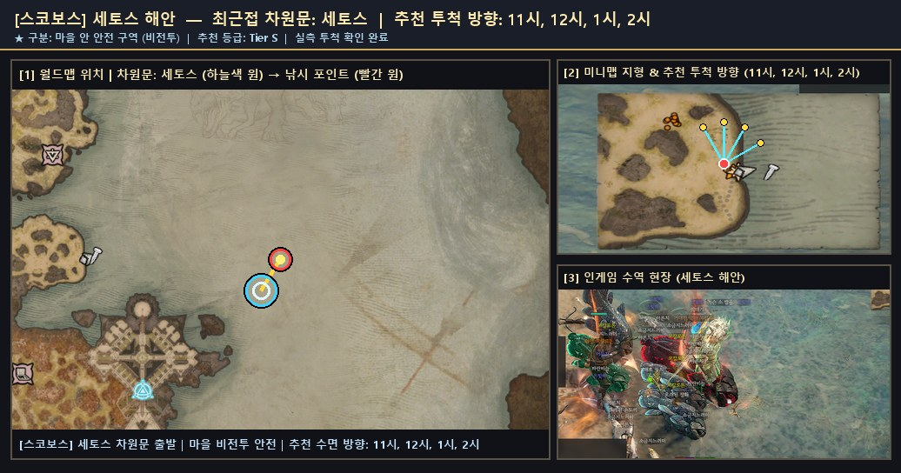
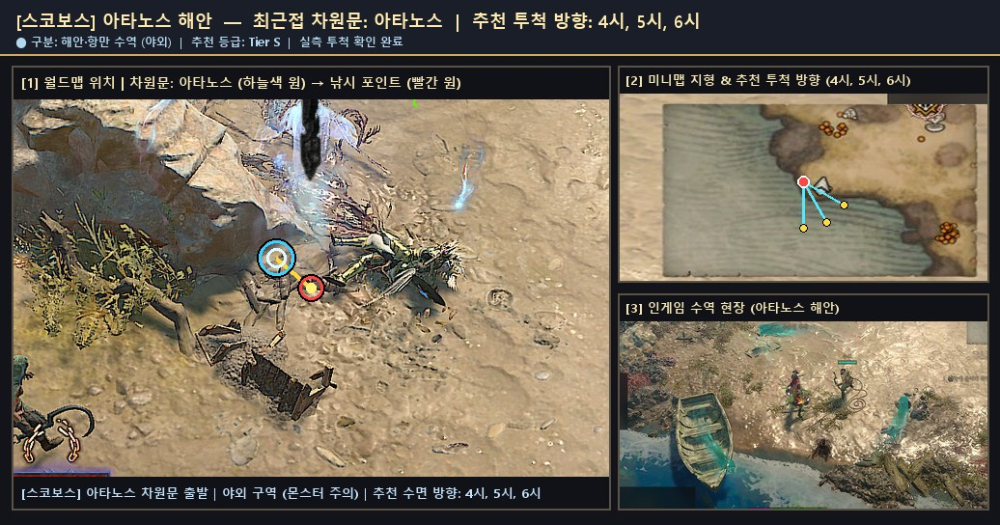
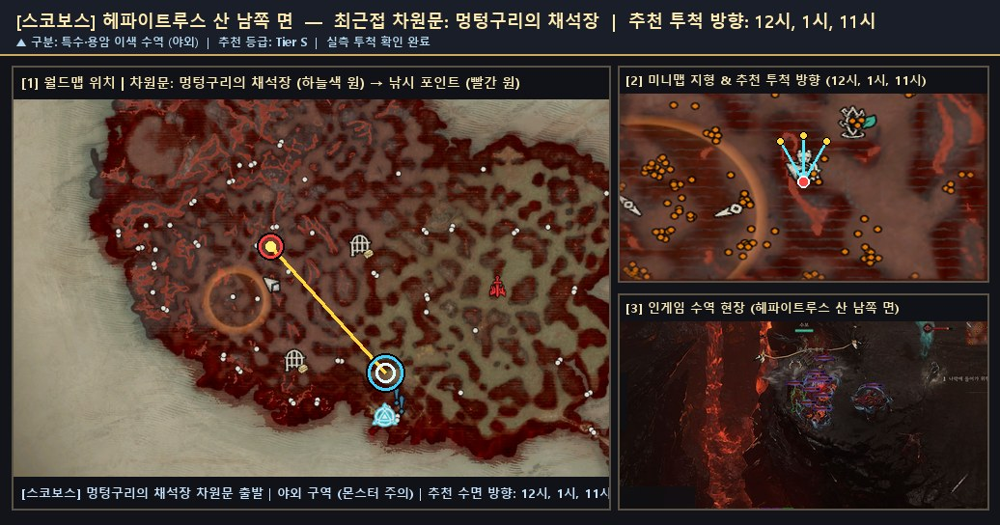
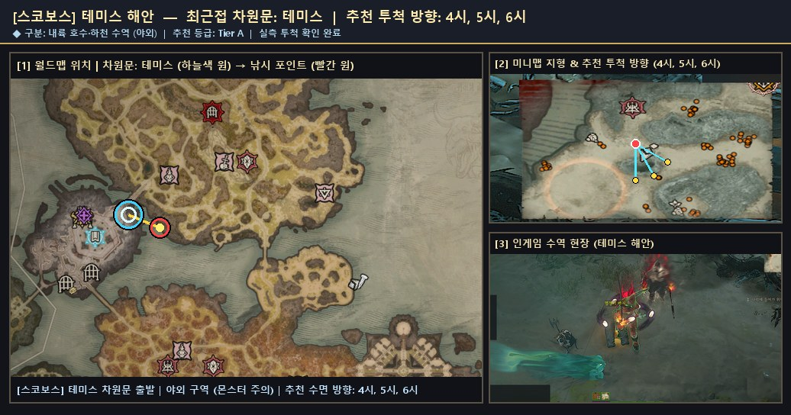
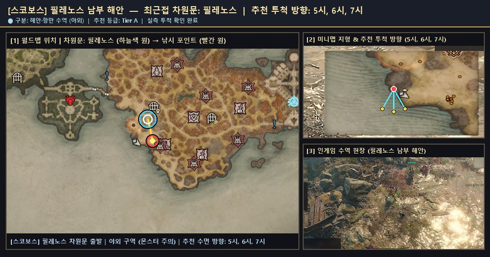

# 🗺️ 스코보스 — 검증 낚시터 위치 가이드 및 서식 어종 도감

> 🌐 **빠른 검색 웹 플랫폼**: [**대화형 낚시터 · 어종 통합 검색 열기 (`낚시터검색.html`)**](https://kaljake70.github.io/d4helper/%EB%82%9A%EC%8B%9C%ED%84%B0/%EB%82%9A%EC%8B%9C%ED%84%B0%EA%B2%80%EC%83%89.html)  
> 📚 **테마별 가이드**: [🏠 전체 허브](./README.md) · [⭐ 인기 추천](./인기_추천_낚시터.md) · [🏘️ 마을 안전](./마을_안전_낚시터.md) · [🏞️ 내륙 호수·강](./내륙_호수_강_낚시터.md) · [🌋 특수·용암](./특수_이색_낚시터.md) · [🐟 전체 어종 도감](./어종_도감.md)  
> 🗺️ **8대 권역**: [스코보스](./스코보스.md) · [나한투](./나한투.md) · [케지스탄](./케지스탄.md) · [하웨자르](./하웨자르.md) · [메마른 평원](./메마른_평원.md) · [스코스글렌](./스코스글렌.md) · [조각난 봉우리](./조각난_봉우리.md) · [용암 웅덩이](./용암_웅덩이.md)

- **권역명**: **스코보스**
- **실측 검증 낚시터**: **5곳** (마을 비전투 안전 **1곳** 포함)
- **권역 전용 서식 어종**: **16종** (+ 성역 전역 공통 어종 5종 출현)
- **누적 어획 표본**: **3,198개**

---

## 1. 스코보스 낚시 포인트 한눈 요약

| # | 유형 | 등급 | 세부 지역 | 최근접 차원문 | 안전 여부 | 추천 투척 방향 | 주요 포획 어종 |
|:--:|:--:|:--:|:--|:--|:--:|:--:|:--|
| 1 | 🏘️ 마을 안전 | **S** | `세토스 해안` | 세토스 | 🏘️ 마을 안전 | `11시, 12시, 1시, 2시` | 코칼로돈(1788), 악마 코칼로돈(194), 거대한 환영 코칼로돈(26) |
| 2 | 🌊 해안·항만 | **S** | `아타노스 해안` | 아타노스 | ⚔️ 야외 주의 | `4시, 5시, 6시` | 거대한 코칼로돈(226), 반짝이는 코칼로돈(164), 반짝이는 악마 코칼로돈(30) |
| 3 | 🌋 특수·용암 | **S** | `헤파이트루스 산 남쪽 면` | 멍텅구리의 채석장 | ⚔️ 야외 주의 | `12시, 1시, 11시` | 코칼로돈(2) |
| 4 | 🏞️ 내륙 수역 | **A** | `테미스 해안` | 테미스 | ⚔️ 야외 주의 | `4시, 5시, 6시` | 천공 코칼로돈(202), 환영 코칼로돈(162), 작은 코칼로돈(132) |
| 5 | 🌊 해안·항만 | **A** | `필레노스 남부 해안` | 필레노스 | ⚔️ 야외 주의 | `5시, 6시, 7시` | 작은 천공 코칼로돈(32), 거대한 악마 코칼로돈(28), 반짝이는 환영 코칼로돈(16) |

---

## 2. 스코보스 세부 낚시 포인트 위치 안내 및 현장 스크린샷

### 1. `세토스 해안` (최근접 차원문: 세토스)

- **유형 및 추천 등급**: **🏘️ 마을 안전** · **Tier S** · ⭐ 인기 추천
- **안전 구역 구분**: 🏘️ 마을 안 안전 구역 (비전투 · 몬스터 출몰 없음)
- **추천 투척 시계 방향**: `11시, 12시, 1시, 2시`
- **실측 투척 확인 여부**: 확인 완료 (`2026-11-10` 기준)
- **차원문 접근 및 위치 안내**: 세토스 차원문 도착 후 동쪽·북동쪽(1~2시 방향) 모래사장 물가로 이동합니다. 상인 NPC가 모여 있는 정착지 경계 안쪽 해변에서 바로 11~2시 넓은 수면으로 투척할 수 있어 몬스터 방해 없이 쾌적하게 코칼로돈을 낚을 수 있습니다.
- **주요 포획 기록**: **코칼로돈**(1788회), **악마 코칼로돈**(194회), **거대한 환영 코칼로돈**(26회), **반짝이는 코칼로돈**(4회), **거대한 코칼로돈**(2회), **천공 코칼로돈**(1회), **환영 코칼로돈**(1회)
- **🌟 포획 확인된 신화·고유 어종**: `거대한 환영 코칼로돈`
- **📍 종합 위치 안내도 (월드맵 차원문 · 미니맵 투척 각도 · 인게임 수역 현장)**:

  

  - 원본 확대 보기: [🗺️ 월드맵 차원문 원본](./patches/스코보스__세토스_해안__11-12-1h/worldmap.jpg) · [🧭 미니맵 방향 원본](./patches/스코보스__세토스_해안__11-12-1h/minimap.jpg) · [🎬 인게임 현장 원본](./patches/스코보스__세토스_해안__11-12-1h/scene.jpg)

### 2. `아타노스 해안` (최근접 차원문: 아타노스)

- **유형 및 추천 등급**: **🌊 해안·항만** · **Tier S** · ⭐ 인기 추천
- **안전 구역 구분**: ⚔️ 야외 구역 (주변 몬스터 출몰 주의)
- **추천 투척 시계 방향**: `4시, 5시, 6시`
- **실측 투척 확인 여부**: 확인 완료 (`2026-11-10` 기준)
- **차원문 접근 및 위치 안내**: 아타노스 차원문에서 남동쪽(4~5시 방향) 성문 밖 해변으로 내려가면 잔잔한 바다 만 수면이 펼쳐집니다. 야외 구역이므로 출몰 몬스터를 먼저 정리한 뒤 4~6시 방향으로 투척하십시오.
- **주요 포획 기록**: **거대한 코칼로돈**(226회), **반짝이는 코칼로돈**(164회), **반짝이는 악마 코칼로돈**(30회), **작은 환영 코칼로돈**(16회), **오래된 장화**(14회), **해초 뭉치**(11회), **쓸모없는 열쇠**(10회), **선원의 머리**(9회) 외 15종 (누적 522개)
- **🌟 포획 확인된 신화·고유 어종**: `작은 환영 코칼로돈`, `반짝이는 악마 코칼로돈`
- **📍 종합 위치 안내도 (월드맵 차원문 · 미니맵 투척 각도 · 인게임 수역 현장)**:

  

  - 원본 확대 보기: [🗺️ 월드맵 차원문 원본](./patches/스코보스__아타노스_해안__4-5-6h/worldmap.jpg) · [🧭 미니맵 방향 원본](./patches/스코보스__아타노스_해안__4-5-6h/minimap.jpg) · [🎬 인게임 현장 원본](./patches/스코보스__아타노스_해안__4-5-6h/scene.jpg)

### 3. `헤파이트루스 산 남쪽 면` (최근접 차원문: 멍텅구리의 채석장)

- **유형 및 추천 등급**: **🌋 특수·용암** · **Tier S** · ⭐ 인기 추천
- **안전 구역 구분**: ⚔️ 야외 구역 (주변 몬스터 출몰 주의)
- **추천 투척 시계 방향**: `12시, 1시, 11시`
- **실측 투척 확인 여부**: 확인 완료 (`2026-11-10` 기준)
- **차원문 접근 및 위치 안내**: 멍텅구리의 채석장 차원문에서 북서쪽(10~11시 방향) 또는 비전의 끝 차원문에서 북쪽 화산 길을 따라 이동합니다. 높은 절벽 턱에서는 시야각 차단 문구가 뜨므로, 반드시 도약 발판 인근의 낮은 현무암 강둑으로 내려서서 11~1시 방향 시뻘건 용암 수면으로 투척하십시오.
- **주요 포획 기록**: **코칼로돈**(2회)
- **📍 종합 위치 안내도 (월드맵 차원문 · 미니맵 투척 각도 · 인게임 수역 현장)**:

  

  - 원본 확대 보기: [🗺️ 월드맵 차원문 원본](./patches/스코보스__헤파이트루스_산_남쪽_면__12-1-11h/worldmap.jpg) · [🧭 미니맵 방향 원본](./patches/스코보스__헤파이트루스_산_남쪽_면__12-1-11h/minimap.jpg) · [🎬 인게임 현장 원본](./patches/스코보스__헤파이트루스_산_남쪽_면__12-1-11h/scene.jpg)

### 4. `테미스 해안` (최근접 차원문: 테미스)

- **유형 및 추천 등급**: **🏞️ 내륙 수역** · **Tier A** · ⭐ 인기 추천
- **안전 구역 구분**: ⚔️ 야외 구역 (주변 몬스터 출몰 주의)
- **추천 투척 시계 방향**: `4시, 5시, 6시`
- **실측 투척 확인 여부**: 확인 완료 (`2026-11-10` 기준)
- **차원문 접근 및 위치 안내**: 테미스 차원문(성벽 내부)에서 2시 방향 직선 석조 다리를 건너 성문 밖으로 나간 뒤, 바로 남쪽에 파고든 내륙 해협 기슭에서 4~6시 방향으로 투척합니다. 테미스 성벽 안쪽에서는 수면 고도 차로 낚싯줄이 닿지 않습니다.
- **주요 포획 기록**: **천공 코칼로돈**(202회), **환영 코칼로돈**(162회), **작은 코칼로돈**(132회), **거대한 천공 코칼로돈**(44회), **반짝이는 천공 코칼로돈**(28회), **작은 악마 코칼로돈**(14회)
- **🌟 포획 확인된 신화·고유 어종**: `거대한 천공 코칼로돈`, `반짝이는 천공 코칼로돈`, `작은 악마 코칼로돈`
- **📍 종합 위치 안내도 (월드맵 차원문 · 미니맵 투척 각도 · 인게임 수역 현장)**:

  

  - 원본 확대 보기: [🗺️ 월드맵 차원문 원본](./patches/스코보스__테미스_해안__4-5-6h/worldmap.jpg) · [🧭 미니맵 방향 원본](./patches/스코보스__테미스_해안__4-5-6h/minimap.jpg) · [🎬 인게임 현장 원본](./patches/스코보스__테미스_해안__4-5-6h/scene.jpg)

### 5. `필레노스 남부 해안` (최근접 차원문: 필레노스)

- **유형 및 추천 등급**: **🌊 해안·항만** · **Tier A**
- **안전 구역 구분**: ⚔️ 야외 구역 (주변 몬스터 출몰 주의)
- **추천 투척 시계 방향**: `5시, 6시, 7시`
- **실측 투척 확인 여부**: 확인 완료 (`2026-11-10` 기준)
- **차원문 접근 및 위치 안내**: 십자형 성곽 도시 필레노스 차원문에서 남문 밖 해안 모래톱(5~7시 수면) 또는 북서문 밖 둥근 반도 동안(2~4시 수면)으로 이동해 투척합니다. 마을 성문 바로 앞이라 보관함·상점 이용 동선이 짧습니다.
- **주요 포획 기록**: **작은 천공 코칼로돈**(32회), **거대한 악마 코칼로돈**(28회), **반짝이는 환영 코칼로돈**(16회)
- **🌟 포획 확인된 신화·고유 어종**: `거대한 악마 코칼로돈`, `작은 천공 코칼로돈`, `반짝이는 환영 코칼로돈`
- **📍 종합 위치 안내도 (월드맵 차원문 · 미니맵 투척 각도 · 인게임 수역 현장)**:

  

  - 원본 확대 보기: [🗺️ 월드맵 차원문 원본](./patches/스코보스__필레노스_남부_해안__5-6-7h/worldmap.jpg) · [🧭 미니맵 방향 원본](./patches/스코보스__필레노스_남부_해안__5-6-7h/minimap.jpg) · [🎬 인게임 현장 원본](./patches/스코보스__필레노스_남부_해안__5-6-7h/scene.jpg)

---

## 3. 스코보스 서식 도감 어종 목록 (16종)

| 등급 | 물고기 이름 (한글) | 영문명 | 세부 서식지 | 도감 설명 |
|:--:|:--|:--|:--|:--|
| 🟤 고유 | **거대한 악마 코칼로돈** | `Giant Demonic Kokalodon` | 스코보스 | 스코보스에 서식하는 고유 물고기입니다. 아스카리 뱃사람들은 이 생물이 창조의 순간부터 존재했던 오래된 물고기로, 각각에 헤아릴 수 없이 많은 전투의 흉터가 새겨져 있다고 주장합니다. 이 물고기를 잡는 건 태초자에게 비견할 만큼 영웅적인 위업으로 간주됩니다. |
| 🟤 고유 | **거대한 천공 코칼로돈** | `Giant Celestial Kokalodon` | 스코보스 | 스코보스에 서식하는 고유 물고기입니다. 아스카리 뱃사람들은 이 생물이 창조의 순간부터 존재했던 오래된 물고기로, 각각에 헤아릴 수 없이 많은 전투의 흉터가 새겨져 있다고 주장합니다. 이 물고기를 잡는 건 태초자에게 비견할 만큼 영웅적인 위업으로 간주됩니다. |
| 🟤 고유 | **거대한 환영 코칼로돈** | `Giant Spectral Kokalodon` | 스코보스 | 스코보스에 서식하는 고유 물고기입니다. 아스카리 뱃사람들은 이 생물이 창조의 순간부터 존재했던 오래된 물고기로, 각각에 헤아릴 수 없이 많은 전투의 흉터가 새겨져 있다고 주장합니다. 이 물고기를 잡는 건 태초자에게 비견할 만큼 영웅적인 위업으로 간주됩니다. |
| 🟤 고유 | **반짝이는 악마 코칼로돈** | `Glittering Demonic Kokalodon` | 스코보스 | 스코보스에 서식하는 고유 물고기입니다. 아스카리 뱃사람들은 이 생물이 창조의 순간부터 존재했던 오래된 물고기로, 각각에 헤아릴 수 없이 많은 전투의 흉터가 새겨져 있다고 주장합니다. 이 물고기를 잡는 건 태초자에게 비견할 만큼 영웅적인 위업으로 간주됩니다. |
| 🟤 고유 | **반짝이는 천공 코칼로돈** | `Glittering Celestial Kokalodon` | 스코보스 | 스코보스에 서식하는 고유 물고기입니다. 아스카리 뱃사람들은 이 생물이 창조의 순간부터 존재했던 오래된 물고기로, 각각에 헤아릴 수 없이 많은 전투의 흉터가 새겨져 있다고 주장합니다. 이 물고기를 잡는 건 태초자에게 비견할 만큼 영웅적인 위업으로 간주됩니다. |
| 🟤 고유 | **반짝이는 환영 코칼로돈** | `Glittering Spectral Kokalodon` | 스코보스 | 스코보스에 서식하는 고유 물고기입니다. 아스카리 뱃사람들은 이 생물이 창조의 순간부터 존재했던 오래된 물고기로, 각각에 헤아릴 수 없이 많은 전투의 흉터가 새겨져 있다고 주장합니다. 이 물고기를 잡는 건 태초자에게 비견할 만큼 영웅적인 위업으로 간주됩니다. |
| 🟤 고유 | **작은 악마 코칼로돈** | `Tiny Demonic Kokalodon` | 스코보스 | 스코보스에 서식하는 고유 물고기입니다. 아스카리 뱃사람들은 이 생물이 창조의 순간부터 존재했던 오래된 물고기로, 각각에 헤아릴 수 없이 많은 전투의 흉터가 새겨져 있다고 주장합니다. 이 물고기를 잡는 건 태초자에게 비견할 만큼 영웅적인 위업으로 간주됩니다. |
| 🟤 고유 | **작은 천공 코칼로돈** | `Tiny Celestial Kokalodon` | 스코보스 | 스코보스에 서식하는 고유 물고기입니다. 아스카리 뱃사람들은 이 생물이 창조의 순간부터 존재했던 오래된 물고기로, 각각에 헤아릴 수 없이 많은 전투의 흉터가 새겨져 있다고 주장합니다. 이 물고기를 잡는 건 태초자에게 비견할 만큼 영웅적인 위업으로 간주됩니다. |
| 🟤 고유 | **작은 환영 코칼로돈** | `Tiny Spectral Kokalodon` | 스코보스 | 스코보스에 서식하는 고유 물고기입니다. 아스카리 뱃사람들은 이 생물이 창조의 순간부터 존재했던 오래된 물고기로, 각각에 헤아릴 수 없이 많은 전투의 흉터가 새겨져 있다고 주장합니다. 이 물고기를 잡는 건 태초자에게 비견할 만큼 영웅적인 위업으로 간주됩니다. |
| 🟠 전설 | **거대한 코칼로돈** | `Giant Kokalodon` | 스코보스 | 스코보스에 서식하는 전설 물고기입니다. 아스카리 뱃사람들은 이 생물이 창조의 순간부터 존재했던 오래된 물고기로, 각각에 헤아릴 수 없이 많은 전투의 흉터가 새겨져 있다고 주장합니다. 이 물고기를 잡는 건 태초자에게 비견할 만큼 영웅적인 위업으로 간주됩니다. |
| 🟠 전설 | **반짝이는 코칼로돈** | `Glittering Kokalodon` | 스코보스 | 스코보스에 서식하는 전설 물고기입니다. 아스카리 뱃사람들은 이 생물이 창조의 순간부터 존재했던 오래된 물고기로, 각각에 헤아릴 수 없이 많은 전투의 흉터가 새겨져 있다고 주장합니다. 이 물고기를 잡는 건 태초자에게 비견할 만큼 영웅적인 위업으로 간주됩니다. |
| 🟠 전설 | **악마 코칼로돈** | `Demonic Kokalodon` | 스코보스 | 스코보스에 서식하는 전설 물고기입니다. 아스카리 뱃사람들은 이 생물이 창조의 순간부터 존재했던 오래된 물고기로, 각각에 헤아릴 수 없이 많은 전투의 흉터가 새겨져 있다고 주장합니다. 이 물고기를 잡는 건 태초자에게 비견할 만큼 영웅적인 위업으로 간주됩니다. |
| 🟠 전설 | **작은 코칼로돈** | `Tiny Kokalodon` | 스코보스 | 스코보스에 서식하는 전설 물고기입니다. 아스카리 뱃사람들은 이 생물이 창조의 순간부터 존재했던 오래된 물고기로, 각각에 헤아릴 수 없이 많은 전투의 흉터가 새겨져 있다고 주장합니다. 이 물고기를 잡는 건 태초자에게 비견할 만큼 영웅적인 위업으로 간주됩니다. |
| 🟠 전설 | **천공 코칼로돈** | `Celestial Kokalodon` | 스코보스 | 스코보스에 서식하는 전설 물고기입니다. 아스카리 뱃사람들은 이 생물이 창조의 순간부터 존재했던 오래된 물고기로, 각각에 헤아릴 수 없이 많은 전투의 흉터가 새겨져 있다고 주장합니다. 이 물고기를 잡는 건 태초자에게 비견할 만큼 영웅적인 위업으로 간주됩니다. |
| 🟠 전설 | **환영 코칼로돈** | `Spectral Kokalodon` | 스코보스 | 스코보스에 서식하는 전설 물고기입니다. 아스카리 뱃사람들은 이 생물이 창조의 순간부터 존재했던 오래된 물고기로, 각각에 헤아릴 수 없이 많은 전투의 흉터가 새겨져 있다고 주장합니다. 이 물고기를 잡는 건 태초자에게 비견할 만큼 영웅적인 위업으로 간주됩니다. |
| 🟡 희귀 | **코칼로돈** | `Kokalodon` | 스코보스 | 스코보스에 서식하는 희귀 물고기입니다. 아스카리 뱃사람들은 이 생물이 창조의 순간부터 존재했던 오래된 물고기로, 각각에 헤아릴 수 없이 많은 전투의 흉터가 새겨져 있다고 주장합니다. 이 물고기를 잡는 건 태초자에게 비견할 만큼 영웅적인 위업으로 간주됩니다. |
