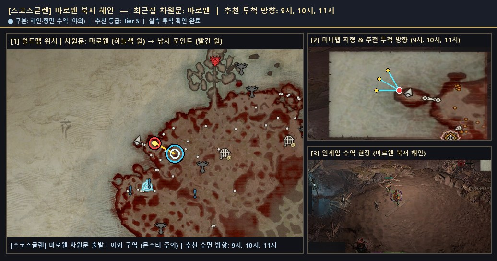
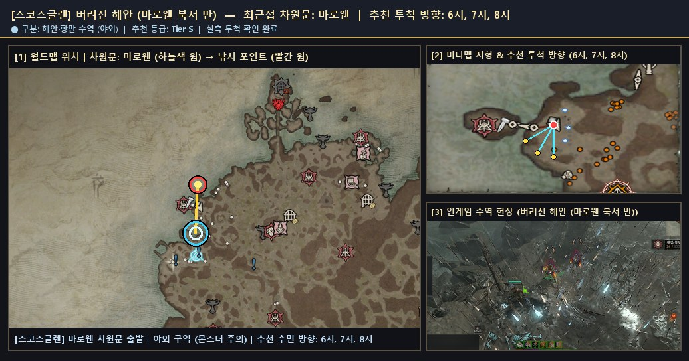
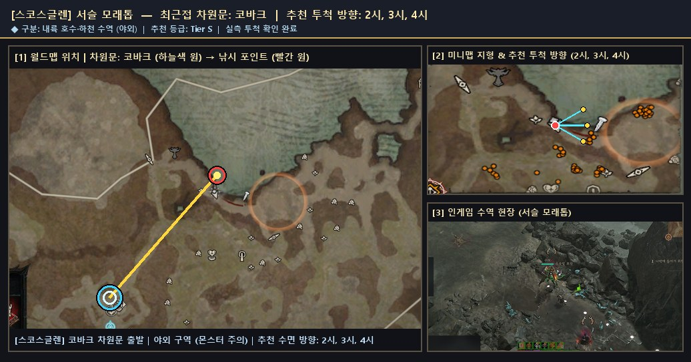
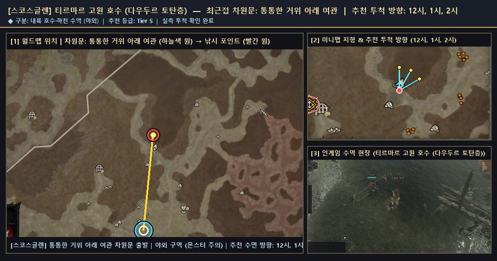

# 🗺️ 스코스글렌 — 검증 낚시터 위치 가이드 및 서식 어종 도감

> 🌐 **빠른 검색 웹 플랫폼**: [**대화형 낚시터 · 어종 통합 검색 열기 (`낚시터검색.html`)**](https://kaljake70.github.io/d4helper/%EB%82%9A%EC%8B%9C%ED%84%B0/%EB%82%9A%EC%8B%9C%ED%84%B0%EA%B2%80%EC%83%89.html)  
> 📚 **테마별 가이드**: [🏠 전체 허브](./README.md) · [⭐ 인기 추천](./인기_추천_낚시터.md) · [🏘️ 마을 안전](./마을_안전_낚시터.md) · [🏞️ 내륙 호수·강](./내륙_호수_강_낚시터.md) · [🌋 특수·용암](./특수_이색_낚시터.md) · [🐟 전체 어종 도감](./어종_도감.md)  
> 🗺️ **8대 권역**: [스코보스](./스코보스.md) · [나한투](./나한투.md) · [케지스탄](./케지스탄.md) · [하웨자르](./하웨자르.md) · [메마른 평원](./메마른_평원.md) · [스코스글렌](./스코스글렌.md) · [조각난 봉우리](./조각난_봉우리.md) · [용암 웅덩이](./용암_웅덩이.md)

- **권역명**: **스코스글렌**
- **실측 검증 낚시터**: **4곳** (마을 비전투 안전 **0곳** 포함)
- **권역 전용 서식 어종**: **16종** (+ 성역 전역 공통 어종 5종 출현)
- **누적 어획 표본**: **1,344개**

---

## 1. 스코스글렌 낚시 포인트 한눈 요약

| # | 유형 | 등급 | 세부 지역 | 최근접 차원문 | 안전 여부 | 추천 투척 방향 | 주요 포획 어종 |
|:--:|:--:|:--:|:--|:--|:--:|:--:|:--|
| 1 | 🌊 해안·항만 | **S** | `마로웬 북서 해안` | 마로웬 | ⚔️ 야외 주의 | `9시, 10시, 11시` | 드라콘수염(552), 반짝이는 드라콘수염(46), 거대한 드라콘수염(44) |
| 2 | 🌊 해안·항만 | **S** | `버려진 해안 (마로웬 북서 만)` | 마로웬 | ⚔️ 야외 주의 | `6시, 7시, 8시` | 드라콘수염(1), 소금지느러미(1), 은빛배(1) |
| 3 | 🏞️ 내륙 수역 | **S** | `서슬 모래톱` | 코바크 | ⚔️ 야외 주의 | `2시, 3시, 4시` | 소금지느러미(4), 아른치(2), 드라콘수염(1) |
| 4 | 🏞️ 내륙 수역 | **S** | `티르마르 고원 호수 (다우두르 토탄층)` | 통통한 거위 아래 여관 | ⚔️ 야외 주의 | `12시, 1시, 2시` | 파란비늘(106), 아른치(88), 소금지느러미(72) |

---

## 2. 스코스글렌 세부 낚시 포인트 위치 안내 및 현장 스크린샷

### 1. `마로웬 북서 해안` (최근접 차원문: 마로웬)

- **유형 및 추천 등급**: **🌊 해안·항만** · **Tier S** · ⭐ 인기 추천
- **안전 구역 구분**: ⚔️ 야외 구역 (주변 몬스터 출몰 주의)
- **추천 투척 시계 방향**: `9시, 10시, 11시`
- **실측 투척 확인 여부**: 확인 완료 (`2026-11-10` 기준)
- **차원문 접근 및 위치 안내**: 마로웬 차원문에서 북북서쪽(11시 방향) 성문 밖으로 나가면 도보 10초 거리 내에 서해 수면과 맞닿는 해변(거대 고래 사체가 밀려온 이색 해안선)이 나타납니다. 9~11시 방향으로 투척하며 스코스글렌 최단거리 명소입니다.
- **주요 포획 기록**: **드라콘수염**(552회), **반짝이는 드라콘수염**(46회), **거대한 드라콘수염**(44회), **환영 드라콘수염**(44회), **파란비늘**(13회), **반짝이는 악마 드라콘수염**(10회), **거대한 악마 드라콘수염**(8회), **작은 환영 드라콘수염**(8회) 외 7종 (누적 743개)
- **🌟 포획 확인된 신화·고유 어종**: `작은 환영 드라콘수염`, `거대한 악마 드라콘수염`, `작은 악마 드라콘수염`, `반짝이는 악마 드라콘수염`, `반짝이는 천공 드라콘수염`
- **📍 종합 위치 안내도 (월드맵 차원문 · 미니맵 투척 각도 · 인게임 수역 현장)**:

  

  - 원본 확대 보기: [🗺️ 월드맵 차원문 원본](./patches/스코스글렌__마로웬_북서_해안__9-10-11h/worldmap.jpg) · [🧭 미니맵 방향 원본](./patches/스코스글렌__마로웬_북서_해안__9-10-11h/minimap.jpg) · [🎬 인게임 현장 원본](./patches/스코스글렌__마로웬_북서_해안__9-10-11h/scene.jpg)

### 2. `버려진 해안 (마로웬 북서 만)` (최근접 차원문: 마로웬)

- **유형 및 추천 등급**: **🌊 해안·항만** · **Tier S** · ⭐ 인기 추천
- **안전 구역 구분**: ⚔️ 야외 구역 (주변 몬스터 출몰 주의)
- **추천 투척 시계 방향**: `6시, 7시, 8시`
- **실측 투척 확인 여부**: 확인 완료 (`2026-11-10` 기준)
- **차원문 접근 및 위치 안내**: 마로웬 차원문에서 북북서쪽 평지 해안길로 나가 모래사장 만 안쪽 기슭에서 6~8시 수면으로 투척합니다. 인게임 우상단 지명이 하웨자르와 동명인 '버려진 해안'으로 표시되나 실제 권역은 스코스글렌이며 스코스글렌 전용 어종 '드라콘수염'이 낚입니다.
- **주요 포획 기록**: **드라콘수염**(1회), **소금지느러미**(1회), **은빛배**(1회), **파란비늘**(1회)
- **📍 종합 위치 안내도 (월드맵 차원문 · 미니맵 투척 각도 · 인게임 수역 현장)**:

  

  - 원본 확대 보기: [🗺️ 월드맵 차원문 원본](./patches/스코스글렌__버려진_해안__6-7-8h/worldmap.jpg) · [🧭 미니맵 방향 원본](./patches/스코스글렌__버려진_해안__6-7-8h/minimap.jpg) · [🎬 인게임 현장 원본](./patches/스코스글렌__버려진_해안__6-7-8h/scene.jpg)

### 3. `서슬 모래톱` (최근접 차원문: 코바크)

- **유형 및 추천 등급**: **🏞️ 내륙 수역** · **Tier S** · ⭐ 인기 추천
- **안전 구역 구분**: ⚔️ 야외 구역 (주변 몬스터 출몰 주의)
- **추천 투척 시계 방향**: `2시, 3시, 4시`
- **실측 투척 확인 여부**: 확인 완료 (`2026-11-10` 기준)
- **차원문 접근 및 위치 안내**: 코바크 차원문에서 북동쪽(1~2시 방향) 숲길을 따라 올라가 내륙 깊숙이 파고든 청록색 물결 수면의 남쪽 모래톱 기슭(서슬 모래톱)에서 2~4시 방향으로 투척합니다. 고유 어종 '반짝이는 천공 드라콘수염' 및 '드라콘수염' 어획이 실증된 핵심 내륙 수변입니다.
- **주요 포획 기록**: **소금지느러미**(4회), **아른치**(2회), **드라콘수염**(1회), **막대기**(1회), **반짝이는 천공 드라콘수염**(1회)
- **🌟 포획 확인된 신화·고유 어종**: `반짝이는 천공 드라콘수염`
- **📍 종합 위치 안내도 (월드맵 차원문 · 미니맵 투척 각도 · 인게임 수역 현장)**:

  

  - 원본 확대 보기: [🗺️ 월드맵 차원문 원본](./patches/스코스글렌__서슬_모래톱__2-3-4h/worldmap.jpg) · [🧭 미니맵 방향 원본](./patches/스코스글렌__서슬_모래톱__2-3-4h/minimap.jpg) · [🎬 인게임 현장 원본](./patches/스코스글렌__서슬_모래톱__2-3-4h/scene.jpg)

### 4. `티르마르 고원 호수 (다우두르 토탄층)` (최근접 차원문: 통통한 거위 아래 여관)

- **유형 및 추천 등급**: **🏞️ 내륙 수역** · **Tier S** · ⭐ 인기 추천
- **안전 구역 구분**: ⚔️ 야외 구역 (주변 몬스터 출몰 주의)
- **추천 투척 시계 방향**: `12시, 1시, 2시`
- **실측 투척 확인 여부**: 확인 완료 (`2026-11-10` 기준)
- **차원문 접근 및 위치 안내**: 통통한 거위 아래 여관(또는 티르마르) 차원문에서 북쪽 다우두르 토탄층 곡선 내륙 하천 남서안(부서진 나무 다리 옆 물가)으로 이동해 12~2시 방향으로 투척합니다. 주의: 캐로크레스트 폐허 서쪽 마른 산길이 아닌 실제 물줄기가 흐르는 다우두르 토탄층 하천 기슭입니다.
- **주요 포획 기록**: **파란비늘**(106회), **아른치**(88회), **소금지느러미**(72회), **천공 드라콘수염**(58회), **작은 드라콘수염**(46회), **악마 드라콘수염**(40회), **은빛배**(30회), **어둠치**(26회) 외 20종 (누적 588개)
- **🌟 포획 확인된 신화·고유 어종**: `거대한 천공 드라콘수염`, `작은 천공 드라콘수염`, `반짝이는 환영 드라콘수염`, `거대한 환영 드라콘수염`
- **📍 종합 위치 안내도 (월드맵 차원문 · 미니맵 투척 각도 · 인게임 수역 현장)**:

  

  - 원본 확대 보기: [🗺️ 월드맵 차원문 원본](./patches/스코스글렌__티르마르_고원_호수__11-12-1h/worldmap.jpg) · [🧭 미니맵 방향 원본](./patches/스코스글렌__티르마르_고원_호수__11-12-1h/minimap.jpg) · [🎬 인게임 현장 원본](./patches/스코스글렌__티르마르_고원_호수__11-12-1h/scene.jpg)

---

## 3. 스코스글렌 서식 도감 어종 목록 (16종)

| 등급 | 물고기 이름 (한글) | 영문명 | 세부 서식지 | 도감 설명 |
|:--:|:--|:--|:--|:--|
| 🟤 고유 | **거대한 악마 드라콘수염** | `Giant Demonic Drakonbeard` | 스코스글렌 | 스코스글렌에 서식하는 고유 물고기입니다. 많은 글렌 청년들은 얼어붙은 바다에 뛰어들어 드라콘수염을 붙잡고 해안으로 끌어내는 것을 성인이 되는 통과 의례로 생각합니다. 이 물고기의 뼈 같은 가시에 찔린 상처는 대단한 명예의 상징이기도 합니다. |
| 🟤 고유 | **거대한 천공 드라콘수염** | `Giant Celestial Drakonbeard` | 스코스글렌 | 스코스글렌에 서식하는 고유 물고기입니다. 많은 글렌 청년들은 얼어붙은 바다에 뛰어들어 드라콘수염을 붙잡고 해안으로 끌어내는 것을 성인이 되는 통과 의례로 생각합니다. 이 물고기의 뼈 같은 가시에 찔린 상처는 대단한 명예의 상징이기도 합니다. |
| 🟤 고유 | **거대한 환영 드라콘수염** | `Giant Spectral Drakonbeard` | 스코스글렌 | 스코스글렌에 서식하는 고유 물고기입니다. 많은 글렌 청년들은 얼어붙은 바다에 뛰어들어 드라콘수염을 붙잡고 해안으로 끌어내는 것을 성인이 되는 통과 의례로 생각합니다. 이 물고기의 뼈 같은 가시에 찔린 상처는 대단한 명예의 상징이기도 합니다. |
| 🟤 고유 | **반짝이는 악마 드라콘수염** | `Glittering Demonic Drakonbeard` | 스코스글렌 | 스코스글렌에 서식하는 고유 물고기입니다. 많은 글렌 청년들은 얼어붙은 바다에 뛰어들어 드라콘수염을 붙잡고 해안으로 끌어내는 것을 성인이 되는 통과 의례로 생각합니다. 이 물고기의 뼈 같은 가시에 찔린 상처는 대단한 명예의 상징이기도 합니다. |
| 🟤 고유 | **반짝이는 천공 드라콘수염** | `Glittering Celestial Drakonbeard` | 스코스글렌 | 스코스글렌에 서식하는 고유 물고기입니다. 많은 글렌 청년들은 얼어붙은 바다에 뛰어들어 드라콘수염을 붙잡고 해안으로 끌어내는 것을 성인이 되는 통과 의례로 생각합니다. 이 물고기의 뼈 같은 가시에 찔린 상처는 대단한 명예의 상징이기도 합니다. |
| 🟤 고유 | **반짝이는 환영 드라콘수염** | `Glittering Spectral Drakonbeard` | 스코스글렌 | 스코스글렌에 서식하는 고유 물고기입니다. 많은 글렌 청년들은 얼어붙은 바다에 뛰어들어 드라콘수염을 붙잡고 해안으로 끌어내는 것을 성인이 되는 통과 의례로 생각합니다. 이 물고기의 뼈 같은 가시에 찔린 상처는 대단한 명예의 상징이기도 합니다. |
| 🟤 고유 | **작은 악마 드라콘수염** | `Tiny Demonic Drakonbeard` | 스코스글렌 | 스코스글렌에 서식하는 고유 물고기입니다. 많은 글렌 청년들은 얼어붙은 바다에 뛰어들어 드라콘수염을 붙잡고 해안으로 끌어내는 것을 성인이 되는 통과 의례로 생각합니다. 이 물고기의 뼈 같은 가시에 찔린 상처는 대단한 명예의 상징이기도 합니다. |
| 🟤 고유 | **작은 천공 드라콘수염** | `Tiny Celestial Drakonbeard` | 스코스글렌 | 스코스글렌에 서식하는 고유 물고기입니다. 많은 글렌 청년들은 얼어붙은 바다에 뛰어들어 드라콘수염을 붙잡고 해안으로 끌어내는 것을 성인이 되는 통과 의례로 생각합니다. 이 물고기의 뼈 같은 가시에 찔린 상처는 대단한 명예의 상징이기도 합니다. |
| 🟤 고유 | **작은 환영 드라콘수염** | `Tiny Spectral Drakonbeard` | 스코스글렌 | 스코스글렌에 서식하는 고유 물고기입니다. 많은 글렌 청년들은 얼어붙은 바다에 뛰어들어 드라콘수염을 붙잡고 해안으로 끌어내는 것을 성인이 되는 통과 의례로 생각합니다. 이 물고기의 뼈 같은 가시에 찔린 상처는 대단한 명예의 상징이기도 합니다. |
| 🟠 전설 | **거대한 드라콘수염** | `Giant Drakonbeard` | 스코스글렌 | 스코스글렌에 서식하는 전설 물고기입니다. 많은 글렌 청년들은 얼어붙은 바다에 뛰어들어 드라콘수염을 붙잡고 해안으로 끌어내는 것을 성인이 되는 통과 의례로 생각합니다. 이 물고기의 뼈 같은 가시에 찔린 상처는 대단한 명예의 상징이기도 합니다. |
| 🟠 전설 | **반짝이는 드라콘수염** | `Glittering Drakonbeard` | 스코스글렌 | 스코스글렌에 서식하는 전설 물고기입니다. 많은 글렌 청년들은 얼어붙은 바다에 뛰어들어 드라콘수염을 붙잡고 해안으로 끌어내는 것을 성인이 되는 통과 의례로 생각합니다. 이 물고기의 뼈 같은 가시에 찔린 상처는 대단한 명예의 상징이기도 합니다. |
| 🟠 전설 | **악마 드라콘수염** | `Demonic Drakonbeard` | 스코스글렌 | 스코스글렌에 서식하는 전설 물고기입니다. 많은 글렌 청년들은 얼어붙은 바다에 뛰어들어 드라콘수염을 붙잡고 해안으로 끌어내는 것을 성인이 되는 통과 의례로 생각합니다. 이 물고기의 뼈 같은 가시에 찔린 상처는 대단한 명예의 상징이기도 합니다. |
| 🟠 전설 | **작은 드라콘수염** | `Tiny Drakonbeard` | 스코스글렌 | 스코스글렌에 서식하는 전설 물고기입니다. 많은 글렌 청년들은 얼어붙은 바다에 뛰어들어 드라콘수염을 붙잡고 해안으로 끌어내는 것을 성인이 되는 통과 의례로 생각합니다. 이 물고기의 뼈 같은 가시에 찔린 상처는 대단한 명예의 상징이기도 합니다. |
| 🟠 전설 | **천공 드라콘수염** | `Celestial Drakonbeard` | 스코스글렌 | 스코스글렌에 서식하는 전설 물고기입니다. 많은 글렌 청년들은 얼어붙은 바다에 뛰어들어 드라콘수염을 붙잡고 해안으로 끌어내는 것을 성인이 되는 통과 의례로 생각합니다. 이 물고기의 뼈 같은 가시에 찔린 상처는 대단한 명예의 상징이기도 합니다. |
| 🟠 전설 | **환영 드라콘수염** | `Spectral Drakonbeard` | 스코스글렌 | 스코스글렌에 서식하는 전설 물고기입니다. 많은 글렌 청년들은 얼어붙은 바다에 뛰어들어 드라콘수염을 붙잡고 해안으로 끌어내는 것을 성인이 되는 통과 의례로 생각합니다. 이 물고기의 뼈 같은 가시에 찔린 상처는 대단한 명예의 상징이기도 합니다. |
| 🟡 희귀 | **드라콘수염** | `Drakonbeard` | 스코스글렌 | 스코스글렌에 서식하는 희귀 물고기입니다. 많은 글렌 청년들은 얼어붙은 바다에 뛰어들어 드라콘수염을 붙잡고 해안으로 끌어내는 것을 성인이 되는 통과 의례로 생각합니다. 이 물고기의 뼈 같은 가시에 찔린 상처는 대단한 명예의 상징이기도 합니다. |
