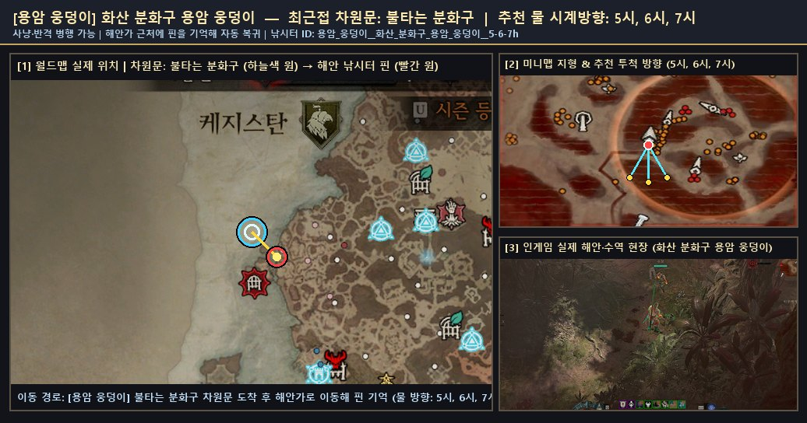

# 🗺️ 용암 웅덩이 — 사냥 가능 낚시터 실제 위치 스크린샷 및 서식 물고기 도감

[← 성역 전역 낚시터 공유 도감으로 돌아가기](./README.md)

- **권역**: **용암 웅덩이**
- **등록된 낚시 포인트**: **1곳**
- **누적 전리품 어획량**: **2개**
- **도감 서식 어종**: **1종**

## 1. 수집된 사냥·낚시 가능 포인트 (실제 위치 스크린샷 포함)

### 1. `화산 분화구 용암 웅덩이` (차원문: 불타는 분화구)
- **낚시터 ID**: `용암_웅덩이__화산_분화구_용암_웅덩이__5-6-7h`
- **추천 물 시계 방향**: `5시, 6시, 7시`
- **사냥(반격) 병행 가능 여부**: `가능 (검증 완료)`
- **F1 낚싯줄 투척 검증**: `통과 (is_fishing_skillbar=True)`
- **최근 갱신**: `2026-11-03 19:55:26`
- **탐색 메모**: 불타는 분화구 차원문 인접 사냥·낚시 검증 수역
- **포획된 물고기**: **녹아내린 순교자**(2마리)
- **🌟 포획된 신화/고유 어종**: 녹아내린 순교자
- **📍 실제 위치 안내 스크린샷 (월드맵 차원문 · 미니맵 해안가 · 인게임 현장)**:

  

  - 확대 보기: [🗺️ 월드맵 위치 원본](./patches/용암_웅덩이__화산_분화구_용암_웅덩이__5-6-7h/worldmap.jpg) · [🧭 미니맵 지형 원본](./patches/용암_웅덩이__화산_분화구_용암_웅덩이__5-6-7h/minimap.jpg)

## 2. 이 권역에서 잡히는 도감 어종 목록

| 등급 | 물고기 이름 (한글) | 영문명 | 세부 서식지 | 설명 |
|:--:|:--|:--|:--|:--|
| **신화** | **녹아내린 순교자** | `Molten Martyr` | 용암 웅덩이 | 용암 웅덩이에 서식하는 신화 고유 물고기입니다. 전설에 따르면, 옛날에 삼위일체단이 한 자카룸 장로를 붙잡아 가마솥 끝으로 내몰았다고 합니다. 장로가 빛을 포기하는 걸 거부하자 삼위일체단은 그를 가마솥으로 내던졌고, 그렇게 타들어 가던 장로를 빛이 나타나 구해줬다고 합니다. |
