# ⭐ 인기 · 고효율 추천 낚시터 가이드 (Tier S · A)

> 🌐 **빠른 검색 웹 플랫폼**: [**대화형 낚시터 · 어종 통합 검색 열기 (`낚시터검색.html`)**](https://kaljake70.github.io/d4helper/%EB%82%9A%EC%8B%9C%ED%84%B0/%EB%82%9A%EC%8B%9C%ED%84%B0%EA%B2%80%EC%83%89.html)  
> 📚 **테마별 가이드**: [🏠 전체 허브](./README.md) · [⭐ 인기 추천](./인기_추천_낚시터.md) · [🏘️ 마을 안전](./마을_안전_낚시터.md) · [🏞️ 내륙 호수·강](./내륙_호수_강_낚시터.md) · [🌋 특수·용암](./특수_이색_낚시터.md) · [🐟 전체 어종 도감](./어종_도감.md)  
> 🗺️ **8대 권역**: [스코보스](./스코보스.md) · [나한투](./나한투.md) · [케지스탄](./케지스탄.md) · [하웨자르](./하웨자르.md) · [메마른 평원](./메마른_평원.md) · [스코스글렌](./스코스글렌.md) · [조각난 봉우리](./조각난_봉우리.md) · [용암 웅덩이](./용암_웅덩이.md)

차원문(웨이포인트)으로부터의 도보 접근 시간, 수면 시야 개방감, 비전투 안전성, 그리고 고유·전설 어종 출현 빈도를 종합 평가하여 선정한 대표 추천 낚시터 가이드입니다.

## 🏆 선정 기준 요약

1. **Tier S (최우선 추천)**: 차원문 도착 후 도보 3~20초 이내 수변 진입이 가능하거나, 마을 안 비전투 안전 구역이면서 넓은 투척 각도를 확보한 핵심 명소입니다.
2. **Tier A (권역별 우수 거점)**: 특정 권역 전용 어종(드라콘수염, 모라야가, 자카라티 등) 도감 수집 시 동선이 간결하고 입질 시야가 깨끗한 검증 포인트입니다.

## 📋 Tier S 핵심 명소 한눈 비교

| 권역 | 세부 지역 | 최근접 차원문 | 유형 | 안전 여부 | 추천 방향 | 핵심 강점 |
|:--|:--|:--|:--:|:--:|:--:|:--|
| **스코보스** | `세토스 해안` | 세토스 | 🏘️ 마을 안전 | 🏘️ 비전투 안전 | `11시, 12시, 1시, 2시` | 세토스 정착지 동·북동쪽 마을 경계 모래사장 수역 (비전투 안전 구역) |
| **하웨자르** | `백워터 항구 해안` | 백워터 | 🌊 해안·항만 | ⚔️ 야외 | `3시, 4시, 5시` | 백워터 남동문 밖 해안 모래톱(추방자의 더미) 다수 어획 검증 수역 |
| **하웨자르** | `위자오 난파선 해안` | 위자오 | 🌊 해안·항만 | ⚔️ 야외 | `5시, 6시, 7시` | 위자오 차원문 남쪽 버려진 해안 난파선 잔해 수역 |
| **메마른 평원** | `지란다이 남부 강변` | 지란다이 | 🏞️ 내륙 수역 | ⚔️ 야외 | `5시, 6시, 7시` | 지란다이 남문 바로 밖 오르베이 강 상류 북안 모래톱 수역 |
| **조각난 봉우리** | `메네스타드 북서 강변` | 메네스타드 | 🏞️ 내륙 수역 | ⚔️ 야외 | `10시, 11시, 12시` | 메네스타드 북서 설원 강변 및 동쪽 사르코바 통로 얼음 계류 수역 |
| **스코스글렌** | `마로웬 북서 해안` | 마로웬 | 🌊 해안·항만 | ⚔️ 야외 | `9시, 10시, 11시` | 마로웬 북문 밖 초근접 북서 해안 및 거대 고래 사체 해변 수역 |
| **스코보스** | `아타노스 해안` | 아타노스 | 🌊 해안·항만 | ⚔️ 야외 | `4시, 5시, 6시` | 아타노스 차원문 남동쪽 만 해변 수역 (히든 보스 메피쉬토 다수 출현 확인) |
| **케지스탄** | `게아 쿨 항구 부두` | 게아 쿨 | 🏘️ 마을 안전 | 🏘️ 비전투 안전 | `7시, 8시, 9시` | 게아 쿨 마을 내부 남서·서쪽 항만 부두 끝단 (비전투 안전 구역 · 실측 검증) |
| **나한투** | `삼두정 약탈자 강가` | 삼두정 | 🏞️ 내륙 수역 | ⚔️ 야외 | `8시, 9시, 10시` | 삼두정 차원문 북서쪽 10시 방향 초근접 나한투 대하천 동안 수역 |
| **하웨자르** | `백워터 항구 부두` | 백워터 | 🏘️ 마을 안전 | 🏘️ 비전투 안전 | `12시, 1시, 11시` | 백워터 마을 내부 북동쪽 목재 부두 끝단 (차원문 도보 3초 · 비전투 안전 구역) |
| **조각난 봉우리** | `불길한 바람의 바위산` | 메네스타드 | 🏞️ 내륙 수역 | ⚔️ 야외 | `2시, 3시, 4시` | 메네스타드 차원문 동쪽 사르코바 통로 내륙 설원 강변 (고유·전설 모라야가 실측 어획) |
| **나한투** | `쿠라스트 부두` | 쿠라스트 부두 | 🏘️ 마을 안전 | 🏘️ 비전투 안전 | `10시, 11시, 12시` | 쿠라스트 부두 마을 내 남서쪽 주 석조 부두 끝단 대하천 (비전투 안전 구역) |
| **스코보스** | `헤파이트루스 산 남쪽 면` | 멍텅구리의 채석장 | 🌋 특수·용암 | ⚔️ 야외 | `12시, 1시, 11시` | 스코보스 서부 스카르타라 화산 용암 강 낮은 암석 강둑 (실측 투척·어획 완료) |
| **용암 웅덩이** | `화산 분화구 용암 웅덩이` | 불타는 분화구 | 🌋 특수·용암 | ⚔️ 야외 | `5시, 6시, 7시` | 화산 분화구·잉걸불 도가니 용암 웅덩이 수역 (신화 고유 어종 녹아내린 순교자 서식지) |

---

## 📍 인기 추천 포인트 상세 안내 및 위치 스크린샷

### 1. [스코보스] `세토스 해안` (최근접 차원문: 세토스)

- **유형 및 추천 등급**: **🏘️ 마을 안전** · **Tier S** · ⭐ 인기 추천
- **안전 구역 구분**: 🏘️ 마을 안 안전 구역 (비전투 · 몬스터 출몰 없음)
- **추천 투척 시계 방향**: `11시, 12시, 1시, 2시`
- **실측 투척 확인 여부**: 확인 완료 (`2026-11-10` 기준)
- **차원문 접근 및 위치 안내**: 세토스 차원문 도착 후 동쪽·북동쪽(1~2시 방향) 모래사장 물가로 이동합니다. 상인 NPC가 모여 있는 정착지 경계 안쪽 해변에서 바로 11~2시 넓은 수면으로 투척할 수 있어 몬스터 방해 없이 쾌적하게 코칼로돈을 낚을 수 있습니다.
- **주요 포획 기록**: **코칼로돈**(1788회), **악마 코칼로돈**(194회), **거대한 환영 코칼로돈**(26회), **반짝이는 코칼로돈**(4회), **거대한 코칼로돈**(2회), **천공 코칼로돈**(1회), **환영 코칼로돈**(1회)
- **🌟 포획 확인된 신화·고유 어종**: `거대한 환영 코칼로돈`
- **📍 종합 위치 안내도 (월드맵 차원문 · 미니맵 투척 각도 · 인게임 수역 현장)**:

  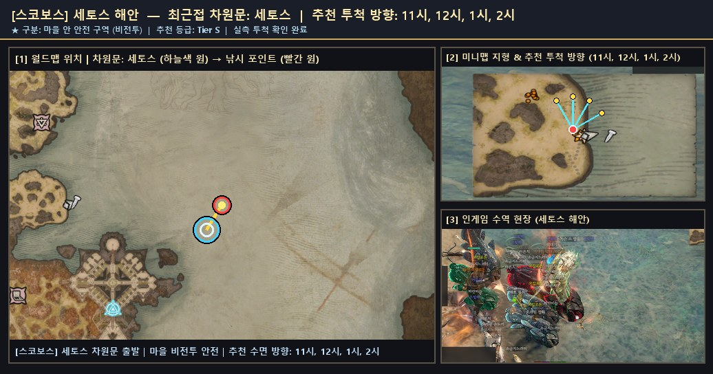

  - 원본 확대 보기: [🗺️ 월드맵 차원문 원본](./patches/스코보스__세토스_해안__11-12-1h/worldmap.jpg) · [🧭 미니맵 방향 원본](./patches/스코보스__세토스_해안__11-12-1h/minimap.jpg) · [🎬 인게임 현장 원본](./patches/스코보스__세토스_해안__11-12-1h/scene.jpg)

### 2. [하웨자르] `백워터 항구 해안` (최근접 차원문: 백워터)

- **유형 및 추천 등급**: **🌊 해안·항만** · **Tier S** · ⭐ 인기 추천
- **안전 구역 구분**: ⚔️ 야외 구역 (주변 몬스터 출몰 주의)
- **추천 투척 시계 방향**: `3시, 4시, 5시`
- **실측 투척 확인 여부**: 확인 완료 (`2026-11-10` 기준)
- **차원문 접근 및 위치 안내**: 백워터 남동쪽 성문 밖으로 나와 해안선(추방자의 더미)을 따라 이동한 뒤 3~5시 동해 수면으로 투척합니다. 고유·전설 갈고리고기 누적 어획량이 매우 높은 대표적인 야외 해안 포인트입니다.
- **주요 포획 기록**: **환영 갈고리고기**(289회), **거대한 악마 갈고리고기**(131회), **거대한 환영 갈고리고기**(128회), **반짝이는 악마 갈고리고기**(110회), **천공 갈고리고기**(94회), **작은 천공 갈고리고기**(78회), **악마 갈고리고기**(73회), **파란비늘**(64회) 외 41종 (누적 1,423개)
- **🌟 포획 확인된 신화·고유 어종**: `반짝이는 환영 갈고리고기`, `반짝이는 천공 갈고리고기`, `반짝이는 악마 갈고리고기`, `거대한 악마 갈고리고기`, `작은 환영 갈고리고기`, `거대한 환영 갈고리고기`, `작은 천공 갈고리고기`, `반짝이는 악마 네메셍가`, `거대한 천공 갈고리고기`, `작은 악마 갈고리고기`, `반짝이는 악마 코칼로돈`, `거대한 악마 모라야가`, `거대한 천공 자카라티`, `거대한 천공 모라야가`, `작은 천공 모라야가`
- **📍 종합 위치 안내도 (월드맵 차원문 · 미니맵 투척 각도 · 인게임 수역 현장)**:

  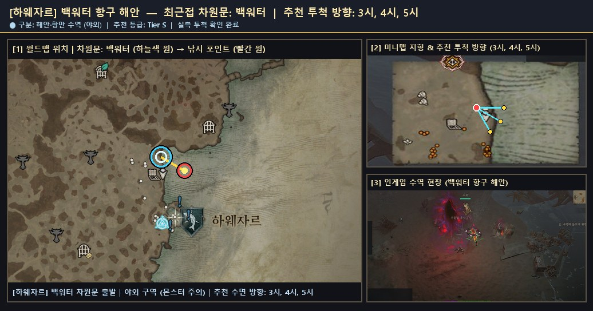

  - 원본 확대 보기: [🗺️ 월드맵 차원문 원본](./patches/하웨자르__백워터_항구_해안__3-4-5h/worldmap.jpg) · [🧭 미니맵 방향 원본](./patches/하웨자르__백워터_항구_해안__3-4-5h/minimap.jpg) · [🎬 인게임 현장 원본](./patches/하웨자르__백워터_항구_해안__3-4-5h/scene.jpg)

### 3. [하웨자르] `위자오 난파선 해안` (최근접 차원문: 위자오)

- **유형 및 추천 등급**: **🌊 해안·항만** · **Tier S** · ⭐ 인기 추천
- **안전 구역 구분**: ⚔️ 야외 구역 (주변 몬스터 출몰 주의)
- **추천 투척 시계 방향**: `5시, 6시, 7시`
- **실측 투척 확인 여부**: 확인 완료 (`2026-11-10` 기준)
- **차원문 접근 및 위치 안내**: 위자오 차원문에서 남쪽(5~6시 방향) 버려진 해안으로 내려가 난파선 잔해 옆 모래 해변에서 5~7시 수면으로 투척합니다. 수면 시야가 탁 트여 있어 입질 확인이 매우 편리합니다.
- **주요 포획 기록**: **갈고리고기**(860회), **작은 갈고리고기**(84회), **소금지느러미**(26회), **파란비늘**(26회), **거대한 악마 갈고리고기**(24회), **거대한 천공 갈고리고기**(24회), **아른치**(18회), **작은 악마 갈고리고기**(14회) 외 15종 (누적 1,128개)
- **🌟 포획 확인된 신화·고유 어종**: `거대한 악마 갈고리고기`, `거대한 천공 갈고리고기`, `거대한 환영 갈고리고기`, `작은 악마 갈고리고기`, `작은 환영 갈고리고기`
- **📍 종합 위치 안내도 (월드맵 차원문 · 미니맵 투척 각도 · 인게임 수역 현장)**:

  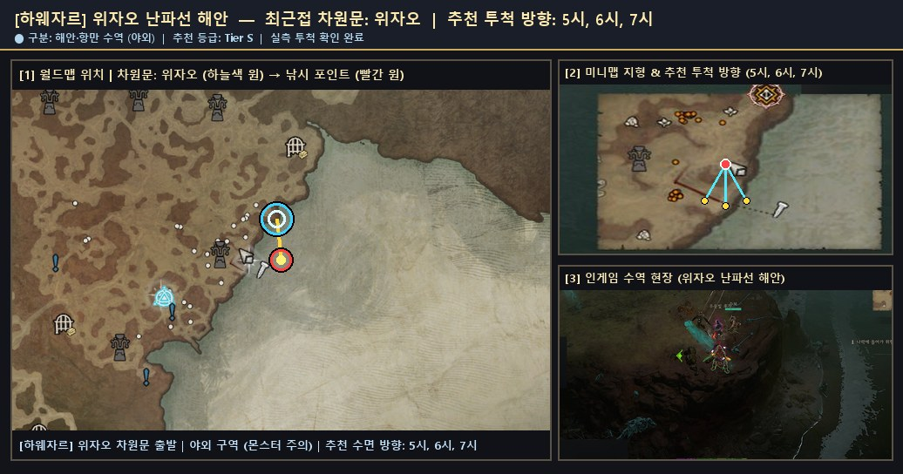

  - 원본 확대 보기: [🗺️ 월드맵 차원문 원본](./patches/하웨자르__위자오_난파선_해안__5-6-7h/worldmap.jpg) · [🧭 미니맵 방향 원본](./patches/하웨자르__위자오_난파선_해안__5-6-7h/minimap.jpg) · [🎬 인게임 현장 원본](./patches/하웨자르__위자오_난파선_해안__5-6-7h/scene.jpg)

### 4. [메마른 평원] `지란다이 남부 강변` (최근접 차원문: 지란다이)

- **유형 및 추천 등급**: **🏞️ 내륙 수역** · **Tier S** · ⭐ 인기 추천
- **안전 구역 구분**: ⚔️ 야외 구역 (주변 몬스터 출몰 주의)
- **추천 투척 시계 방향**: `5시, 6시, 7시`
- **실측 투척 확인 여부**: 확인 완료 (`2026-11-10` 기준)
- **차원문 접근 및 위치 안내**: 지란다이 차원문에서 남쪽(6시 방향) 성문 돌계단을 완전히 내려가 동서로 흐르는 내륙 강(두 다리 사이 북쪽 강기슭) 물가에서 5~7시 방향으로 투척합니다. 마을 내부 돌계단이나 비석 근처에서 멈추면 수역에 닿지 않으니 강변 모래톱까지 내려가십시오.
- **주요 포획 기록**: **시보의 징조**(856회), **천공 시보의 징조**(88회), **악마 시보의 징조**(78회), **거대한 천공 시보의 징조**(30회), **거대한 악마 시보의 징조**(20회), **작은 악마 시보의 징조**(20회)
- **🌟 포획 확인된 신화·고유 어종**: `작은 악마 시보의 징조`, `거대한 천공 시보의 징조`, `거대한 악마 시보의 징조`
- **📍 종합 위치 안내도 (월드맵 차원문 · 미니맵 투척 각도 · 인게임 수역 현장)**:

  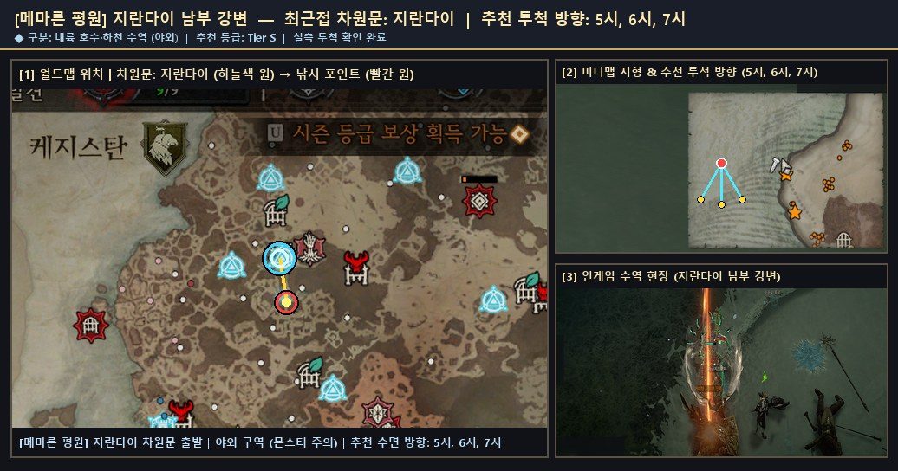

  - 원본 확대 보기: [🗺️ 월드맵 차원문 원본](./patches/메마른_평원__지란다이_남부_강변__5-6-7h/worldmap.jpg) · [🧭 미니맵 방향 원본](./patches/메마른_평원__지란다이_남부_강변__5-6-7h/minimap.jpg) · [🎬 인게임 현장 원본](./patches/메마른_평원__지란다이_남부_강변__5-6-7h/scene.jpg)

### 5. [조각난 봉우리] `메네스타드 북서 강변` (최근접 차원문: 메네스타드)

- **유형 및 추천 등급**: **🏞️ 내륙 수역** · **Tier S** · ⭐ 인기 추천
- **안전 구역 구분**: ⚔️ 야외 구역 (주변 몬스터 출몰 주의)
- **추천 투척 시계 방향**: `10시, 11시, 12시`
- **실측 투척 확인 여부**: 확인 완료 (`2026-11-10` 기준)
- **차원문 접근 및 위치 안내**: 메네스타드 차원문에서 북서쪽 성문 밖 설원 강기슭(10~12시 수면) 또는 동쪽(3시 방향) 사르코바 통로 다리 옆 얼음 계류 남안(12~2시 수면)으로 이동해 투척합니다. 조각난 봉우리에서 차원문 접근성이 가장 우수한 내륙 하천입니다.
- **주요 포획 기록**: **모라야가**(660회), **거대한 모라야가**(128회), **반짝이는 모라야가**(91회), **환영 모라야가**(64회), **악마 모라야가**(56회), **작은 환영 모라야가**(16회), **거대한 악마 모라야가**(14회), **파란비늘**(12회) 외 3종 (누적 1,063개)
- **🌟 포획 확인된 신화·고유 어종**: `작은 악마 모라야가`, `작은 환영 모라야가`, `거대한 악마 모라야가`
- **📍 종합 위치 안내도 (월드맵 차원문 · 미니맵 투척 각도 · 인게임 수역 현장)**:

  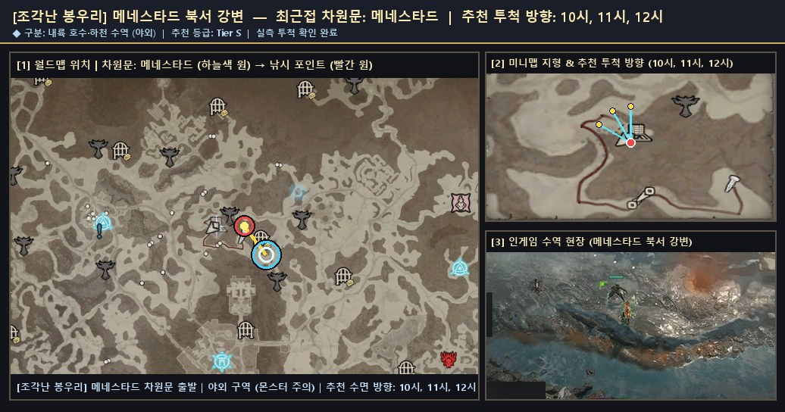

  - 원본 확대 보기: [🗺️ 월드맵 차원문 원본](./patches/조각난_봉우리__메네스타드_북서_강변__10-11-12h/worldmap.jpg) · [🧭 미니맵 방향 원본](./patches/조각난_봉우리__메네스타드_북서_강변__10-11-12h/minimap.jpg) · [🎬 인게임 현장 원본](./patches/조각난_봉우리__메네스타드_북서_강변__10-11-12h/scene.jpg)

### 6. [스코스글렌] `마로웬 북서 해안` (최근접 차원문: 마로웬)

- **유형 및 추천 등급**: **🌊 해안·항만** · **Tier S** · ⭐ 인기 추천
- **안전 구역 구분**: ⚔️ 야외 구역 (주변 몬스터 출몰 주의)
- **추천 투척 시계 방향**: `9시, 10시, 11시`
- **실측 투척 확인 여부**: 확인 완료 (`2026-11-10` 기준)
- **차원문 접근 및 위치 안내**: 마로웬 차원문에서 북북서쪽(11시 방향) 성문 밖으로 나가면 도보 10초 거리 내에 서해 수면과 맞닿는 해변(거대 고래 사체가 밀려온 이색 해안선)이 나타납니다. 9~11시 방향으로 투척하며 스코스글렌 최단거리 명소입니다.
- **주요 포획 기록**: **드라콘수염**(552회), **반짝이는 드라콘수염**(46회), **거대한 드라콘수염**(44회), **환영 드라콘수염**(44회), **파란비늘**(13회), **반짝이는 악마 드라콘수염**(10회), **거대한 악마 드라콘수염**(8회), **작은 환영 드라콘수염**(8회) 외 7종 (누적 743개)
- **🌟 포획 확인된 신화·고유 어종**: `작은 환영 드라콘수염`, `거대한 악마 드라콘수염`, `작은 악마 드라콘수염`, `반짝이는 악마 드라콘수염`, `반짝이는 천공 드라콘수염`
- **📍 종합 위치 안내도 (월드맵 차원문 · 미니맵 투척 각도 · 인게임 수역 현장)**:

  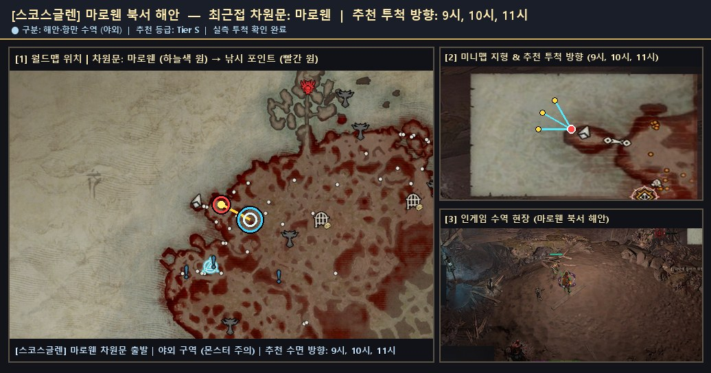

  - 원본 확대 보기: [🗺️ 월드맵 차원문 원본](./patches/스코스글렌__마로웬_북서_해안__9-10-11h/worldmap.jpg) · [🧭 미니맵 방향 원본](./patches/스코스글렌__마로웬_북서_해안__9-10-11h/minimap.jpg) · [🎬 인게임 현장 원본](./patches/스코스글렌__마로웬_북서_해안__9-10-11h/scene.jpg)

### 7. [스코보스] `아타노스 해안` (최근접 차원문: 아타노스)

- **유형 및 추천 등급**: **🌊 해안·항만** · **Tier S** · ⭐ 인기 추천
- **안전 구역 구분**: ⚔️ 야외 구역 (주변 몬스터 출몰 주의)
- **추천 투척 시계 방향**: `4시, 5시, 6시`
- **실측 투척 확인 여부**: 확인 완료 (`2026-11-10` 기준)
- **차원문 접근 및 위치 안내**: 아타노스 차원문에서 남동쪽(4~5시 방향) 성문 밖 해변으로 내려가면 잔잔한 바다 만 수면이 펼쳐집니다. 야외 구역이므로 출몰 몬스터를 먼저 정리한 뒤 4~6시 방향으로 투척하십시오.
- **주요 포획 기록**: **거대한 코칼로돈**(226회), **반짝이는 코칼로돈**(164회), **반짝이는 악마 코칼로돈**(30회), **작은 환영 코칼로돈**(16회), **오래된 장화**(14회), **해초 뭉치**(11회), **쓸모없는 열쇠**(10회), **선원의 머리**(9회) 외 15종 (누적 522개)
- **🌟 포획 확인된 신화·고유 어종**: `작은 환영 코칼로돈`, `반짝이는 악마 코칼로돈`
- **📍 종합 위치 안내도 (월드맵 차원문 · 미니맵 투척 각도 · 인게임 수역 현장)**:

  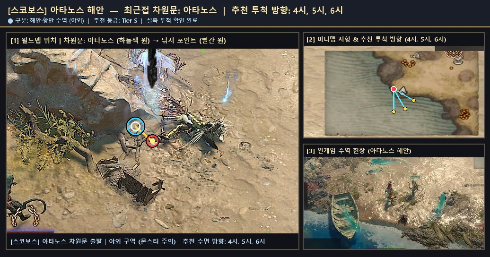

  - 원본 확대 보기: [🗺️ 월드맵 차원문 원본](./patches/스코보스__아타노스_해안__4-5-6h/worldmap.jpg) · [🧭 미니맵 방향 원본](./patches/스코보스__아타노스_해안__4-5-6h/minimap.jpg) · [🎬 인게임 현장 원본](./patches/스코보스__아타노스_해안__4-5-6h/scene.jpg)

### 8. [케지스탄] `게아 쿨 항구 부두` (최근접 차원문: 게아 쿨)

- **유형 및 추천 등급**: **🏘️ 마을 안전** · **Tier S** · ⭐ 인기 추천
- **안전 구역 구분**: 🏘️ 마을 안 안전 구역 (비전투 · 몬스터 출몰 없음)
- **추천 투척 시계 방향**: `7시, 8시, 9시`
- **실측 투척 확인 여부**: 확인 완료 (`2026-11-10` 기준)
- **차원문 접근 및 위치 안내**: 게아 쿨 차원문에서 서남쪽 항구 계단을 내려가 마을 내부 철제 격자·석조 부두 끝단에서 7~9시 바다 수면으로 투척합니다. 전투 스킬이 비활성화되는 완벽한 마을 안전 구역이며 상점·대장간과도 인접해 있습니다.
- **주요 포획 기록**: **소금지느러미**(78회), **파란비늘**(72회), **자카라티**(54회), **아른치**(50회), **은빛배**(41회), **어둠치**(24회), **거대한 자카라티**(10회), **천공 자카라티**(9회) 외 29종 (누적 413개)
- **🌟 포획 확인된 신화·고유 어종**: `작은 천공 자카라티`, `반짝이는 천공 코칼로돈`, `작은 환영 자카라티`, `반짝이는 환영 자카라티`, `작은 악마 자카라티`, `거대한 천공 자카라티`, `거대한 악마 자카라티`
- **📍 종합 위치 안내도 (월드맵 차원문 · 미니맵 투척 각도 · 인게임 수역 현장)**:

  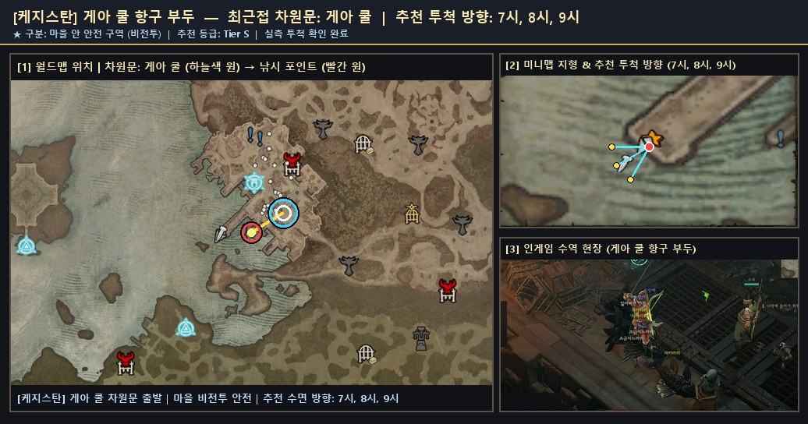

  - 원본 확대 보기: [🗺️ 월드맵 차원문 원본](./patches/케지스탄__게아_쿨_항구_부두__7-8-9h/worldmap.jpg) · [🧭 미니맵 방향 원본](./patches/케지스탄__게아_쿨_항구_부두__7-8-9h/minimap.jpg) · [🎬 인게임 현장 원본](./patches/케지스탄__게아_쿨_항구_부두__7-8-9h/scene.jpg)

### 9. [나한투] `삼두정 약탈자 강가` (최근접 차원문: 삼두정)

- **유형 및 추천 등급**: **🏞️ 내륙 수역** · **Tier S** · ⭐ 인기 추천
- **안전 구역 구분**: ⚔️ 야외 구역 (주변 몬스터 출몰 주의)
- **추천 투척 시계 방향**: `8시, 9시, 10시`
- **실측 투척 확인 여부**: 확인 완료 (`2026-11-10` 기준)
- **차원문 접근 및 위치 안내**: 삼두정 차원문 도착 후 바로 북서쪽(10시 방향)으로 짧게 걸어 나가면 정글 대하천 동쪽 만곡부 물가와 즉시 맞닿습니다. 차원문과의 거리가 매우 짧고 8~10시 수면 폭이 넓어 고유 네메셍가 채집 효율이 뛰어납니다.
- **주요 포획 기록**: **작은 악마 네메셍가**(112회), **악마 네메셍가**(80회), **작은 네메셍가**(50회), **거대한 네메셍가**(46회), **거대한 천공 네메셍가**(46회), **환영 네메셍가**(42회), **거대한 악마 네메셍가**(22회), **반짝이는 악마 네메셍가**(12회)
- **🌟 포획 확인된 신화·고유 어종**: `거대한 악마 네메셍가`, `반짝이는 악마 네메셍가`, `작은 악마 네메셍가`, `거대한 천공 네메셍가`
- **📍 종합 위치 안내도 (월드맵 차원문 · 미니맵 투척 각도 · 인게임 수역 현장)**:

  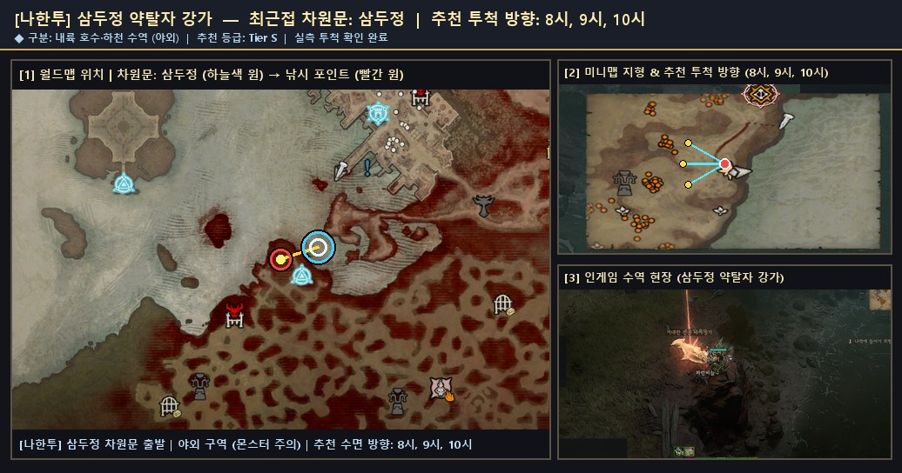

  - 원본 확대 보기: [🗺️ 월드맵 차원문 원본](./patches/나한투__삼두정_약탈자_강가__8-9-10h/worldmap.jpg) · [🧭 미니맵 방향 원본](./patches/나한투__삼두정_약탈자_강가__8-9-10h/minimap.jpg) · [🎬 인게임 현장 원본](./patches/나한투__삼두정_약탈자_강가__8-9-10h/scene.jpg)

### 10. [하웨자르] `백워터 항구 부두` (최근접 차원문: 백워터)

- **유형 및 추천 등급**: **🏘️ 마을 안전** · **Tier S** · ⭐ 인기 추천
- **안전 구역 구분**: 🏘️ 마을 안 안전 구역 (비전투 · 몬스터 출몰 없음)
- **추천 투척 시계 방향**: `12시, 1시, 11시`
- **실측 투척 확인 여부**: 확인 완료 (`2026-11-10` 기준)
- **차원문 접근 및 위치 안내**: 백워터 차원문 도착 후 바로 북동쪽(1~2시 방향) 마을 안 나무 잔교 끝단으로 몇 걸음만 이동해 11~1시 북쪽 석호 수면으로 투척합니다. 차원문에서 가장 가까운 마을 안 비전투 안전 포인트 중 하나입니다.
- **주요 포획 기록**: **갈고리고기**(24회), **파란비늘**(15회), **아른치**(12회), **소금지느러미**(10회), **환영 갈고리고기**(6회), **반짝이는 갈고리고기**(2회), **작은 천공 갈고리고기**(2회)
- **🌟 포획 확인된 신화·고유 어종**: `작은 천공 갈고리고기`
- **📍 종합 위치 안내도 (월드맵 차원문 · 미니맵 투척 각도 · 인게임 수역 현장)**:

  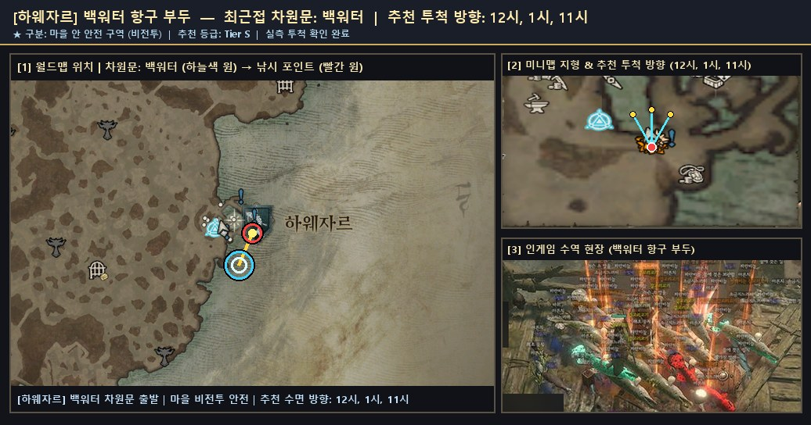

  - 원본 확대 보기: [🗺️ 월드맵 차원문 원본](./patches/하웨자르__백워터_항구_부두__12-1-11h/worldmap.jpg) · [🧭 미니맵 방향 원본](./patches/하웨자르__백워터_항구_부두__12-1-11h/minimap.jpg) · [🎬 인게임 현장 원본](./patches/하웨자르__백워터_항구_부두__12-1-11h/scene.jpg)

### 11. [조각난 봉우리] `불길한 바람의 바위산` (최근접 차원문: 메네스타드)

- **유형 및 추천 등급**: **🏞️ 내륙 수역** · **Tier S** · ⭐ 인기 추천
- **안전 구역 구분**: ⚔️ 야외 구역 (주변 몬스터 출몰 주의)
- **추천 투척 시계 방향**: `2시, 3시, 4시`
- **실측 투척 확인 여부**: 확인 완료 (`2026-11-10` 기준)
- **차원문 접근 및 위치 안내**: 메네스타드 차원문에서 동북동쪽(2~3시 방향) 사르코바 통로 설원 길을 따라 이동해 내륙 강 서안 물가 발판에서 2~4시 방향으로 투척합니다. 고유 어종 '작은 천공 모라야가' 및 전설 '환영 모라야가' 실측 포획이 확인된 내륙 명소입니다.
- **주요 포획 기록**: **아른치**(2회), **모라야가**(1회), **소금지느러미**(1회), **작은 천공 모라야가**(1회), **파란비늘**(1회), **환영 모라야가**(1회)
- **🌟 포획 확인된 신화·고유 어종**: `작은 천공 모라야가`
- **📍 종합 위치 안내도 (월드맵 차원문 · 미니맵 투척 각도 · 인게임 수역 현장)**:

  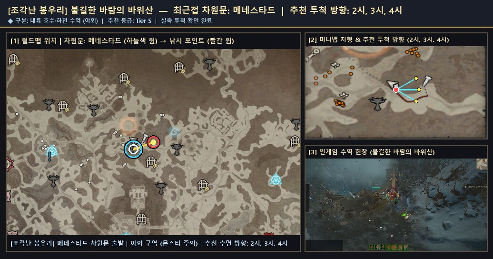

  - 원본 확대 보기: [🗺️ 월드맵 차원문 원본](./patches/조각난_봉우리__불길한_바람의_바위산__2-3-4h/worldmap.jpg) · [🧭 미니맵 방향 원본](./patches/조각난_봉우리__불길한_바람의_바위산__2-3-4h/minimap.jpg) · [🎬 인게임 현장 원본](./patches/조각난_봉우리__불길한_바람의_바위산__2-3-4h/scene.jpg)

### 12. [나한투] `쿠라스트 부두` (최근접 차원문: 쿠라스트 부두)

- **유형 및 추천 등급**: **🏘️ 마을 안전** · **Tier S** · ⭐ 인기 추천
- **안전 구역 구분**: 🏘️ 마을 안 안전 구역 (비전투 · 몬스터 출몰 없음)
- **추천 투척 시계 방향**: `10시, 11시, 12시`
- **실측 투척 확인 여부**: 확인 완료 (`2026-11-10` 기준)
- **차원문 접근 및 위치 안내**: 쿠라스트 부두 차원문에서 남서쪽(7시 방향) 직사각형 주 석조 부두 끝단으로 도보 15초 이동한 뒤 10~12시 대하천 수면으로 투척합니다. 주의: 북서쪽의 작은 나무 잔교는 장식용 진흙 여울이라 낚시 수역 판정이 없으니 반드시 남서쪽 큰 석조 부두로 가십시오.
- **주요 포획 기록**: **아른치**(1회), **은빛배**(1회), **천공 네메셍가**(1회), **파란비늘**(1회), **환영 네메셍가**(1회)
- **📍 종합 위치 안내도 (월드맵 차원문 · 미니맵 투척 각도 · 인게임 수역 현장)**:

  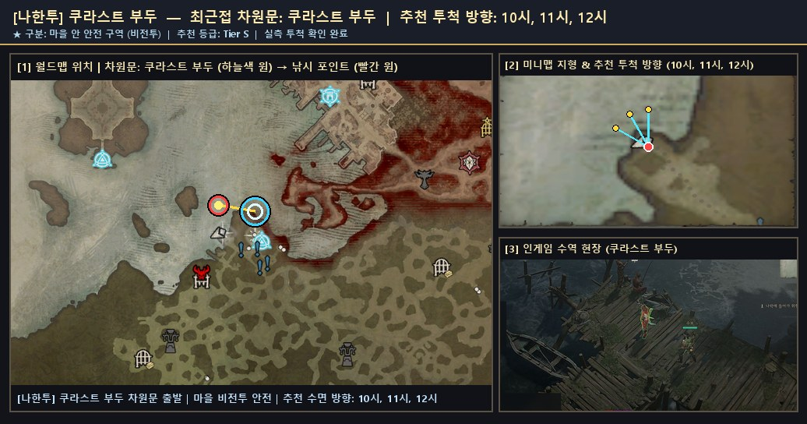

  - 원본 확대 보기: [🗺️ 월드맵 차원문 원본](./patches/나한투__쿠라스트_부두__10-11-12h/worldmap.jpg) · [🧭 미니맵 방향 원본](./patches/나한투__쿠라스트_부두__10-11-12h/minimap.jpg) · [🎬 인게임 현장 원본](./patches/나한투__쿠라스트_부두__10-11-12h/scene.jpg)

### 13. [스코보스] `헤파이트루스 산 남쪽 면` (최근접 차원문: 멍텅구리의 채석장)

- **유형 및 추천 등급**: **🌋 특수·용암** · **Tier S** · ⭐ 인기 추천
- **안전 구역 구분**: ⚔️ 야외 구역 (주변 몬스터 출몰 주의)
- **추천 투척 시계 방향**: `12시, 1시, 11시`
- **실측 투척 확인 여부**: 확인 완료 (`2026-11-10` 기준)
- **차원문 접근 및 위치 안내**: 멍텅구리의 채석장 차원문에서 북서쪽(10~11시 방향) 또는 비전의 끝 차원문에서 북쪽 화산 길을 따라 이동합니다. 높은 절벽 턱에서는 시야각 차단 문구가 뜨므로, 반드시 도약 발판 인근의 낮은 현무암 강둑으로 내려서서 11~1시 방향 시뻘건 용암 수면으로 투척하십시오.
- **주요 포획 기록**: **코칼로돈**(2회)
- **📍 종합 위치 안내도 (월드맵 차원문 · 미니맵 투척 각도 · 인게임 수역 현장)**:

  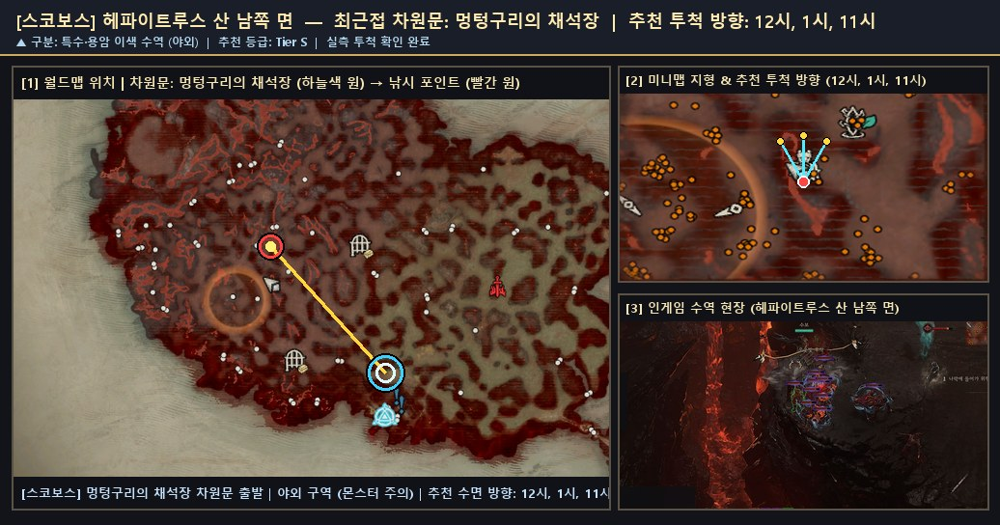

  - 원본 확대 보기: [🗺️ 월드맵 차원문 원본](./patches/스코보스__헤파이트루스_산_남쪽_면__12-1-11h/worldmap.jpg) · [🧭 미니맵 방향 원본](./patches/스코보스__헤파이트루스_산_남쪽_면__12-1-11h/minimap.jpg) · [🎬 인게임 현장 원본](./patches/스코보스__헤파이트루스_산_남쪽_면__12-1-11h/scene.jpg)

### 14. [용암 웅덩이] `화산 분화구 용암 웅덩이` (최근접 차원문: 불타는 분화구)

- **유형 및 추천 등급**: **🌋 특수·용암** · **Tier S** · ⭐ 인기 추천
- **안전 구역 구분**: ⚔️ 야외 구역 (주변 몬스터 출몰 주의)
- **추천 투척 시계 방향**: `5시, 6시, 7시`
- **실측 투척 확인 여부**: 확인 완료 (`2026-11-10` 기준)
- **차원문 접근 및 위치 안내**: 화산 분화구 및 용암 지대(잉걸불 도가니·참바타르 분화구 인근 용암 웅덩이)에서 끓어오르는 주황빛 용암 수면 가장자리 낮은 바위 턱에 서서 5~7시 방향으로 투척합니다. 신화 고유 물고기 '녹아내린 순교자'를 낚을 수 있는 특수 수역입니다.
- **주요 포획 기록**: **녹아내린 순교자**(2회)
- **🌟 포획 확인된 신화·고유 어종**: `녹아내린 순교자`
- **📍 종합 위치 안내도 (월드맵 차원문 · 미니맵 투척 각도 · 인게임 수역 현장)**:

  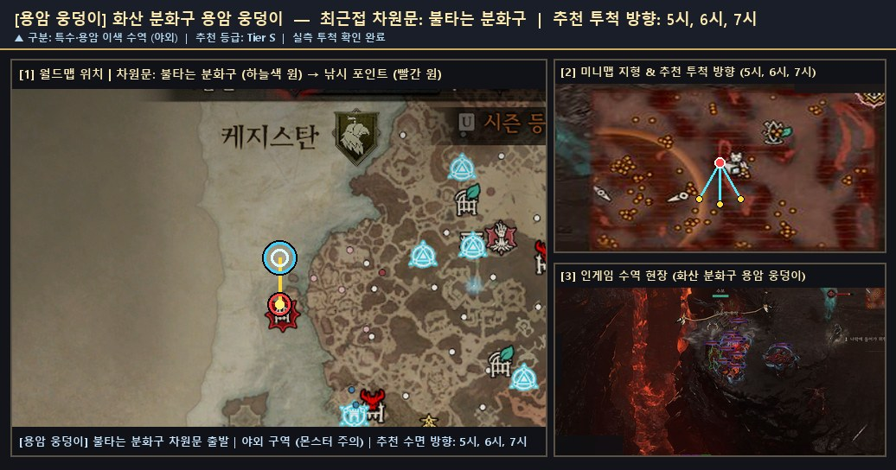

  - 원본 확대 보기: [🗺️ 월드맵 차원문 원본](./patches/용암_웅덩이__화산_분화구_용암_웅덩이__5-6-7h/worldmap.jpg) · [🧭 미니맵 방향 원본](./patches/용암_웅덩이__화산_분화구_용암_웅덩이__5-6-7h/minimap.jpg) · [🎬 인게임 현장 원본](./patches/용암_웅덩이__화산_분화구_용암_웅덩이__5-6-7h/scene.jpg)

### 15. [나한투] `쿠라스트 부두 강변` (최근접 차원문: 쿠라스트 부두)

- **유형 및 추천 등급**: **🏞️ 내륙 수역** · **Tier A** · ⭐ 인기 추천
- **안전 구역 구분**: ⚔️ 야외 구역 (주변 몬스터 출몰 주의)
- **추천 투척 시계 방향**: `6시, 7시, 8시`
- **실측 투척 확인 여부**: 확인 완료 (`2026-11-10` 기준)
- **차원문 접근 및 위치 안내**: 쿠라스트 부두 남쪽 성문 밖으로 나와 우아일 분지 서편 대하천 강기슭으로 이동한 뒤 6~8시 수면으로 투척합니다. 야외 정글 강변이므로 주변 몬스터에 유의하십시오.
- **주요 포획 기록**: **네메셍가**(462회), **천공 네메셍가**(48회), **반짝이는 네메셍가**(34회), **거대한 환영 네메셍가**(12회), **작은 천공 네메셍가**(12회), **작은 환영 네메셍가**(10회), **반짝이는 천공 네메셍가**(8회), **반짝이는 환영 네메셍가**(6회)
- **🌟 포획 확인된 신화·고유 어종**: `작은 천공 네메셍가`, `반짝이는 천공 네메셍가`, `반짝이는 환영 네메셍가`, `거대한 환영 네메셍가`, `작은 환영 네메셍가`
- **📍 종합 위치 안내도 (월드맵 차원문 · 미니맵 투척 각도 · 인게임 수역 현장)**:

  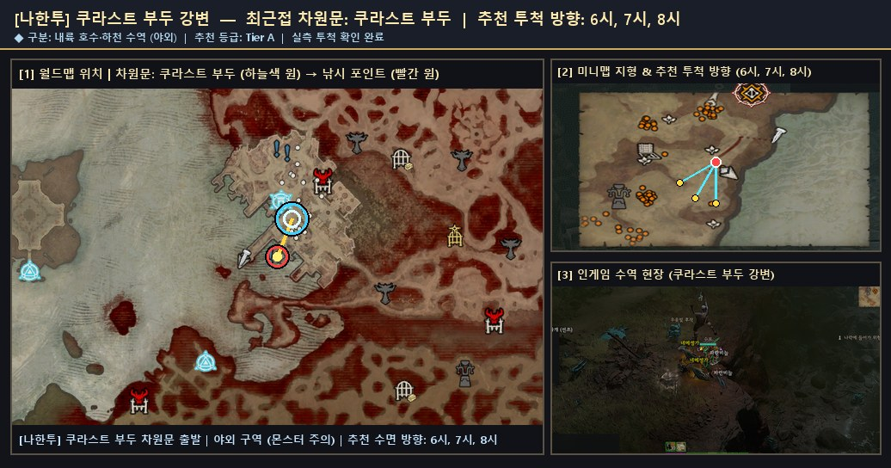

  - 원본 확대 보기: [🗺️ 월드맵 차원문 원본](./patches/나한투__쿠라스트_부두_강변__6-7-8h/worldmap.jpg) · [🧭 미니맵 방향 원본](./patches/나한투__쿠라스트_부두_강변__6-7-8h/minimap.jpg) · [🎬 인게임 현장 원본](./patches/나한투__쿠라스트_부두_강변__6-7-8h/scene.jpg)

### 16. [스코보스] `테미스 해안` (최근접 차원문: 테미스)

- **유형 및 추천 등급**: **🏞️ 내륙 수역** · **Tier A** · ⭐ 인기 추천
- **안전 구역 구분**: ⚔️ 야외 구역 (주변 몬스터 출몰 주의)
- **추천 투척 시계 방향**: `4시, 5시, 6시`
- **실측 투척 확인 여부**: 확인 완료 (`2026-11-10` 기준)
- **차원문 접근 및 위치 안내**: 테미스 차원문(성벽 내부)에서 2시 방향 직선 석조 다리를 건너 성문 밖으로 나간 뒤, 바로 남쪽에 파고든 내륙 해협 기슭에서 4~6시 방향으로 투척합니다. 테미스 성벽 안쪽에서는 수면 고도 차로 낚싯줄이 닿지 않습니다.
- **주요 포획 기록**: **천공 코칼로돈**(202회), **환영 코칼로돈**(162회), **작은 코칼로돈**(132회), **거대한 천공 코칼로돈**(44회), **반짝이는 천공 코칼로돈**(28회), **작은 악마 코칼로돈**(14회)
- **🌟 포획 확인된 신화·고유 어종**: `거대한 천공 코칼로돈`, `반짝이는 천공 코칼로돈`, `작은 악마 코칼로돈`
- **📍 종합 위치 안내도 (월드맵 차원문 · 미니맵 투척 각도 · 인게임 수역 현장)**:

  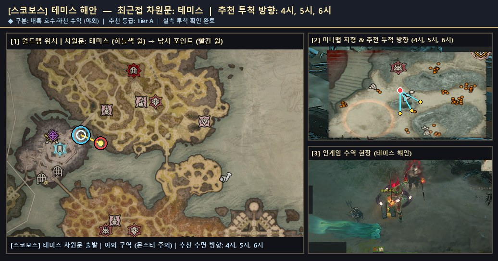

  - 원본 확대 보기: [🗺️ 월드맵 차원문 원본](./patches/스코보스__테미스_해안__4-5-6h/worldmap.jpg) · [🧭 미니맵 방향 원본](./patches/스코보스__테미스_해안__4-5-6h/minimap.jpg) · [🎬 인게임 현장 원본](./patches/스코보스__테미스_해안__4-5-6h/scene.jpg)

### 17. [메마른 평원] `운명의 은신처 서해안` (최근접 차원문: 운명의 은신처)

- **유형 및 추천 등급**: **🌊 해안·항만** · **Tier A** · ⭐ 인기 추천
- **안전 구역 구분**: ⚔️ 야외 구역 (주변 몬스터 출몰 주의)
- **추천 투척 시계 방향**: `8시, 9시, 10시`
- **실측 투척 확인 여부**: 확인 완료 (`2026-11-10` 기준)
- **차원문 접근 및 위치 안내**: 운명의 은신처(또는 케드바르두) 차원문에서 서쪽(9시 방향) 해안 만 안쪽 모래변으로 이동해 8~10시 바다 수면으로 투척합니다. 전설·고유 등급 시보의 징조 어획 비중이 높은 포인트입니다.
- **주요 포획 기록**: **환영 시보의 징조**(96회), **반짝이는 시보의 징조**(84회), **거대한 시보의 징조**(80회), **거대한 환영 시보의 징조**(20회), **반짝이는 천공 시보의 징조**(16회), **작은 천공 시보의 징조**(16회)
- **🌟 포획 확인된 신화·고유 어종**: `거대한 환영 시보의 징조`, `반짝이는 천공 시보의 징조`, `작은 천공 시보의 징조`
- **📍 종합 위치 안내도 (월드맵 차원문 · 미니맵 투척 각도 · 인게임 수역 현장)**:

  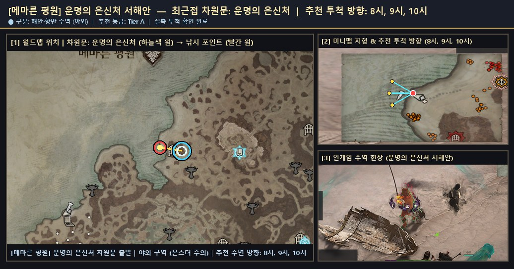

  - 원본 확대 보기: [🗺️ 월드맵 차원문 원본](./patches/메마른_평원__운명의_은신처_서해안__8-9-10h/worldmap.jpg) · [🧭 미니맵 방향 원본](./patches/메마른_평원__운명의_은신처_서해안__8-9-10h/minimap.jpg) · [🎬 인게임 현장 원본](./patches/메마른_평원__운명의_은신처_서해안__8-9-10h/scene.jpg)

### 18. [스코스글렌] `티르마르 고원 호수` (최근접 차원문: 티르마르)

- **유형 및 추천 등급**: **🏞️ 내륙 수역** · **Tier A** · ⭐ 인기 추천
- **안전 구역 구분**: ⚔️ 야외 구역 (주변 몬스터 출몰 주의)
- **추천 투척 시계 방향**: `11시, 12시, 1시`
- **실측 투척 확인 여부**: 확인 완료 (`2026-11-10` 기준)
- **차원문 접근 및 위치 안내**: 티르마르 차원문에서 북쪽 숲길을 따라 고원 호수 남안으로 이동하거나, 통통한 거위 아래 여관 차원문에서 북동쪽(1~2시 방향) 청록색 내륙 만 남쪽 모래톱으로 이동해 11~1시 방향으로 투척합니다.
- **주요 포획 기록**: **천공 드라콘수염**(50회), **작은 드라콘수염**(46회), **아른치**(40회), **악마 드라콘수염**(40회), **파란비늘**(40회), **소금지느러미**(16회), **찢어진 그물**(12회), **작은 천공 드라콘수염**(10회) 외 7종 (누적 298개)
- **🌟 포획 확인된 신화·고유 어종**: `거대한 천공 드라콘수염`, `작은 천공 드라콘수염`, `반짝이는 환영 드라콘수염`, `거대한 환영 드라콘수염`
- **📍 종합 위치 안내도 (월드맵 차원문 · 미니맵 투척 각도 · 인게임 수역 현장)**:

  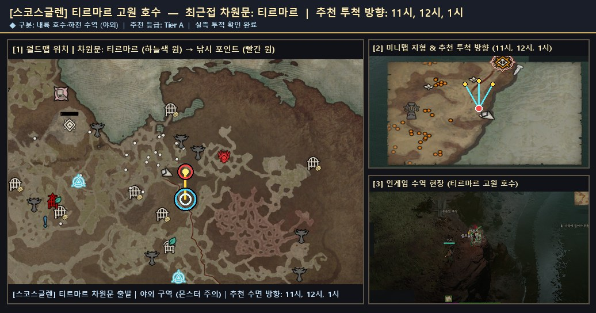

  - 원본 확대 보기: [🗺️ 월드맵 차원문 원본](./patches/스코스글렌__티르마르_고원_호수__11-12-1h/worldmap.jpg) · [🧭 미니맵 방향 원본](./patches/스코스글렌__티르마르_고원_호수__11-12-1h/minimap.jpg) · [🎬 인게임 현장 원본](./patches/스코스글렌__티르마르_고원_호수__11-12-1h/scene.jpg)

### 19. [조각난 봉우리] `마르그레이브 얼어붙은 호수` (최근접 차원문: 마르그레이브)

- **유형 및 추천 등급**: **🏞️ 내륙 수역** · **Tier A** · ⭐ 인기 추천
- **안전 구역 구분**: ⚔️ 야외 구역 (주변 몬스터 출몰 주의)
- **추천 투척 시계 방향**: `6시, 7시, 8시`
- **실측 투척 확인 여부**: 확인 완료 (`2026-11-10` 기준)
- **차원문 접근 및 위치 안내**: 마르그레이브 또는 옐레스나 차원문에서 남남서쪽(7시 방향) 설원 계곡 통로를 따라 내려가면 얼어붙지 않은 어두운 내륙 호수 수면 북쪽 기슭과 만납니다. 6~8시 방향으로 투척하며 고유 모라야가 출현 기록이 풍부합니다.
- **주요 포획 기록**: **천공 모라야가**(68회), **작은 모라야가**(66회), **반짝이는 악마 모라야가**(24회), **반짝이는 환영 모라야가**(20회), **작은 천공 모라야가**(20회), **거대한 환영 모라야가**(14회), **거대한 천공 모라야가**(12회), **반짝이는 천공 모라야가**(12회)
- **🌟 포획 확인된 신화·고유 어종**: `반짝이는 악마 모라야가`, `거대한 천공 모라야가`, `반짝이는 천공 모라야가`, `반짝이는 환영 모라야가`, `작은 천공 모라야가`, `거대한 환영 모라야가`
- **📍 종합 위치 안내도 (월드맵 차원문 · 미니맵 투척 각도 · 인게임 수역 현장)**:

  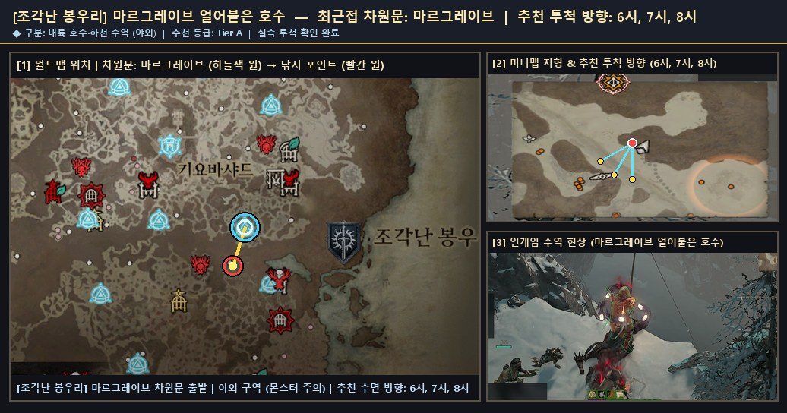

  - 원본 확대 보기: [🗺️ 월드맵 차원문 원본](./patches/조각난_봉우리__마르그레이브_얼어붙은_호수__6-7-8h/worldmap.jpg) · [🧭 미니맵 방향 원본](./patches/조각난_봉우리__마르그레이브_얼어붙은_호수__6-7-8h/minimap.jpg) · [🎬 인게임 현장 원본](./patches/조각난_봉우리__마르그레이브_얼어붙은_호수__6-7-8h/scene.jpg)

### 20. [하웨자르] `속삭임의 나무 늪지` (최근접 차원문: 속삭임의 나무)

- **유형 및 추천 등급**: **🏞️ 내륙 수역** · **Tier A** · ⭐ 인기 추천
- **안전 구역 구분**: ⚔️ 야외 구역 (주변 몬스터 출몰 주의)
- **추천 투척 시계 방향**: `2시, 3시, 4시`
- **실측 투척 확인 여부**: 확인 완료 (`2026-11-10` 기준)
- **차원문 접근 및 위치 안내**: 속삭임의 나무 차원문에서 동북동쪽(2~3시 방향) 늪지 길을 따라 내륙 호수의 낮은 남동쪽 물가 기슭으로 이동해 2~4시 방향으로 투척합니다. 주의: 호수 남서안(씁쓸한 길) 쪽은 수면보다 높은 바위 절벽이라 투척이 차단되므로 낮은 물가 발판을 이용하십시오.
- **주요 포획 기록**: **환영 갈고리고기**(92회), **반짝이는 갈고리고기**(66회), **작은 천공 갈고리고기**(20회)
- **🌟 포획 확인된 신화·고유 어종**: `작은 천공 갈고리고기`
- **📍 종합 위치 안내도 (월드맵 차원문 · 미니맵 투척 각도 · 인게임 수역 현장)**:

  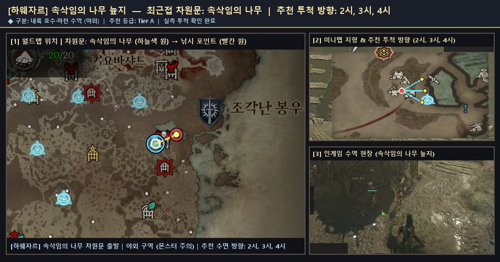

  - 원본 확대 보기: [🗺️ 월드맵 차원문 원본](./patches/하웨자르__속삭임의_나무_늪지__2-3-4h/worldmap.jpg) · [🧭 미니맵 방향 원본](./patches/하웨자르__속삭임의_나무_늪지__2-3-4h/minimap.jpg) · [🎬 인게임 현장 원본](./patches/하웨자르__속삭임의_나무_늪지__2-3-4h/scene.jpg)

### 21. [케지스탄] `거친 해안선 (톱니 해안)` (최근접 차원문: 강철늑대단 야영지)

- **유형 및 추천 등급**: **🌊 해안·항만** · **Tier A** · ⭐ 인기 추천
- **안전 구역 구분**: ⚔️ 야외 구역 (주변 몬스터 출몰 주의)
- **추천 투척 시계 방향**: `12시, 1시, 11시`
- **실측 투척 확인 여부**: 확인 완료 (`2026-11-10` 기준)
- **차원문 접근 및 위치 안내**: 다층 구조인 황실 도서관 대신 평지 거점인 강철늑대단 야영지 차원문에서 출발하여 서남서쪽 달구르 오아시스를 지나 서해안 만(톱니 해안) 모래톱으로 이동합니다. 11~1시 방향 잔잔한 만 수면에서 케지스탄 고유 어종 자카라티가 낚입니다.
- **주요 포획 기록**: **자카라티**(1회), **찢어진 그물**(1회), **파란비늘**(1회)
- **📍 종합 위치 안내도 (월드맵 차원문 · 미니맵 투척 각도 · 인게임 수역 현장)**:

  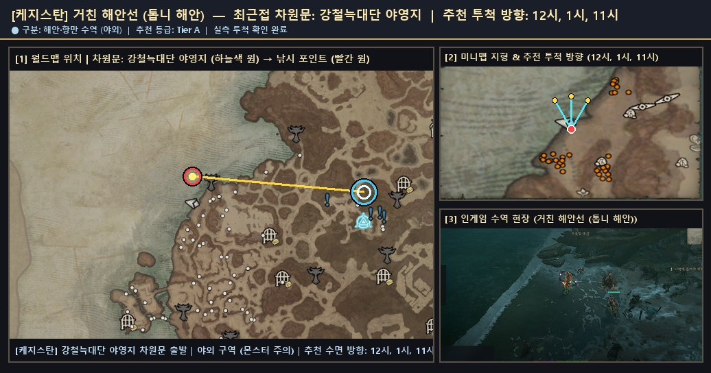

  - 원본 확대 보기: [🗺️ 월드맵 차원문 원본](./patches/케지스탄__거친_해안선_톱니_해안__12-1-11h/worldmap.jpg) · [🧭 미니맵 방향 원본](./patches/케지스탄__거친_해안선_톱니_해안__12-1-11h/minimap.jpg) · [🎬 인게임 현장 원본](./patches/케지스탄__거친_해안선_톱니_해안__12-1-11h/scene.jpg)
