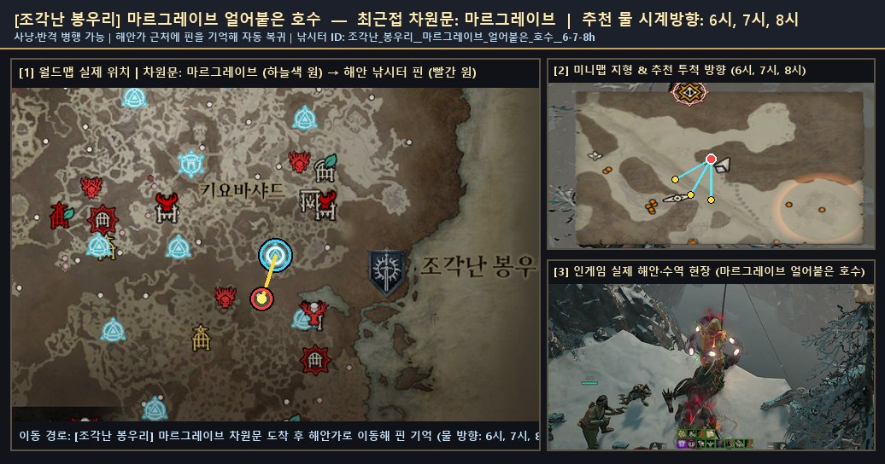
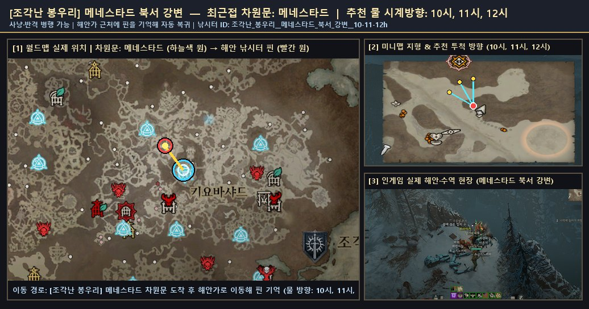

# 🗺️ 조각난 봉우리 — 사냥 가능 낚시터 실제 위치 스크린샷 및 서식 물고기 도감

[← 성역 전역 낚시터 공유 도감으로 돌아가기](./README.md)

- **권역**: **조각난 봉우리**
- **등록된 낚시 포인트**: **2곳**
- **누적 전리품 어획량**: **1,266개**
- **도감 서식 어종**: **16종**

## 1. 수집된 사냥·낚시 가능 포인트 (실제 위치 스크린샷 포함)

### 1. `마르그레이브 얼어붙은 호수` (차원문: 마르그레이브)
- **낚시터 ID**: `조각난_봉우리__마르그레이브_얼어붙은_호수__6-7-8h`
- **추천 물 시계 방향**: `6시, 7시, 8시`
- **사냥(반격) 병행 가능 여부**: `가능 (검증 완료)`
- **F1 낚싯줄 투척 검증**: `통과 (is_fishing_skillbar=True)`
- **최근 갱신**: `2026-11-02 10:10:15`
- **탐색 메모**: 마르그레이브 차원문 인접 사냥·낚시 검증 수역
- **포획된 물고기**: **천공 모라야가**(68마리), **작은 모라야가**(66마리), **반짝이는 악마 모라야가**(24마리), **반짝이는 환영 모라야가**(20마리), **작은 천공 모라야가**(20마리), **거대한 환영 모라야가**(14마리), **거대한 천공 모라야가**(12마리), **반짝이는 천공 모라야가**(12마리)
- **🌟 포획된 신화/고유 어종**: 반짝이는 악마 모라야가, 거대한 천공 모라야가, 반짝이는 천공 모라야가, 반짝이는 환영 모라야가, 작은 천공 모라야가, 거대한 환영 모라야가
- **📍 실제 위치 안내 스크린샷 (월드맵 차원문 · 미니맵 해안가 · 인게임 현장)**:

  

  - 확대 보기: [🗺️ 월드맵 위치 원본](./patches/조각난_봉우리__마르그레이브_얼어붙은_호수__6-7-8h/worldmap.jpg) · [🧭 미니맵 지형 원본](./patches/조각난_봉우리__마르그레이브_얼어붙은_호수__6-7-8h/minimap.jpg)

### 2. `메네스타드 북서 강변` (차원문: 메네스타드)
- **낚시터 ID**: `조각난_봉우리__메네스타드_북서_강변__10-11-12h`
- **추천 물 시계 방향**: `10시, 11시, 12시`
- **사냥(반격) 병행 가능 여부**: `가능 (검증 완료)`
- **F1 낚싯줄 투척 검증**: `통과 (is_fishing_skillbar=True)`
- **최근 갱신**: `2026-11-02 10:55:37`
- **탐색 메모**: 메네스타드 차원문 인접 사냥·낚시 검증 수역
- **포획된 물고기**: **모라야가**(656마리), **거대한 모라야가**(128마리), **반짝이는 모라야가**(90마리), **환영 모라야가**(64마리), **악마 모라야가**(56마리), **작은 환영 모라야가**(16마리), **거대한 악마 모라야가**(14마리), **작은 악마 모라야가**(6마리)
- **🌟 포획된 신화/고유 어종**: 작은 악마 모라야가, 작은 환영 모라야가, 거대한 악마 모라야가
- **📍 실제 위치 안내 스크린샷 (월드맵 차원문 · 미니맵 해안가 · 인게임 현장)**:

  

  - 확대 보기: [🗺️ 월드맵 위치 원본](./patches/조각난_봉우리__메네스타드_북서_강변__10-11-12h/worldmap.jpg) · [🧭 미니맵 지형 원본](./patches/조각난_봉우리__메네스타드_북서_강변__10-11-12h/minimap.jpg)

## 2. 이 권역에서 잡히는 도감 어종 목록

| 등급 | 물고기 이름 (한글) | 영문명 | 세부 서식지 | 설명 |
|:--:|:--|:--|:--|:--|
| **희귀** | **모라야가** | `Morayaga` | 조각난 봉우리 | 조각난 봉우리에 서식하는 희귀 물고기입니다. 모라야가는 얼어붙을 듯한 물에서 뭍으로 올라와, 죄 없는 사람들의 피를 찾아 헤맨다고 합니다. 식욕을 채운 후에는 붉게 부풀어 오른 배를 안고 차가운 심해로 돌아갑니다. |
| **전설** | **작은 모라야가** | `Tiny Morayaga` | 조각난 봉우리 | 조각난 봉우리에 서식하는 전설 물고기입니다. 모라야가는 얼어붙을 듯한 물에서 뭍으로 올라와, 죄 없는 사람들의 피를 찾아 헤맨다고 합니다. 식욕을 채운 후에는 붉게 부풀어 오른 배를 안고 차가운 심해로 돌아갑니다. |
| **전설** | **거대한 모라야가** | `Giant Morayaga` | 조각난 봉우리 | 조각난 봉우리에 서식하는 전설 물고기입니다. 모라야가는 얼어붙을 듯한 물에서 뭍으로 올라와, 죄 없는 사람들의 피를 찾아 헤맨다고 합니다. 식욕을 채운 후에는 붉게 부풀어 오른 배를 안고 차가운 심해로 돌아갑니다. |
| **전설** | **반짝이는 모라야가** | `Glittering Morayaga` | 조각난 봉우리 | 조각난 봉우리에 서식하는 전설 물고기입니다. 모라야가는 얼어붙을 듯한 물에서 뭍으로 올라와, 죄 없는 사람들의 피를 찾아 헤맨다고 합니다. 식욕을 채운 후에는 붉게 부풀어 오른 배를 안고 차가운 심해로 돌아갑니다. |
| **전설** | **악마 모라야가** | `Demonic Morayaga` | 조각난 봉우리 | 조각난 봉우리에 서식하는 전설 물고기입니다. 모라야가는 얼어붙을 듯한 물에서 뭍으로 올라와, 죄 없는 사람들의 피를 찾아 헤맨다고 합니다. 식욕을 채운 후에는 붉게 부풀어 오른 배를 안고 차가운 심해로 돌아갑니다. |
| **전설** | **천공 모라야가** | `Celestial Morayaga` | 조각난 봉우리 | 조각난 봉우리에 서식하는 전설 물고기입니다. 모라야가는 얼어붙을 듯한 물에서 뭍으로 올라와, 죄 없는 사람들의 피를 찾아 헤맨다고 합니다. 식욕을 채운 후에는 붉게 부풀어 오른 배를 안고 차가운 심해로 돌아갑니다. |
| **전설** | **환영 모라야가** | `Spectral Morayaga` | 조각난 봉우리 | 조각난 봉우리에 서식하는 전설 물고기입니다. 모라야가는 얼어붙을 듯한 물에서 뭍으로 올라와, 죄 없는 사람들의 피를 찾아 헤맨다고 합니다. 식욕을 채운 후에는 붉게 부풀어 오른 배를 안고 차가운 심해로 돌아갑니다. |
| **고유** | **작은 악마 모라야가** | `Tiny Demonic Morayaga` | 조각난 봉우리 | 조각난 봉우리에 서식하는 고유 물고기입니다. 모라야가는 얼어붙을 듯한 물에서 뭍으로 올라와, 죄 없는 사람들의 피를 찾아 헤맨다고 합니다. 식욕을 채운 후에는 붉게 부풀어 오른 배를 안고 차가운 심해로 돌아갑니다. |
| **고유** | **작은 천공 모라야가** | `Tiny Celestial Morayaga` | 조각난 봉우리 | 조각난 봉우리에 서식하는 고유 물고기입니다. 모라야가는 얼어붙을 듯한 물에서 뭍으로 올라와, 죄 없는 사람들의 피를 찾아 헤맨다고 합니다. 식욕을 채운 후에는 붉게 부풀어 오른 배를 안고 차가운 심해로 돌아갑니다. |
| **고유** | **작은 환영 모라야가** | `Tiny Spectral Morayaga` | 조각난 봉우리 | 조각난 봉우리에 서식하는 고유 물고기입니다. 모라야가는 얼어붙을 듯한 물에서 뭍으로 올라와, 죄 없는 사람들의 피를 찾아 헤맨다고 합니다. 식욕을 채운 후에는 붉게 부풀어 오른 배를 안고 차가운 심해로 돌아갑니다. |
| **고유** | **거대한 악마 모라야가** | `Giant Demonic Morayaga` | 조각난 봉우리 | 조각난 봉우리에 서식하는 고유 물고기입니다. 모라야가는 얼어붙을 듯한 물에서 뭍으로 올라와, 죄 없는 사람들의 피를 찾아 헤맨다고 합니다. 식욕을 채운 후에는 붉게 부풀어 오른 배를 안고 차가운 심해로 돌아갑니다. |
| **고유** | **거대한 천공 모라야가** | `Giant Celestial Morayaga` | 조각난 봉우리 | 조각난 봉우리에 서식하는 고유 물고기입니다. 모라야가는 얼어붙을 듯한 물에서 뭍으로 올라와, 죄 없는 사람들의 피를 찾아 헤맨다고 합니다. 식욕을 채운 후에는 붉게 부풀어 오른 배를 안고 차가운 심해로 돌아갑니다. |
| **고유** | **거대한 환영 모라야가** | `Giant Spectral Morayaga` | 조각난 봉우리 | 조각난 봉우리에 서식하는 고유 물고기입니다. 모라야가는 얼어붙을 듯한 물에서 뭍으로 올라와, 죄 없는 사람들의 피를 찾아 헤맨다고 합니다. 식욕을 채운 후에는 붉게 부풀어 오른 배를 안고 차가운 심해로 돌아갑니다. |
| **고유** | **반짝이는 악마 모라야가** | `Glittering Demonic Morayaga` | 조각난 봉우리 | 조각난 봉우리에 서식하는 고유 물고기입니다. 모라야가는 얼어붙을 듯한 물에서 뭍으로 올라와, 죄 없는 사람들의 피를 찾아 헤맨다고 합니다. 식욕을 채운 후에는 붉게 부풀어 오른 배를 안고 차가운 심해로 돌아갑니다. |
| **고유** | **반짝이는 천공 모라야가** | `Glittering Celestial Morayaga` | 조각난 봉우리 | 조각난 봉우리에 서식하는 고유 물고기입니다. 모라야가는 얼어붙을 듯한 물에서 뭍으로 올라와, 죄 없는 사람들의 피를 찾아 헤맨다고 합니다. 식욕을 채운 후에는 붉게 부풀어 오른 배를 안고 차가운 심해로 돌아갑니다. |
| **고유** | **반짝이는 환영 모라야가** | `Glittering Spectral Morayaga` | 조각난 봉우리 | 조각난 봉우리에 서식하는 고유 물고기입니다. 모라야가는 얼어붙을 듯한 물에서 뭍으로 올라와, 죄 없는 사람들의 피를 찾아 헤맨다고 합니다. 식욕을 채운 후에는 붉게 부풀어 오른 배를 안고 차가운 심해로 돌아갑니다. |
