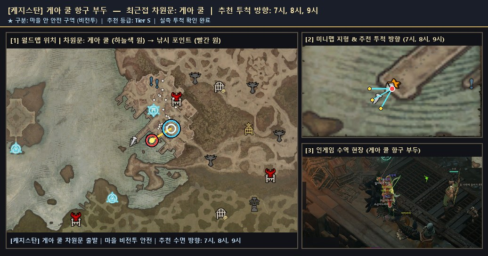
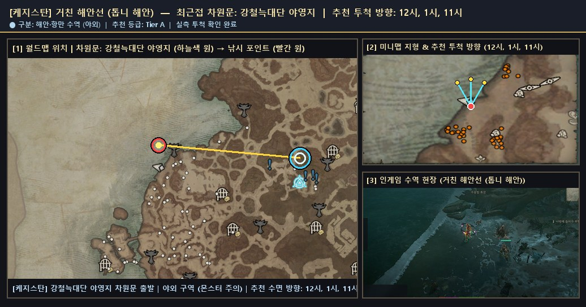
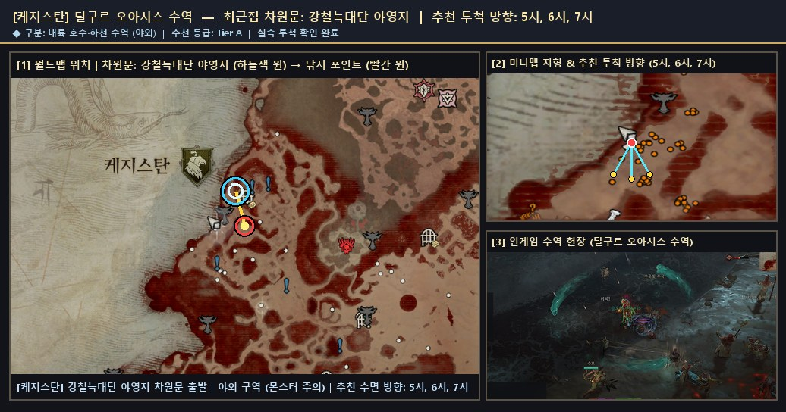

# 🗺️ 케지스탄 — 검증 낚시터 위치 가이드 및 서식 어종 도감

> 🌐 **빠른 검색 웹 플랫폼**: [**대화형 낚시터 · 어종 통합 검색 열기 (`낚시터검색.html`)**](https://kaljake70.github.io/d4helper/%EB%82%9A%EC%8B%9C%ED%84%B0/%EB%82%9A%EC%8B%9C%ED%84%B0%EA%B2%80%EC%83%89.html)  
> 📚 **테마별 가이드**: [🏠 전체 허브](./README.md) · [⭐ 인기 추천](./인기_추천_낚시터.md) · [🏘️ 마을 안전](./마을_안전_낚시터.md) · [🏞️ 내륙 호수·강](./내륙_호수_강_낚시터.md) · [🌋 특수·용암](./특수_이색_낚시터.md) · [🐟 전체 어종 도감](./어종_도감.md)  
> 🗺️ **8대 권역**: [스코보스](./스코보스.md) · [나한투](./나한투.md) · [케지스탄](./케지스탄.md) · [하웨자르](./하웨자르.md) · [메마른 평원](./메마른_평원.md) · [스코스글렌](./스코스글렌.md) · [조각난 봉우리](./조각난_봉우리.md) · [용암 웅덩이](./용암_웅덩이.md)

- **권역명**: **케지스탄**
- **실측 검증 낚시터**: **3곳** (마을 비전투 안전 **1곳** 포함)
- **권역 전용 서식 어종**: **16종** (+ 성역 전역 공통 어종 5종 출현)
- **누적 어획 표본**: **576개**

---

## 1. 케지스탄 낚시 포인트 한눈 요약

| # | 유형 | 등급 | 세부 지역 | 최근접 차원문 | 안전 여부 | 추천 투척 방향 | 주요 포획 어종 |
|:--:|:--:|:--:|:--|:--|:--:|:--:|:--|
| 1 | 🏘️ 마을 안전 | **S** | `게아 쿨 항구 부두` | 게아 쿨 | 🏘️ 마을 안전 | `7시, 8시, 9시` | 소금지느러미(88), 파란비늘(74), 자카라티(62) |
| 2 | 🌊 해안·항만 | **A** | `거친 해안선 (톱니 해안)` | 강철늑대단 야영지 | ⚔️ 야외 주의 | `12시, 1시, 11시` | 자카라티(1), 찢어진 그물(1), 파란비늘(1) |
| 3 | 🏞️ 내륙 수역 | **A** | `달구르 오아시스 수역` | 강철늑대단 야영지 | ⚔️ 야외 주의 | `5시, 6시, 7시` | 파란비늘(36), 은빛배(24), 자카라티(18) |

---

## 2. 케지스탄 세부 낚시 포인트 위치 안내 및 현장 스크린샷

### 1. `게아 쿨 항구 부두` (최근접 차원문: 게아 쿨)

- **유형 및 추천 등급**: **🏘️ 마을 안전** · **Tier S** · ⭐ 인기 추천
- **안전 구역 구분**: 🏘️ 마을 안 안전 구역 (비전투 · 몬스터 출몰 없음)
- **추천 투척 시계 방향**: `7시, 8시, 9시`
- **실측 투척 확인 여부**: 확인 완료 (`2026-11-10` 기준)
- **차원문 접근 및 위치 안내**: 게아 쿨 차원문에서 서남쪽 항구 계단을 내려가 마을 내부 철제 격자·석조 부두 끝단에서 7~9시 바다 수면으로 투척합니다. 전투 스킬이 비활성화되는 완벽한 마을 안전 구역이며 상점·대장간과도 인접해 있습니다.
- **주요 포획 기록**: **소금지느러미**(88회), **파란비늘**(74회), **자카라티**(62회), **아른치**(58회), **은빛배**(51회), **어둠치**(26회), **거대한 자카라티**(14회), **천공 자카라티**(9회) 외 29종 (누적 457개)
- **🌟 포획 확인된 신화·고유 어종**: `작은 천공 자카라티`, `반짝이는 천공 코칼로돈`, `작은 환영 자카라티`, `반짝이는 환영 자카라티`, `작은 악마 자카라티`, `거대한 천공 자카라티`, `거대한 악마 자카라티`
- **📍 종합 위치 안내도 (월드맵 차원문 · 미니맵 투척 각도 · 인게임 수역 현장)**:

  

  - 원본 확대 보기: [🗺️ 월드맵 차원문 원본](./patches/케지스탄__게아_쿨_항구_부두__7-8-9h/worldmap.jpg) · [🧭 미니맵 방향 원본](./patches/케지스탄__게아_쿨_항구_부두__7-8-9h/minimap.jpg) · [🎬 인게임 현장 원본](./patches/케지스탄__게아_쿨_항구_부두__7-8-9h/scene.jpg)

### 2. `거친 해안선 (톱니 해안)` (최근접 차원문: 강철늑대단 야영지)

- **유형 및 추천 등급**: **🌊 해안·항만** · **Tier A** · ⭐ 인기 추천
- **안전 구역 구분**: ⚔️ 야외 구역 (주변 몬스터 출몰 주의)
- **추천 투척 시계 방향**: `12시, 1시, 11시`
- **실측 투척 확인 여부**: 확인 완료 (`2026-11-10` 기준)
- **차원문 접근 및 위치 안내**: 다층 구조인 황실 도서관 대신 평지 거점인 강철늑대단 야영지 차원문에서 출발하여 서남서쪽 달구르 오아시스를 지나 서해안 만(톱니 해안) 모래톱으로 이동합니다. 11~1시 방향 잔잔한 만 수면에서 케지스탄 고유 어종 자카라티가 낚입니다.
- **주요 포획 기록**: **자카라티**(1회), **찢어진 그물**(1회), **파란비늘**(1회)
- **📍 종합 위치 안내도 (월드맵 차원문 · 미니맵 투척 각도 · 인게임 수역 현장)**:

  

  - 원본 확대 보기: [🗺️ 월드맵 차원문 원본](./patches/케지스탄__거친_해안선_톱니_해안__12-1-11h/worldmap.jpg) · [🧭 미니맵 방향 원본](./patches/케지스탄__거친_해안선_톱니_해안__12-1-11h/minimap.jpg) · [🎬 인게임 현장 원본](./patches/케지스탄__거친_해안선_톱니_해안__12-1-11h/scene.jpg)

### 3. `달구르 오아시스 수역` (최근접 차원문: 강철늑대단 야영지)

- **유형 및 추천 등급**: **🏞️ 내륙 수역** · **Tier A**
- **안전 구역 구분**: ⚔️ 야외 구역 (주변 몬스터 출몰 주의)
- **추천 투척 시계 방향**: `5시, 6시, 7시`
- **실측 투척 확인 여부**: 확인 완료 (`2026-11-10` 기준)
- **차원문 접근 및 위치 안내**: 강철늑대단 야영지 차원문에서 남서쪽(7시 방향)으로 내려가 월드맵상 수평 물결 무늬가 그려진 청회록색 오아시스·석호 수변에서 투척합니다. 동쪽 사막 내륙의 밝은 베이지색 구불구불한 띠는 물이 없는 마른 모래 협곡 길이므로 혼동하지 마십시오.
- **주요 포획 기록**: **파란비늘**(36회), **은빛배**(24회), **자카라티**(18회), **소금지느러미**(12회), **아른치**(6회), **악마 자카라티**(6회), **어둠치**(6회), **작은 자카라티**(6회) 외 1종 (누적 116개)
- **🌟 포획 확인된 신화·고유 어종**: `반짝이는 환영 자카라티`
- **📍 종합 위치 안내도 (월드맵 차원문 · 미니맵 투척 각도 · 인게임 수역 현장)**:

  

  - 원본 확대 보기: [🗺️ 월드맵 차원문 원본](./patches/케지스탄__달구르_오아시스_수역__5-6-7h/worldmap.jpg) · [🧭 미니맵 방향 원본](./patches/케지스탄__달구르_오아시스_수역__5-6-7h/minimap.jpg) · [🎬 인게임 현장 원본](./patches/케지스탄__달구르_오아시스_수역__5-6-7h/scene.jpg)

---

## 3. 케지스탄 서식 도감 어종 목록 (16종)

| 등급 | 물고기 이름 (한글) | 영문명 | 세부 서식지 | 도감 설명 |
|:--:|:--|:--|:--|:--|
| 🟤 고유 | **거대한 악마 자카라티** | `Giant Demonic Zakarati` | 케지스탄 | 케지스탄에 서식하는 고유 물고기입니다. 금속성 비늘이 성전사의 갑옷을 닮은 이 물고기는 한때 자카룸교의 정예병들이 즐겨 찾는 별미였으며, 수많은 성전을 떠나기 전에 축복하는 의미로 식탁에 올랐습니다. |
| 🟤 고유 | **거대한 천공 자카라티** | `Giant Celestial Zakarati` | 케지스탄 | 케지스탄에 서식하는 고유 물고기입니다. 금속성 비늘이 성전사의 갑옷을 닮은 이 물고기는 한때 자카룸교의 정예병들이 즐겨 찾는 별미였으며, 수많은 성전을 떠나기 전에 축복하는 의미로 식탁에 올랐습니다. |
| 🟤 고유 | **거대한 환영 자카라티** | `Giant Spectral Zakarati` | 케지스탄 | 케지스탄에 서식하는 고유 물고기입니다. 금속성 비늘이 성전사의 갑옷을 닮은 이 물고기는 한때 자카룸교의 정예병들이 즐겨 찾는 별미였으며, 수많은 성전을 떠나기 전에 축복하는 의미로 식탁에 올랐습니다. |
| 🟤 고유 | **반짝이는 악마 자카라티** | `Glittering Demonic Zakarati` | 케지스탄 | 케지스탄에 서식하는 고유 물고기입니다. 금속성 비늘이 성전사의 갑옷을 닮은 이 물고기는 한때 자카룸교의 정예병들이 즐겨 찾는 별미였으며, 수많은 성전을 떠나기 전에 축복하는 의미로 식탁에 올랐습니다. |
| 🟤 고유 | **반짝이는 천공 자카라티** | `Glittering Celestial Zakarati` | 케지스탄 | 케지스탄에 서식하는 고유 물고기입니다. 금속성 비늘이 성전사의 갑옷을 닮은 이 물고기는 한때 자카룸교의 정예병들이 즐겨 찾는 별미였으며, 수많은 성전을 떠나기 전에 축복하는 의미로 식탁에 올랐습니다. |
| 🟤 고유 | **반짝이는 환영 자카라티** | `Glittering Spectral Zakarati` | 케지스탄 | 케지스탄에 서식하는 고유 물고기입니다. 금속성 비늘이 성전사의 갑옷을 닮은 이 물고기는 한때 자카룸교의 정예병들이 즐겨 찾는 별미였으며, 수많은 성전을 떠나기 전에 축복하는 의미로 식탁에 올랐습니다. |
| 🟤 고유 | **작은 악마 자카라티** | `Tiny Demonic Zakarati` | 케지스탄 | 케지스탄에 서식하는 고유 물고기입니다. 금속성 비늘이 성전사의 갑옷을 닮은 이 물고기는 한때 자카룸교의 정예병들이 즐겨 찾는 별미였으며, 수많은 성전을 떠나기 전에 축복하는 의미로 식탁에 올랐습니다. |
| 🟤 고유 | **작은 천공 자카라티** | `Tiny Celestial Zakarati` | 케지스탄 | 케지스탄에 서식하는 고유 물고기입니다. 금속성 비늘이 성전사의 갑옷을 닮은 이 물고기는 한때 자카룸교의 정예병들이 즐겨 찾는 별미였으며, 수많은 성전을 떠나기 전에 축복하는 의미로 식탁에 올랐습니다. |
| 🟤 고유 | **작은 환영 자카라티** | `Tiny Spectral Zakarati` | 케지스탄 | 케지스탄에 서식하는 고유 물고기입니다. 금속성 비늘이 성전사의 갑옷을 닮은 이 물고기는 한때 자카룸교의 정예병들이 즐겨 찾는 별미였으며, 수많은 성전을 떠나기 전에 축복하는 의미로 식탁에 올랐습니다. |
| 🟠 전설 | **거대한 자카라티** | `Giant Zakarati` | 케지스탄 | 케지스탄에 서식하는 전설 물고기입니다. 금속성 비늘이 성전사의 갑옷을 닮은 이 물고기는 한때 자카룸교의 정예병들이 즐겨 찾는 별미였으며, 수많은 성전을 떠나기 전에 축복하는 의미로 식탁에 올랐습니다. |
| 🟠 전설 | **반짝이는 자카라티** | `Glittering Zakarati` | 케지스탄 | 케지스탄에 서식하는 전설 물고기입니다. 금속성 비늘이 성전사의 갑옷을 닮은 이 물고기는 한때 자카룸교의 정예병들이 즐겨 찾는 별미였으며, 수많은 성전을 떠나기 전에 축복하는 의미로 식탁에 올랐습니다. |
| 🟠 전설 | **악마 자카라티** | `Demonic Zakarati` | 케지스탄 | 케지스탄에 서식하는 전설 물고기입니다. 금속성 비늘이 성전사의 갑옷을 닮은 이 물고기는 한때 자카룸교의 정예병들이 즐겨 찾는 별미였으며, 수많은 성전을 떠나기 전에 축복하는 의미로 식탁에 올랐습니다. |
| 🟠 전설 | **작은 자카라티** | `Tiny Zakarati` | 케지스탄 | 케지스탄에 서식하는 전설 물고기입니다. 금속성 비늘이 성전사의 갑옷을 닮은 이 물고기는 한때 자카룸교의 정예병들이 즐겨 찾는 별미였으며, 수많은 성전을 떠나기 전에 축복하는 의미로 식탁에 올랐습니다. |
| 🟠 전설 | **천공 자카라티** | `Celestial Zakarati` | 케지스탄 | 케지스탄에 서식하는 전설 물고기입니다. 금속성 비늘이 성전사의 갑옷을 닮은 이 물고기는 한때 자카룸교의 정예병들이 즐겨 찾는 별미였으며, 수많은 성전을 떠나기 전에 축복하는 의미로 식탁에 올랐습니다. |
| 🟠 전설 | **환영 자카라티** | `Spectral Zakarati` | 케지스탄 | 케지스탄에 서식하는 전설 물고기입니다. 금속성 비늘이 성전사의 갑옷을 닮은 이 물고기는 한때 자카룸교의 정예병들이 즐겨 찾는 별미였으며, 수많은 성전을 떠나기 전에 축복하는 의미로 식탁에 올랐습니다. |
| 🟡 희귀 | **자카라티** | `Zakarati` | 케지스탄 | 케지스탄에 서식하는 희귀 물고기입니다. 금속성 비늘이 성전사의 갑옷을 닮은 이 물고기는 한때 자카룸교의 정예병들이 즐겨 찾는 별미였으며, 수많은 성전을 떠나기 전에 축복하는 의미로 식탁에 올랐습니다. |
