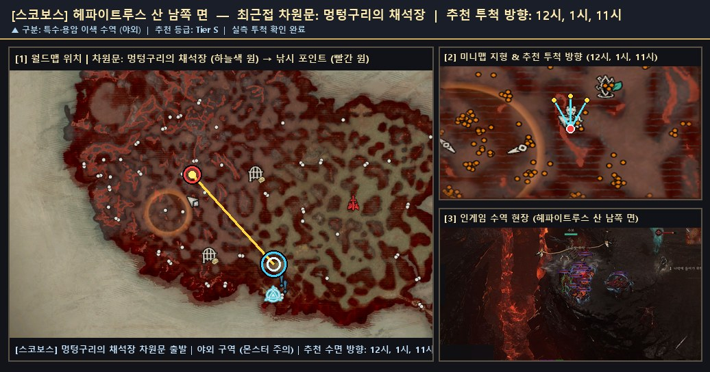
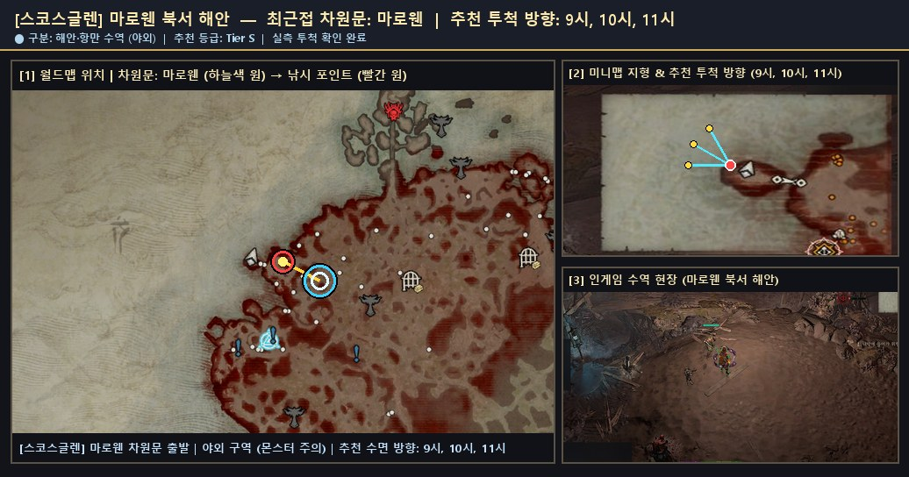
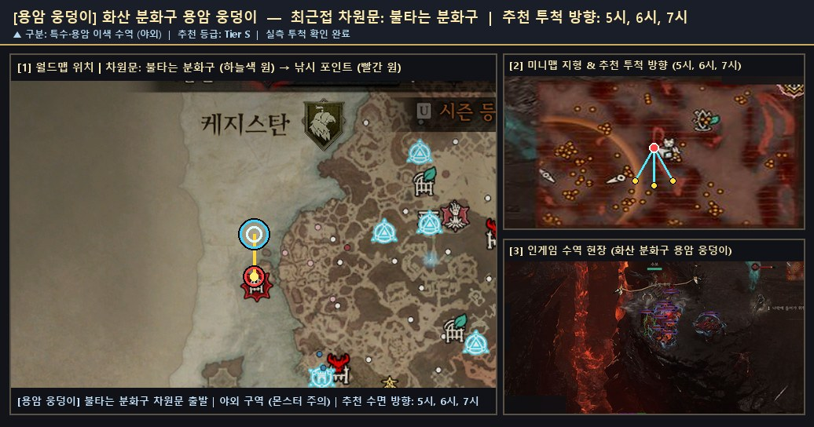

# 🌋 특수 · 용암 · 이색 지형 낚시터 및 신화 어종 · 메피쉬토 가이드

> 🌐 **빠른 검색 웹 플랫폼**: [**대화형 낚시터 · 어종 통합 검색 열기 (`낚시터검색.html`)**](https://kaljake70.github.io/d4helper/%EB%82%9A%EC%8B%9C%ED%84%B0/%EB%82%9A%EC%8B%9C%ED%84%B0%EA%B2%80%EC%83%89.html)  
> 📚 **테마별 가이드**: [🏠 전체 허브](./README.md) · [⭐ 인기 추천](./인기_추천_낚시터.md) · [🏘️ 마을 안전](./마을_안전_낚시터.md) · [🏞️ 내륙 호수·강](./내륙_호수_강_낚시터.md) · [🌋 특수·용암](./특수_이색_낚시터.md) · [🐟 전체 어종 도감](./어종_도감.md)  
> 🗺️ **8대 권역**: [스코보스](./스코보스.md) · [나한투](./나한투.md) · [케지스탄](./케지스탄.md) · [하웨자르](./하웨자르.md) · [메마른 평원](./메마른_평원.md) · [스코스글렌](./스코스글렌.md) · [조각난 봉우리](./조각난_봉우리.md) · [용암 웅덩이](./용암_웅덩이.md)

시뻘겋게 끓어오르는 **화산 용암 강**, 신화 물고기가 잠든 **용암 분화구**, 거대한 **고래 사체가 밀려온 해변** 등 성역의 이색적인 낚시 명소와 특수 이벤트 정보를 정리했습니다.

---

## 🌟 성역 5대 신화 고유 물고기 서식 조건 일람

도감에 수록된 최상위 등급인 **신화 고유 물고기(5종)** 는 일반 권역 물고기와 달리 특정 환경이나 희귀 조건에서 출현합니다.

| 등급 | 한글 이름 | 영문명 | 도감 표기 서식지 | 특징 및 도감 전승 요약 |
|:--:|:--|:--|:--|:--|
| **🟣 신화** | **녹아내린 순교자** | `Molten Martyr` | **용암 웅덩이** | 용암 웅덩이에 서식하는 신화 고유 물고기입니다. 전설에 따르면, 옛날에 삼위일체단이 한 자카룸 장로를 붙잡아 가마솥 끝으로 내몰았다고 합니다. 장로가 빛을 포기하는 걸 거부하자 삼위일체단은 그를 가마솥으로 내던졌고, 그렇게 타들어 가던 장로를 빛이 나타나 구해줬다고 합니다. |
| **🟣 신화** | **구울벌레** | `Ghoulworm` | **피 웅덩이** | 피 웅덩이에 서식하는 신화 고유 물고기입니다. 아주 오래전부터 사람들은 아이들에게 피투성이 물을 피하라고 가르쳤습니다. 자칫하면 구울벌레에게 잡혀갈 수 있다고요. 대부분의 사람들은 그게 아이들이 병에 걸리지 않게 하려는 우화라고 생각하지만, 진실을 아는 사람도 있습니다. |
| **🟣 신화** | **타타메트의 송곳니** | `Fang of Tathamet` | **지옥물결** | 지옥물결에 서식하는 신화 고유 물고기입니다. 지옥의 온갖 생물들이 물결과 함께 나타났습니다. 그중에는 성역의 빛을 처음으로 보고, 그 빛에 이끌려 심연을 벗어난 존재들도 있습니다. |
| **🟣 신화** | **새끼 사막상어** | `Dune Thresher Hatchling` | **모래 언덕** | 모래 언덕에 서식하는 신화 고유 물고기입니다. "멍청한 학자들은 야수라고 부르지만, 내가 분명히 얘기하자면 그것들은 악마야! 지옥에서 소환되어 나온 존재들이지! 생각해 보라고. 아기 사막상어를 본 적이 있어? 아무도 없다고!" - 메시프 |
| **🟣 신화** | **선명한 별종** | `Vivid Whimsy` | **성역 어딘가** | 성역 어딘가에 서식하는 신화 고유 물고기입니다. 성역에서 전설로 전해지며 놀라운 색상과 생명력을 보여주는 생물입니다. 별종을 붙잡으면 소원을 이룰 수 있다고 합니다. 어린아이일 때 빌고 어른이 되면 잊곤 하는 그런 소원을요. |

---

## 🦈 히든 보스 『메피쉬토 — 여유의 군주』 출현 안내

- **출현 조건**: 성역 야외 수역(특히 `스코보스 · 아타노스 해안` 등 다수 확인)에서 낚시를 지속할 때 낮은 확률로 물속에서 히든 보스 **메피쉬토(여유의 군주)** 가 솟아오릅니다.
- **특징 및 보상**: 야외 전투 구역에서 출현하므로 캐릭터의 전투 세팅이 갖춰져 있다면 즉시 처치하여 고유·전설 전리품과 낚시 보상을 획득할 수 있습니다. 비전투 캐릭터로 안전하게 낚시만 즐기시려면 [🏘️ 마을 안 비전투 안전 낚시터](./마을_안전_낚시터.md)를 이용하십시오.

---

## 📍 실측 확인된 특수 · 용암 · 이색 낚시터 상세

### 1. [스코보스] `헤파이트루스 산 남쪽 면` (최근접 차원문: 멍텅구리의 채석장)

- **유형 및 추천 등급**: **🌋 특수·용암** · **Tier S** · ⭐ 인기 추천
- **안전 구역 구분**: ⚔️ 야외 구역 (주변 몬스터 출몰 주의)
- **추천 투척 시계 방향**: `12시, 1시, 11시`
- **실측 투척 확인 여부**: 확인 완료 (`2026-11-10` 기준)
- **차원문 접근 및 위치 안내**: 멍텅구리의 채석장 차원문에서 북서쪽(10~11시 방향) 또는 비전의 끝 차원문에서 북쪽 화산 길을 따라 이동합니다. 높은 절벽 턱에서는 시야각 차단 문구가 뜨므로, 반드시 도약 발판 인근의 낮은 현무암 강둑으로 내려서서 11~1시 방향 시뻘건 용암 수면으로 투척하십시오.
- **주요 포획 기록**: **코칼로돈**(2회)
- **📍 종합 위치 안내도 (월드맵 차원문 · 미니맵 투척 각도 · 인게임 수역 현장)**:

  

  - 원본 확대 보기: [🗺️ 월드맵 차원문 원본](./patches/스코보스__헤파이트루스_산_남쪽_면__12-1-11h/worldmap.jpg) · [🧭 미니맵 방향 원본](./patches/스코보스__헤파이트루스_산_남쪽_면__12-1-11h/minimap.jpg) · [🎬 인게임 현장 원본](./patches/스코보스__헤파이트루스_산_남쪽_면__12-1-11h/scene.jpg)

### 2. [스코스글렌] `마로웬 북서 해안` (최근접 차원문: 마로웬)

- **유형 및 추천 등급**: **🌊 해안·항만** · **Tier S** · ⭐ 인기 추천
- **안전 구역 구분**: ⚔️ 야외 구역 (주변 몬스터 출몰 주의)
- **추천 투척 시계 방향**: `9시, 10시, 11시`
- **실측 투척 확인 여부**: 확인 완료 (`2026-11-10` 기준)
- **차원문 접근 및 위치 안내**: 마로웬 차원문에서 북북서쪽(11시 방향) 성문 밖으로 나가면 도보 10초 거리 내에 서해 수면과 맞닿는 해변(거대 고래 사체가 밀려온 이색 해안선)이 나타납니다. 9~11시 방향으로 투척하며 스코스글렌 최단거리 명소입니다.
- **주요 포획 기록**: **드라콘수염**(552회), **반짝이는 드라콘수염**(46회), **거대한 드라콘수염**(44회), **환영 드라콘수염**(44회), **파란비늘**(13회), **반짝이는 악마 드라콘수염**(10회), **거대한 악마 드라콘수염**(8회), **작은 환영 드라콘수염**(8회) 외 7종 (누적 743개)
- **🌟 포획 확인된 신화·고유 어종**: `작은 환영 드라콘수염`, `거대한 악마 드라콘수염`, `작은 악마 드라콘수염`, `반짝이는 악마 드라콘수염`, `반짝이는 천공 드라콘수염`
- **📍 종합 위치 안내도 (월드맵 차원문 · 미니맵 투척 각도 · 인게임 수역 현장)**:

  

  - 원본 확대 보기: [🗺️ 월드맵 차원문 원본](./patches/스코스글렌__마로웬_북서_해안__9-10-11h/worldmap.jpg) · [🧭 미니맵 방향 원본](./patches/스코스글렌__마로웬_북서_해안__9-10-11h/minimap.jpg) · [🎬 인게임 현장 원본](./patches/스코스글렌__마로웬_북서_해안__9-10-11h/scene.jpg)

### 3. [용암 웅덩이] `화산 분화구 용암 웅덩이` (최근접 차원문: 불타는 분화구)

- **유형 및 추천 등급**: **🌋 특수·용암** · **Tier S** · ⭐ 인기 추천
- **안전 구역 구분**: ⚔️ 야외 구역 (주변 몬스터 출몰 주의)
- **추천 투척 시계 방향**: `5시, 6시, 7시`
- **실측 투척 확인 여부**: 확인 완료 (`2026-11-10` 기준)
- **차원문 접근 및 위치 안내**: 화산 분화구 및 용암 지대(잉걸불 도가니·참바타르 분화구 인근 용암 웅덩이)에서 끓어오르는 주황빛 용암 수면 가장자리 낮은 바위 턱에 서서 5~7시 방향으로 투척합니다. 신화 고유 물고기 '녹아내린 순교자'를 낚을 수 있는 특수 수역입니다.
- **주요 포획 기록**: **녹아내린 순교자**(2회)
- **🌟 포획 확인된 신화·고유 어종**: `녹아내린 순교자`
- **📍 종합 위치 안내도 (월드맵 차원문 · 미니맵 투척 각도 · 인게임 수역 현장)**:

  

  - 원본 확대 보기: [🗺️ 월드맵 차원문 원본](./patches/용암_웅덩이__화산_분화구_용암_웅덩이__5-6-7h/worldmap.jpg) · [🧭 미니맵 방향 원본](./patches/용암_웅덩이__화산_분화구_용암_웅덩이__5-6-7h/minimap.jpg) · [🎬 인게임 현장 원본](./patches/용암_웅덩이__화산_분화구_용암_웅덩이__5-6-7h/scene.jpg)
