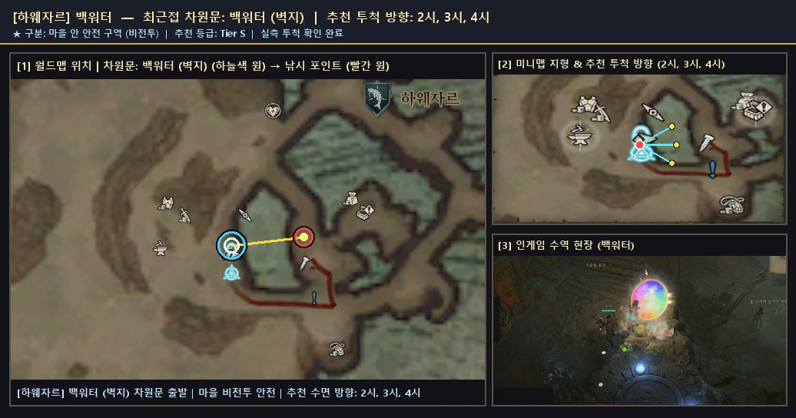
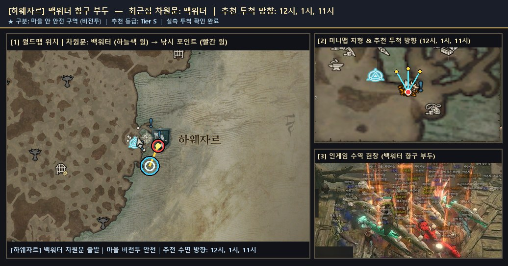
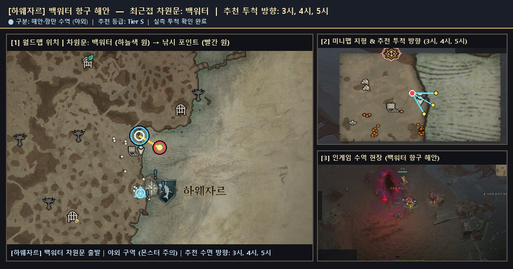
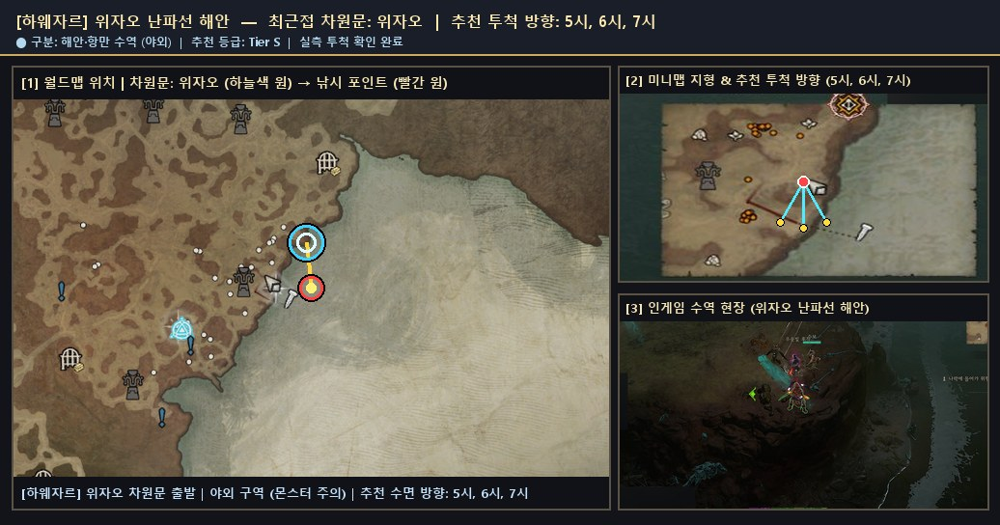
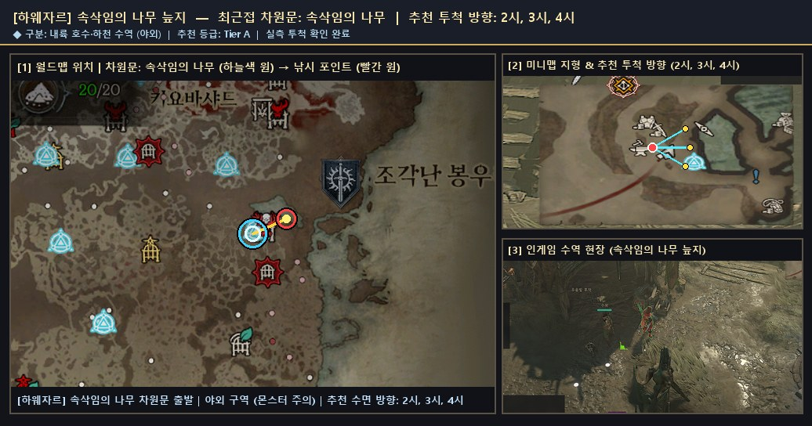

# 🗺️ 하웨자르 — 검증 낚시터 위치 가이드 및 서식 어종 도감

> 🌐 **빠른 검색 웹 플랫폼**: [**대화형 낚시터 · 어종 통합 검색 열기 (`낚시터검색.html`)**](https://kaljake70.github.io/d4helper/%EB%82%9A%EC%8B%9C%ED%84%B0/%EB%82%9A%EC%8B%9C%ED%84%B0%EA%B2%80%EC%83%89.html)  
> 📚 **테마별 가이드**: [🏠 전체 허브](./README.md) · [⭐ 인기 추천](./인기_추천_낚시터.md) · [🏘️ 마을 안전](./마을_안전_낚시터.md) · [🏞️ 내륙 호수·강](./내륙_호수_강_낚시터.md) · [🌋 특수·용암](./특수_이색_낚시터.md) · [🐟 전체 어종 도감](./어종_도감.md)  
> 🗺️ **8대 권역**: [스코보스](./스코보스.md) · [나한투](./나한투.md) · [케지스탄](./케지스탄.md) · [하웨자르](./하웨자르.md) · [메마른 평원](./메마른_평원.md) · [스코스글렌](./스코스글렌.md) · [조각난 봉우리](./조각난_봉우리.md) · [용암 웅덩이](./용암_웅덩이.md)

- **권역명**: **하웨자르**
- **실측 검증 낚시터**: **5곳** (마을 비전투 안전 **2곳** 포함)
- **권역 전용 서식 어종**: **16종** (+ 성역 전역 공통 어종 5종 출현)
- **누적 어획 표본**: **2,803개**

---

## 1. 하웨자르 낚시 포인트 한눈 요약

| # | 유형 | 등급 | 세부 지역 | 최근접 차원문 | 안전 여부 | 추천 투척 방향 | 주요 포획 어종 |
|:--:|:--:|:--:|:--|:--|:--:|:--:|:--|
| 1 | 🏘️ 마을 안전 | **S** | `백워터` | 백워터 (벽지) | 🏘️ 마을 안전 | `2시, 3시, 4시` | 부서진 낚싯대(1), 잃어버린 단검(1), 파란비늘(1) |
| 2 | 🏘️ 마을 안전 | **S** | `백워터 항구 부두` | 백워터 | 🏘️ 마을 안전 | `12시, 1시, 11시` | 갈고리고기(24), 파란비늘(15), 아른치(12) |
| 3 | 🌊 해안·항만 | **S** | `백워터 항구 해안` | 백워터 | ⚔️ 야외 주의 | `3시, 4시, 5시` | 환영 갈고리고기(289), 거대한 악마 갈고리고기(131), 거대한 환영 갈고리고기(128) |
| 4 | 🌊 해안·항만 | **S** | `위자오 난파선 해안` | 위자오 | ⚔️ 야외 주의 | `5시, 6시, 7시` | 갈고리고기(860), 작은 갈고리고기(84), 소금지느러미(26) |
| 5 | 🏞️ 내륙 수역 | **A** | `속삭임의 나무 늪지` | 속삭임의 나무 | ⚔️ 야외 주의 | `2시, 3시, 4시` | 환영 갈고리고기(92), 반짝이는 갈고리고기(66), 작은 천공 갈고리고기(20) |

---

## 2. 하웨자르 세부 낚시 포인트 위치 안내 및 현장 스크린샷

### 1. `백워터` (최근접 차원문: 백워터 (벽지))

- **유형 및 추천 등급**: **🏘️ 마을 안전** · **Tier S** · ⭐ 인기 추천
- **안전 구역 구분**: 🏘️ 마을 안 안전 구역 (비전투 · 몬스터 출몰 없음)
- **추천 투척 시계 방향**: `2시, 3시, 4시`
- **실측 투척 확인 여부**: 확인 완료 (`2026-11-10` 기준)
- **차원문 접근 및 위치 안내**: 한국어 클라이언트에서는 지명이 '벽지'(Backwater)로 표기됩니다. 벽지(백워터) 차원문 바로 동쪽 항구 내해 또는 동남쪽 목재 선착장 끝단으로 이동해 2~4시 방향으로 투척합니다. 몬스터 공격이 전혀 없는 마을 내부 안전 구역입니다.
- **주요 포획 기록**: **부서진 낚싯대**(1회), **잃어버린 단검**(1회), **파란비늘**(1회)
- **📍 종합 위치 안내도 (월드맵 차원문 · 미니맵 투척 각도 · 인게임 수역 현장)**:

  

  - 원본 확대 보기: [🗺️ 월드맵 차원문 원본](./patches/하웨자르__백워터__2-3-4h/worldmap.jpg) · [🧭 미니맵 방향 원본](./patches/하웨자르__백워터__2-3-4h/minimap.jpg) · [🎬 인게임 현장 원본](./patches/하웨자르__백워터__2-3-4h/scene.jpg)

### 2. `백워터 항구 부두` (최근접 차원문: 백워터)

- **유형 및 추천 등급**: **🏘️ 마을 안전** · **Tier S** · ⭐ 인기 추천
- **안전 구역 구분**: 🏘️ 마을 안 안전 구역 (비전투 · 몬스터 출몰 없음)
- **추천 투척 시계 방향**: `12시, 1시, 11시`
- **실측 투척 확인 여부**: 확인 완료 (`2026-11-10` 기준)
- **차원문 접근 및 위치 안내**: 백워터 차원문 도착 후 바로 북동쪽(1~2시 방향) 마을 안 나무 잔교 끝단으로 몇 걸음만 이동해 11~1시 북쪽 석호 수면으로 투척합니다. 차원문에서 가장 가까운 마을 안 비전투 안전 포인트 중 하나입니다.
- **주요 포획 기록**: **갈고리고기**(24회), **파란비늘**(15회), **아른치**(12회), **소금지느러미**(10회), **환영 갈고리고기**(6회), **반짝이는 갈고리고기**(2회), **작은 천공 갈고리고기**(2회)
- **🌟 포획 확인된 신화·고유 어종**: `작은 천공 갈고리고기`
- **📍 종합 위치 안내도 (월드맵 차원문 · 미니맵 투척 각도 · 인게임 수역 현장)**:

  

  - 원본 확대 보기: [🗺️ 월드맵 차원문 원본](./patches/하웨자르__백워터_항구_부두__12-1-11h/worldmap.jpg) · [🧭 미니맵 방향 원본](./patches/하웨자르__백워터_항구_부두__12-1-11h/minimap.jpg) · [🎬 인게임 현장 원본](./patches/하웨자르__백워터_항구_부두__12-1-11h/scene.jpg)

### 3. `백워터 항구 해안` (최근접 차원문: 백워터)

- **유형 및 추천 등급**: **🌊 해안·항만** · **Tier S** · ⭐ 인기 추천
- **안전 구역 구분**: ⚔️ 야외 구역 (주변 몬스터 출몰 주의)
- **추천 투척 시계 방향**: `3시, 4시, 5시`
- **실측 투척 확인 여부**: 확인 완료 (`2026-11-10` 기준)
- **차원문 접근 및 위치 안내**: 백워터 남동쪽 성문 밖으로 나와 해안선(추방자의 더미)을 따라 이동한 뒤 3~5시 동해 수면으로 투척합니다. 고유·전설 갈고리고기 누적 어획량이 매우 높은 대표적인 야외 해안 포인트입니다.
- **주요 포획 기록**: **환영 갈고리고기**(289회), **거대한 악마 갈고리고기**(131회), **거대한 환영 갈고리고기**(128회), **반짝이는 악마 갈고리고기**(110회), **천공 갈고리고기**(94회), **작은 천공 갈고리고기**(78회), **악마 갈고리고기**(73회), **파란비늘**(64회) 외 41종 (누적 1,423개)
- **🌟 포획 확인된 신화·고유 어종**: `반짝이는 환영 갈고리고기`, `반짝이는 천공 갈고리고기`, `반짝이는 악마 갈고리고기`, `거대한 악마 갈고리고기`, `작은 환영 갈고리고기`, `거대한 환영 갈고리고기`, `작은 천공 갈고리고기`, `반짝이는 악마 네메셍가`, `거대한 천공 갈고리고기`, `작은 악마 갈고리고기`, `반짝이는 악마 코칼로돈`, `거대한 악마 모라야가`, `거대한 천공 자카라티`, `거대한 천공 모라야가`, `작은 천공 모라야가`
- **📍 종합 위치 안내도 (월드맵 차원문 · 미니맵 투척 각도 · 인게임 수역 현장)**:

  

  - 원본 확대 보기: [🗺️ 월드맵 차원문 원본](./patches/하웨자르__백워터_항구_해안__3-4-5h/worldmap.jpg) · [🧭 미니맵 방향 원본](./patches/하웨자르__백워터_항구_해안__3-4-5h/minimap.jpg) · [🎬 인게임 현장 원본](./patches/하웨자르__백워터_항구_해안__3-4-5h/scene.jpg)

### 4. `위자오 난파선 해안` (최근접 차원문: 위자오)

- **유형 및 추천 등급**: **🌊 해안·항만** · **Tier S** · ⭐ 인기 추천
- **안전 구역 구분**: ⚔️ 야외 구역 (주변 몬스터 출몰 주의)
- **추천 투척 시계 방향**: `5시, 6시, 7시`
- **실측 투척 확인 여부**: 확인 완료 (`2026-11-10` 기준)
- **차원문 접근 및 위치 안내**: 위자오 차원문에서 남쪽(5~6시 방향) 버려진 해안으로 내려가 난파선 잔해 옆 모래 해변에서 5~7시 수면으로 투척합니다. 수면 시야가 탁 트여 있어 입질 확인이 매우 편리합니다.
- **주요 포획 기록**: **갈고리고기**(860회), **작은 갈고리고기**(84회), **소금지느러미**(26회), **파란비늘**(26회), **거대한 악마 갈고리고기**(24회), **거대한 천공 갈고리고기**(24회), **아른치**(18회), **작은 악마 갈고리고기**(14회) 외 15종 (누적 1,128개)
- **🌟 포획 확인된 신화·고유 어종**: `거대한 악마 갈고리고기`, `거대한 천공 갈고리고기`, `거대한 환영 갈고리고기`, `작은 악마 갈고리고기`, `작은 환영 갈고리고기`
- **📍 종합 위치 안내도 (월드맵 차원문 · 미니맵 투척 각도 · 인게임 수역 현장)**:

  

  - 원본 확대 보기: [🗺️ 월드맵 차원문 원본](./patches/하웨자르__위자오_난파선_해안__5-6-7h/worldmap.jpg) · [🧭 미니맵 방향 원본](./patches/하웨자르__위자오_난파선_해안__5-6-7h/minimap.jpg) · [🎬 인게임 현장 원본](./patches/하웨자르__위자오_난파선_해안__5-6-7h/scene.jpg)

### 5. `속삭임의 나무 늪지` (최근접 차원문: 속삭임의 나무)

- **유형 및 추천 등급**: **🏞️ 내륙 수역** · **Tier A** · ⭐ 인기 추천
- **안전 구역 구분**: ⚔️ 야외 구역 (주변 몬스터 출몰 주의)
- **추천 투척 시계 방향**: `2시, 3시, 4시`
- **실측 투척 확인 여부**: 확인 완료 (`2026-11-10` 기준)
- **차원문 접근 및 위치 안내**: 속삭임의 나무 차원문에서 동북동쪽(2~3시 방향) 늪지 길을 따라 내륙 호수의 낮은 남동쪽 물가 기슭으로 이동해 2~4시 방향으로 투척합니다. 주의: 호수 남서안(씁쓸한 길) 쪽은 수면보다 높은 바위 절벽이라 투척이 차단되므로 낮은 물가 발판을 이용하십시오.
- **주요 포획 기록**: **환영 갈고리고기**(92회), **반짝이는 갈고리고기**(66회), **작은 천공 갈고리고기**(20회)
- **🌟 포획 확인된 신화·고유 어종**: `작은 천공 갈고리고기`
- **📍 종합 위치 안내도 (월드맵 차원문 · 미니맵 투척 각도 · 인게임 수역 현장)**:

  

  - 원본 확대 보기: [🗺️ 월드맵 차원문 원본](./patches/하웨자르__속삭임의_나무_늪지__2-3-4h/worldmap.jpg) · [🧭 미니맵 방향 원본](./patches/하웨자르__속삭임의_나무_늪지__2-3-4h/minimap.jpg) · [🎬 인게임 현장 원본](./patches/하웨자르__속삭임의_나무_늪지__2-3-4h/scene.jpg)

---

## 3. 하웨자르 서식 도감 어종 목록 (16종)

| 등급 | 물고기 이름 (한글) | 영문명 | 세부 서식지 | 도감 설명 |
|:--:|:--|:--|:--|:--|
| 🟤 고유 | **거대한 악마 갈고리고기** | `Giant Demonic Crookfish` | 하웨자르 | 하웨자르에 서식하는 고유 물고기입니다. 갈고리고기는 조임틀을 닮은 턱으로 낚싯줄을 끊은 후 미끼와 낚싯바늘을 한꺼번에 삼키고 도망치는 물고기로 벽지의 낚시꾼들 사이에서 악명이 높습니다. |
| 🟤 고유 | **거대한 천공 갈고리고기** | `Giant Celestial Crookfish` | 하웨자르 | 하웨자르에 서식하는 고유 물고기입니다. 갈고리고기는 조임틀을 닮은 턱으로 낚싯줄을 끊은 후 미끼와 낚싯바늘을 한꺼번에 삼키고 도망치는 물고기로 벽지의 낚시꾼들 사이에서 악명이 높습니다. |
| 🟤 고유 | **거대한 환영 갈고리고기** | `Giant Spectral Crookfish` | 하웨자르 | 하웨자르에 서식하는 고유 물고기입니다. 갈고리고기는 조임틀을 닮은 턱으로 낚싯줄을 끊은 후 미끼와 낚싯바늘을 한꺼번에 삼키고 도망치는 물고기로 벽지의 낚시꾼들 사이에서 악명이 높습니다. |
| 🟤 고유 | **반짝이는 악마 갈고리고기** | `Glittering Demonic Crookfish` | 하웨자르 | 하웨자르에 서식하는 고유 물고기입니다. 갈고리고기는 조임틀을 닮은 턱으로 낚싯줄을 끊은 후 미끼와 낚싯바늘을 한꺼번에 삼키고 도망치는 물고기로 벽지의 낚시꾼들 사이에서 악명이 높습니다. |
| 🟤 고유 | **반짝이는 천공 갈고리고기** | `Glittering Celestial Crookfish` | 하웨자르 | 하웨자르에 서식하는 고유 물고기입니다. 갈고리고기는 조임틀을 닮은 턱으로 낚싯줄을 끊은 후 미끼와 낚싯바늘을 한꺼번에 삼키고 도망치는 물고기로 벽지의 낚시꾼들 사이에서 악명이 높습니다. |
| 🟤 고유 | **반짝이는 환영 갈고리고기** | `Glittering Spectral Crookfish` | 하웨자르 | 하웨자르에 서식하는 고유 물고기입니다. 갈고리고기는 조임틀을 닮은 턱으로 낚싯줄을 끊은 후 미끼와 낚싯바늘을 한꺼번에 삼키고 도망치는 물고기로 벽지의 낚시꾼들 사이에서 악명이 높습니다. |
| 🟤 고유 | **작은 악마 갈고리고기** | `Tiny Demonic Crookfish` | 하웨자르 | 하웨자르에 서식하는 고유 물고기입니다. 갈고리고기는 조임틀을 닮은 턱으로 낚싯줄을 끊은 후 미끼와 낚싯바늘을 한꺼번에 삼키고 도망치는 물고기로 벽지의 낚시꾼들 사이에서 악명이 높습니다. |
| 🟤 고유 | **작은 천공 갈고리고기** | `Tiny Celestial Crookfish` | 하웨자르 | 하웨자르에 서식하는 고유 물고기입니다. 갈고리고기는 조임틀을 닮은 턱으로 낚싯줄을 끊은 후 미끼와 낚싯바늘을 한꺼번에 삼키고 도망치는 물고기로 벽지의 낚시꾼들 사이에서 악명이 높습니다. |
| 🟤 고유 | **작은 환영 갈고리고기** | `Tiny Spectral Crookfish` | 하웨자르 | 하웨자르에 서식하는 고유 물고기입니다. 갈고리고기는 조임틀을 닮은 턱으로 낚싯줄을 끊은 후 미끼와 낚싯바늘을 한꺼번에 삼키고 도망치는 물고기로 벽지의 낚시꾼들 사이에서 악명이 높습니다. |
| 🟠 전설 | **거대한 갈고리고기** | `Giant Crookfish` | 하웨자르 | 하웨자르에 서식하는 전설 물고기입니다. 갈고리고기는 조임틀을 닮은 턱으로 낚싯줄을 끊은 후 미끼와 낚싯바늘을 한꺼번에 삼키고 도망치는 물고기로 벽지의 낚시꾼들 사이에서 악명이 높습니다. |
| 🟠 전설 | **반짝이는 갈고리고기** | `Glittering Crookfish` | 하웨자르 | 하웨자르에 서식하는 전설 물고기입니다. 갈고리고기는 조임틀을 닮은 턱으로 낚싯줄을 끊은 후 미끼와 낚싯바늘을 한꺼번에 삼키고 도망치는 물고기로 벽지의 낚시꾼들 사이에서 악명이 높습니다. |
| 🟠 전설 | **악마 갈고리고기** | `Demonic Crookfish` | 하웨자르 | 하웨자르에 서식하는 전설 물고기입니다. 갈고리고기는 조임틀을 닮은 턱으로 낚싯줄을 끊은 후 미끼와 낚싯바늘을 한꺼번에 삼키고 도망치는 물고기로 벽지의 낚시꾼들 사이에서 악명이 높습니다. |
| 🟠 전설 | **작은 갈고리고기** | `Tiny Crookfish` | 하웨자르 | 하웨자르에 서식하는 전설 물고기입니다. 갈고리고기는 조임틀을 닮은 턱으로 낚싯줄을 끊은 후 미끼와 낚싯바늘을 한꺼번에 삼키고 도망치는 물고기로 벽지의 낚시꾼들 사이에서 악명이 높습니다. |
| 🟠 전설 | **천공 갈고리고기** | `Celestial Crookfish` | 하웨자르 | 하웨자르에 서식하는 전설 물고기입니다. 갈고리고기는 조임틀을 닮은 턱으로 낚싯줄을 끊은 후 미끼와 낚싯바늘을 한꺼번에 삼키고 도망치는 물고기로 벽지의 낚시꾼들 사이에서 악명이 높습니다. |
| 🟠 전설 | **환영 갈고리고기** | `Spectral Crookfish` | 하웨자르 | 하웨자르에 서식하는 전설 물고기입니다. 갈고리고기는 조임틀을 닮은 턱으로 낚싯줄을 끊은 후 미끼와 낚싯바늘을 한꺼번에 삼키고 도망치는 물고기로 벽지의 낚시꾼들 사이에서 악명이 높습니다. |
| 🟡 희귀 | **갈고리고기** | `Crookfish` | 하웨자르 | 하웨자르에 서식하는 희귀 물고기입니다. 갈고리고기는 조임틀을 닮은 턱으로 낚싯줄을 끊은 후 미끼와 낚싯바늘을 한꺼번에 삼키고 도망치는 물고기로 벽지의 낚시꾼들 사이에서 악명이 높습니다. |
